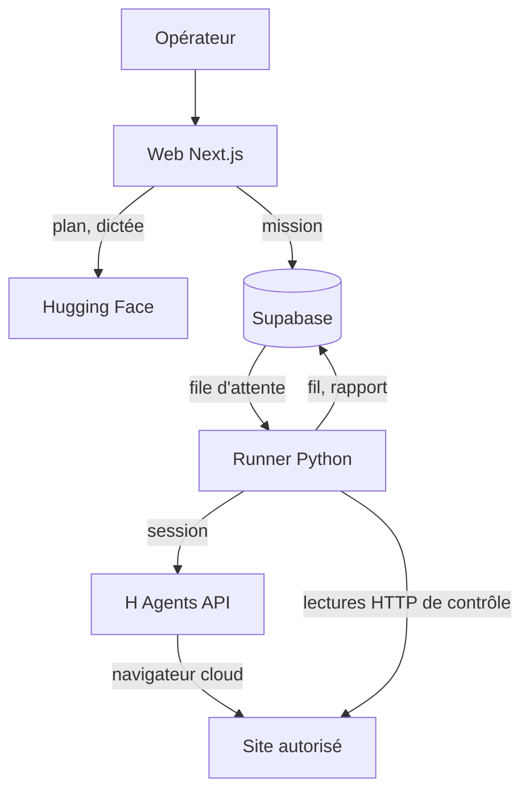
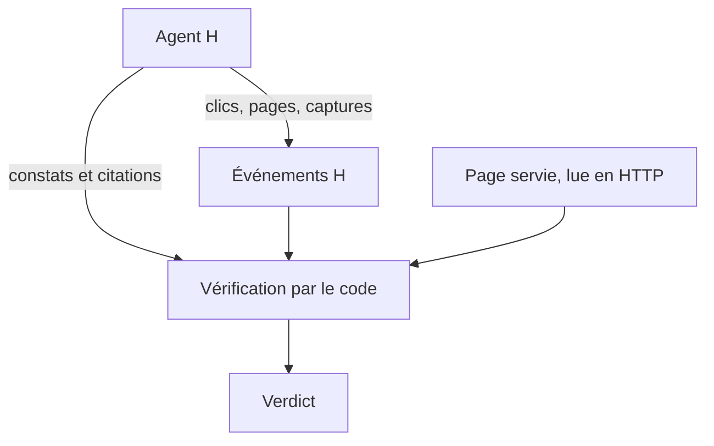
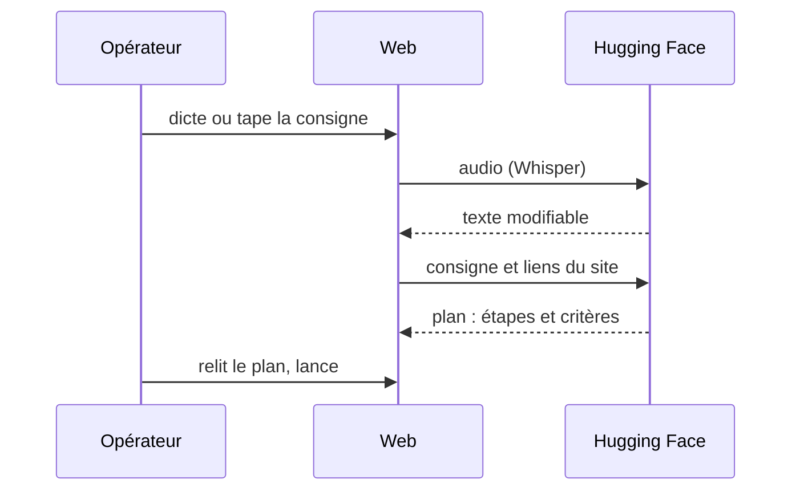
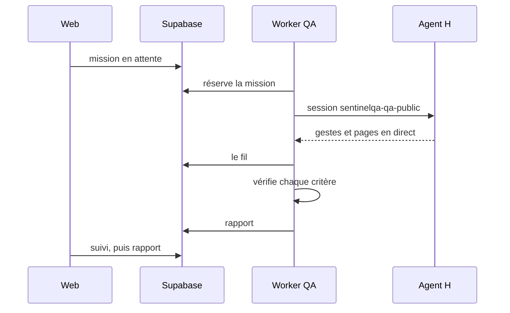
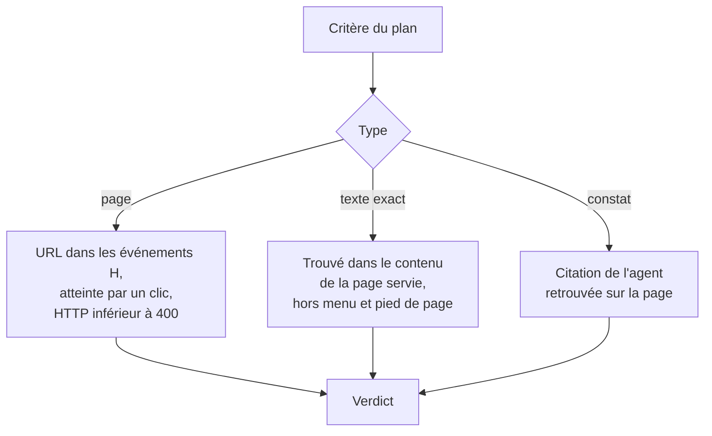
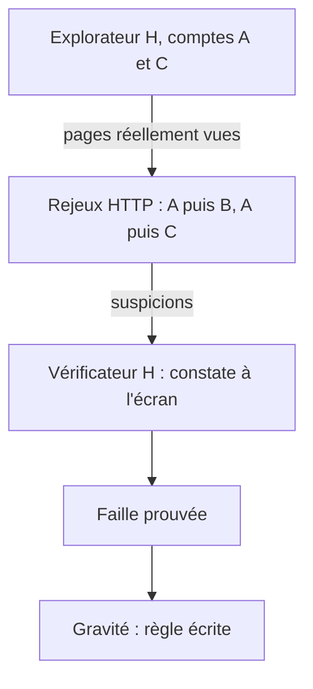
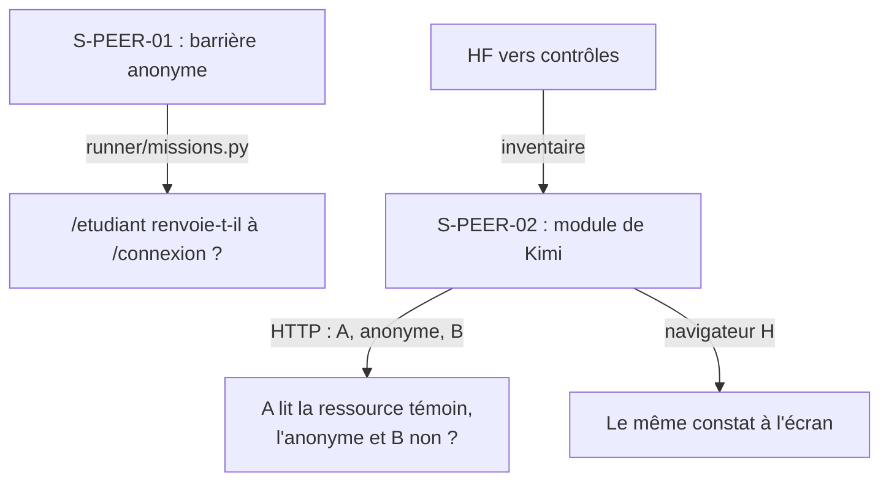
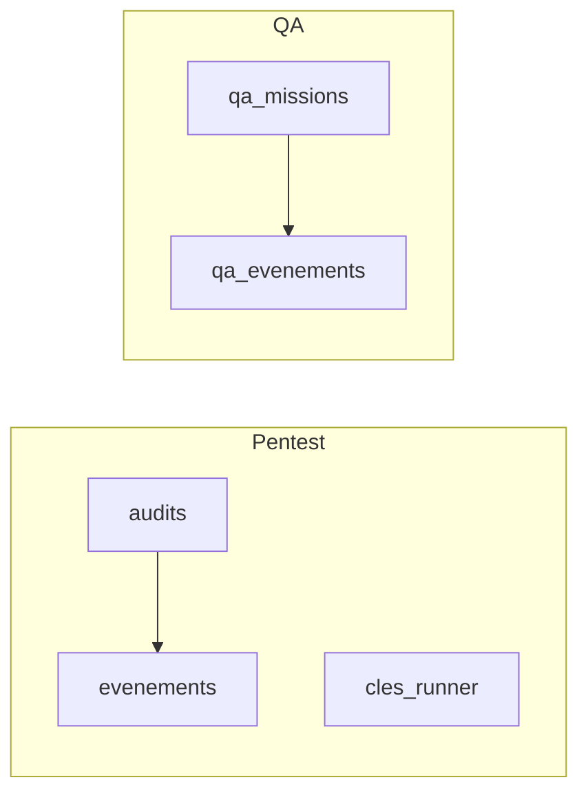
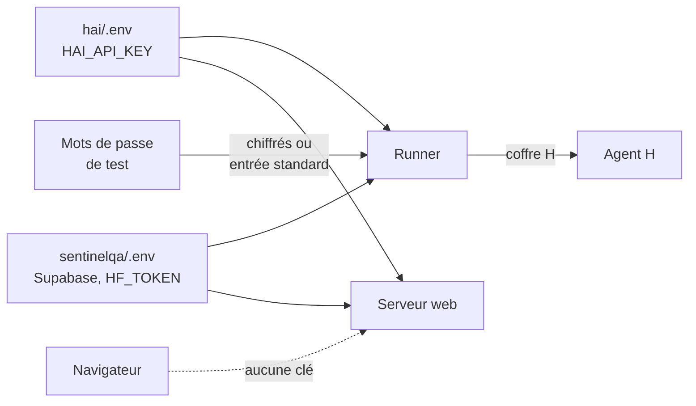

# Architecture de HSentinel

> État au 19/11/2026, 5 h 20, relu contre le code à cette heure. Depuis 19 h 39, l'équipe travaille dans l'espace H de Jahdiel. Ce document décrit ce qui tourne aujourd'hui, brique par brique : une idée par section, avec son schéma, ses fichiers et ses mesures. Ce qui reste à faire est dans [SUIVI.md](SUIVI.md). Kimi corrige `contributions/kimi-pentest` en ce moment : la section 6 décrit l'état lu à 19 h 05.

0. [Ce qui a changé depuis le document du 17/11](#0-ce-qui-a-changé-depuis-le-document-du-1711)
1. [Vue d'ensemble](#1-vue-densemble)
2. [Le principe : l'agent montre, le code décide](#2-le-principe--lagent-montre-le-code-décide)
3. [Volet QA : le trajet d'une mission](#3-volet-qa--le-trajet-dune-mission)
4. [Volet QA : comment un critère est vérifié](#4-volet-qa--comment-un-critère-est-vérifié)
5. [Volet Pentest : le banc Paie Express](#5-volet-pentest--le-banc-paie-express)
6. [Volet Pentest : Peer Review, en cours](#6-volet-pentest--peer-review-en-cours)
7. [Les agents H](#7-les-agents-h)
8. [Les données dans Supabase](#8-les-données-dans-supabase)
9. [Les secrets](#9-les-secrets)
10. [Hugging Face : quatre usages, aucun verdict](#10-hugging-face--quatre-usages-aucun-verdict)
11. [La web](#11-la-web)
12. [L'état de chaque brique](#12-létat-de-chaque-brique)
13. [La carte du code](#13-la-carte-du-code)
14. [Les travaux de l'équipe hors de `main`](#14-les-travaux-de-léquipe-hors-de-main)

---

## 0. Ce qui a changé depuis le document du 17/11

Le grand document illustré déposé sur Notion le 17/11 (24 pages) est périmé : ces décisions en ont changé le fond. Il a été corrigé le 18/11 (27 pages, mêmes revirements en pages 2 et 3) ; c'est la nouvelle version qu'il faut déposer. **En cas de doute, ce document fait foi.**

| Sujet | Document du 17/11 | Aujourd'hui | Décision |
|---|---|---|---|
| Ce qu'est HSentinel | Un agent qui se comporte comme un client malveillant et vérifie qu'aucun client n'atteint les données d'un autre | Deux volets de même importance : le **QA** (le site fait-il ce qu'on attend ?) et le **Pentest** (un accès interdit est-il possible ?) | D-25, D-26 |
| Le volet QA | Le test T0, l'isolation entre entreprises : cartographie, puis rejeu | Un **test fonctionnel** : parcours dicté ou exploration bornée, vérifiés par le code ; construit et exécuté en réel | D-25, D-30 |
| Le volet Pentest | Exploration libre guidée par Hugging Face, et T1 (un accès qui reste après un changement de droits) | Des **contrôles d'accès en lecture** sur Peer Review : la barrière anonyme (S-PEER-01), et une ressource témoin lue par A mais pas par un anonyme ni par B (S-PEER-02). **T1 est retiré** des sites réels | D-24, D-26 |
| Les cibles | Une préproduction du client ; la démo sur le cobaye Paie Express | **Des sites réels autorisés** : eugeniaschool.com et Peer Review, en consultation seule. Paie Express devient un banc de calibration | D-24 |
| Les écritures | Permises sur des données de test, avec le feu vert donné au cadrage, puis remise en état | **Aucune écriture** ni aucun changement de droits sur les sites réels | D-24 |
| Les agents H | Explorateur, Vérificateur, et le Préparateur à venir pour T1 | `sentinelqa-qa-public` pour le QA public, `sentinelqa-qa-connecte` pour un site à compte ; l'Explorateur et le Vérificateur pour le banc ; `sentinelqa-pentest-acces` pour S-PEER-02. **Le Préparateur est abandonné** | D-24, D-30 |
| Le verdict | Un rejeu HTTP (pages similaires à 95 % ou plus), puis une preuve à l'écran | Banc : inchangé. QA : les preuves du code (événements H, page servie, citation de l'agent retrouvée). Peer Review : une règle d'accès écrite, vérifiée sur une ressource témoin | D-24, D-30 |
| Hugging Face | Il dit où chercher dans le pentest, et il rédige l'explication | Il prépare le **plan QA**, transcrit la **dictée** et propose des contrôles d'accès (module en cours). Il ne rend jamais le verdict | D-23, D-30 |
| La voix | Absente | Une **dictée** dans la web, qui écrit dans le même champ que la saisie | D-30, D-32 |
| n8n | Les déclencheurs : un audit à chaque déploiement (W1), les alertes (W3), un pentest régulier (W4) | **Construit par Jahdiel** (W1, W3, W4). Les workflows appellent notre base, où le runner publie les failles prouvées. Recette réelle du 19/11 : constat de test → ticket GitHub n° 7, par le rattrapage. Le webhook instantané reste refusé (403, secret à aligner) (section 14) | — |
| Supabase | 3 tables, et une extension prévue (Auth, RLS par organisation, Storage) | Une **file QA séparée** (`qa_missions`, `qa_evenements`) ; l'extension prévue n'est pas faite | D-30 |
| La web | La salle de contrôle : cadrer un audit avec trois comptes de test | Deux onglets : **QA** (studio, dictée, plan, suivi en direct, arrêt, rapport) et Pentest. Pas encore déployée | D-27, D-30 |
| La preuve de propriété de la cible | Un fichier à déposer sur la préproduction | Pour ces deux sites, l'accord écrit de l'école | D-24 |
| Le plan et les questions ouvertes | Neuf livrables et sept questions, dans le document | Tenus dans [SUIVI.md](SUIVI.md) | — |

---

## 1. Vue d'ensemble



- **Web** (`sentinelqa/web`) : on y lance une mission, on la suit en direct, on l'arrête, et on lit le rapport. Elle tourne en local et n'est pas encore déployée.
- **La console de l'équipe** (`sentinelqa/web-console`, en ligne sur https://hsentinel-console.vercel.app depuis le 19/11 (Vercel, accès par jeton d'opérateur)) : l'interface d'un camarade (v0), que Codex raccorde depuis le 18/11 au soir. Son API `/api/console` réutilise les services de la web : plan, dictée, lancement, suivi, arrêt et rapports (section 11).
- **Runner** (`sentinelqa/runner`) : deux processus Python sur un poste de l'équipe, le worker QA (`qa_worker.py`) et le runner du pentest (`sentinelqa.py --surveiller`). Ils prennent les missions dans Supabase, pilotent les agents H et vérifient les résultats.
- **H Agents API** : des agents qui voient l'écran et cliquent, dans un navigateur cloud que H fournit à chaque session.
- **Supabase** : les files de missions, le fil en direct et les rapports. Le QA et le pentest ont chacun leurs tables.
- **Hugging Face** : il prépare et transcrit, mais ne rend jamais de verdict (section 10).
- **n8n** (Jahdiel) : les déclencheurs et les alertes, branchés sur notre base. Une faille prouvée devient un ticket GitHub (vérifié le 19/11) ; le webhook instantané attend un secret aligné (section 14).

## 2. Le principe : l'agent montre, le code décide



Un agent peut se tromper ou inventer. Le verdict ne repose donc jamais sur son seul texte : il repose sur ce que H a **enregistré** et sur ce que le site **sert**.

| Verdict | Condition |
|---|---|
| **Conforme** | Une preuve relevée par le code : page atteinte dans les événements H, texte trouvé dans la page, citation de l'agent retrouvée mot pour mot |
| **Écart constaté** | Une preuve d'écart relevée par le code : erreur HTTP, texte absent de la page servie alors que c'est bien la page vue, texte anormal affiché |
| **Non concluant** | Tout le reste, y compris un écart que l'agent voit seul (« à confirmer ») |
| **Non exécuté** | La mission s'est arrêtée avant ce critère |

Ce principe est né d'une erreur réelle. Le 18/11, l'agent a vu « 3 étapes » en manquant la FAQ de la page, puis « Quatre étapes » une heure plus tard. Avec la règle, aucune de ses deux lectures n'est devenue un faux écart.

## 3. Volet QA : le trajet d'une mission

**La préparation**, avant tout agent :



**L'exécution** :



- **Deux pilotages.** Le *parcours guidé* suit la consigne de l'utilisateur. L'*exploration bornée* fonctionne sans consigne : l'agent ouvre le menu principal, 6 pages au plus, et relève les problèmes visibles.
- **Deux écrans.** Ordinateur en 1280 × 800, mobile en 390 × 844. On change de valeur par session (`overrides`), sans dupliquer l'agent.
- **La veille des mises à jour (D-43, `runner/veille.py`)**. Elle sait qu'un site a changé sans rien installer chez le client. Le worker QA lit chaque application suivie deux fois de suite, par HTTP et sans agent, toutes les 15 minutes ; `HSENTINEL_VEILLE_S` change ce rythme. L'empreinte ne garde que ce qui est identique dans les deux lectures :
  - l'identifiant de compilation de Next.js (`"b":"…"` dans les données de rendu de l'App Router, ou `/_next/static/<id>/`) ;
  - les ressources JS et CSS ;
  - les titres h1 à h3.

  Ce qui change à chaque requête n'y entre donc jamais. Si l'empreinte change, une mission QA d'exploration est créée et exécutée, et un écart prouvé devient un ticket (D-42). Un site à compte (Peer Review) est seulement signalé. Une erreur de lecture ne vaut ni changement ni mission.

  **Mesuré le 19/11** : la console est redéployée à 5 h 16 min 08 s. La veille détecte la « nouvelle compilation » à 5 h 17 min 04 s, et la mission d'exploration est faite à 5 h 17 min 34 s (2 conformes, 0 écart, 0,010 $). La console en ligne l'affiche.

  Les autres voies de détection, à proposer selon le client : l'intégration (une application GitHub, Vercel, une étape de CI) et le calendrier (W4). La console elle-même est devenue une cible QA, pour ses pages publiques seulement (`/app` et `/api` exclus).
- **Arrêt.** Le bouton de la web met `arret_demande` à vrai. Le worker annule alors la session H et garde les preuves déjà recueillies.
- **Mesures réelles du 18/11 sur eugeniaschool.com : 9 missions complètes, 0,300 $ au total, 0,033 $ et 76 s en moyenne.** Parcours guidé : 37 à 81 s, 0,011 à 0,039 $. Exploration : 86 à 160 s, 0,045 à 0,070 $. Plan Hugging Face : environ 1 s. Dictée : 1,1 à 1,6 s.
- **Répétitions du 18/11 au soir, 10 par scénario, réussite jugée par le code** :
  - parcours guidé « Bac+3 » : 10 sur 10, 29 s (22 à 40) et 0,007 $ en moyenne ;
  - exploration : 10 sur 10, avec au moins 3 pages et aucun arrêt, 103 s (79 à 147) et 0,051 $. Un essai relève un « parcours difficile » sur le menu mobile : il reste non concluant ;
  - Peer Review connecté : connexion et identité 10 sur 10, « Mon parcours » 10 sur 10, aucune évaluation ouverte, 40 s (34 à 47) et 0,015 $. Le titre de l'accueil et l'état des évaluations restent non concluants dans 10 et 5 essais : H tronque ces titres à styles mêlés (`h_text_partial`) ;
  - **piège corrigé** : H passe une session à « idle » avant d'y attacher la réponse de l'agent, jusqu'à 2 s plus tard. Lue trop tôt, une réponse donnée paraissait absente (1 essai sur 10). Le runner relit désormais la session tant qu'elle est « idle » sans réponse, 10 s au plus (`lire_fin`).
- **Site connecté (Peer Review).** Un second agent, `sentinelqa-qa-connecte`, part de la page de connexion et remplit les champs avec `fill_secret_at` : il ne voit jamais les valeurs. Le coffre H est créé pour l'essai, lié à la session, puis supprimé. Le mot de passe arrive par l'entrée standard du terminal et ne va qu'au coffre. Le code prouve la connexion (secrets remplis sur `/connexion`, puis une page de l'espace) et l'identité (un marqueur comparé, jamais recopié). Une saisie, un choix dans une liste ou un clic « envoyer », « noter », « évaluer », « commencer »… arrêtent la session. Le contrat déclare aussi des zones interdites (`chemins_exclus` ; sur Peer Review, la review du soir, `/etudiant/sessions`). Si l'une de ces pages s'affiche, la session s'arrête, quel que soit le libellé cliqué (`forbidden_page`). La mission rappelle ces interdits à l'agent (`interdits_du_site`). H enregistre les événements par lots : il a souvent déjà exécuté le geste quand la garde le voit. L'arrêt borne donc la suite, ce n'est pas un pare-feu (incident du 18/11 à 22 h 48 : une évaluation ouverte, aucune note donnée). Une lecture HTTP anonyme d'une page privée, renvoyée à la connexion, ne sert jamais de preuve. Lancement depuis le terminal, ou par la file web. Dans la file web, la demande porte le compte, et le navigateur chiffre le mot de passe avec la clé publique du runner. Le worker efface le texte chiffré de la base avant de le déchiffrer, crée le coffre, puis le supprime, même en cas d'échec. Mesures : 18 missions réelles avec le compte d'Alec, 0,259 $ au total ; les répétitions sont plus haut. Le second compte (Nathan) est refusé par le site, « Adresse ou mot de passe incorrect. », en deux essais : le mot de passe transmis est à vérifier.
- Fichiers :
  - `runner/qa_moteur.py` : mission, session, vérification, rapport, CLI ;
  - `runner/qa_worker.py` : la file ;
  - `web/app/qa/`, `web/app/api/qa/` : le studio, le suivi et le rapport.

## 4. Volet QA : comment un critère est vérifié



- **Page atteinte.** L'URL doit figurer dans les observations du navigateur. Une page ouverte en tapant son adresse ne compte pas comme atteinte par l'interface. Sur un site connecté, une page privée se prouve par la trajectoire du navigateur connecté : une lecture HTTP anonyme n'y voit que la connexion.
- **Texte exact.** Il s'agit des mots que l'utilisateur met entre guillemets. On les cherche dans la page servie, sans `nav`, `header` ni `footer` : le menu de chaque page cite les autres pages. La comparaison est normalisée : casse, accents, « Quatre » vaut « 4 ».
- **Constat.** L'agent doit citer le texte vu mot pour mot. Le code retrouve la citation, entière ou fragment par fragment. Le texte relevé par H tronque les titres à styles mêlés (« Bonne *soirée*, Alec » → « *soirée* ») : une citation introuvable pour cette raison reste non concluante, avec ce motif (`h_text_partial`).
- **Contrôles automatiques**, dans les deux pilotages :
  - chaque page visitée répond sans erreur ;
  - aucun texte anormal n'est affiché (`undefined`, `lorem ipsum`…) ;
  - en exploration, chaque lien affiché à l'écran mène à une page.
- **Signal de difficulté** : 6 clics ou plus sans changer de page, relevés dans les gestes et signalés « à revoir ». En mobile, 2 explorations sur 2 ont buté sur le menu.

## 5. Volet Pentest : le banc Paie Express



- **Paie Express** (`sentinelqa/cobaye`) : un SaaS de paie, construit par nous, avec des failles injectées et documentées (`VERITE_TERRAIN.json`). Il sert à mesurer la détection avant de toucher un vrai site.
- **Trois thèmes :**
  - **lecture** : B, d'une autre entreprise, lit les données de A ;
  - **écriture** : B modifie les données de A, seulement avec un feu vert humain, et A remet ensuite la valeur d'origine ;
  - **admin** : C, simple salarié, dépasse son rôle.
- **Une faille n'est prouvée que si le rejeu et l'agent la confirment.** La gravité ne vient pas du LLM, qui variait d'un audit à l'autre : elle vient d'une règle écrite (`runner/gravite.py`).
- **Mesures du 17/11**, sur le banc à 6 failles injectées : 59 failles prouvées sur 60 et 0 faux positif, en 10 audits. Un audit coûte de 0,13 à 0,21 $ et dure de 170 à 349 s.
- **En ligne depuis le 19/11 (D-45)** : https://hsentinel-banc.vercel.app, sans cobaye local ni tunnel. Sur Vercel, chaque instance a sa propre mémoire. Les seuls champs modifiables, le commentaire d'une fiche et la note d'une facture, vivent donc dans la table `cobaye_ecritures` (`supabase/banc.sql`), et le secret de session est fixé (`SESSION_SECRET`). Le cobaye, volontairement vulnérable, n'a que la clé publishable : la RLS ne lui ouvre que cette table, limitée à six lignes de 500 caractères au plus. En local, sans `SUPABASE_URL`, l'état reste en mémoire, comme avant. Audit réel en ligne : 6 failles prouvées sur 6, 0 faux positif, 283 s, 0,215 $.
- Fichiers : `runner/sentinelqa.py` (orchestration), `runner/agents_h.py`, `runner/gravite.py`, `runner/hf.py`.

## 6. Volet Pentest : Peer Review, en cours



- **S-PEER-01** (`runner/missions.py`) : un GET anonyme de `/etudiant`, puis un constat à l'écran par l'agent `sentinelqa-pentest`. Sa définition est corrigée (plus de `about:blank`) et l'agent existe depuis le 18/11 à 19 h 40, dans l'espace de Jahdiel. Exécuté en réel le 19/11 à 2 h 52, lancé depuis la console : conforme. Le GET anonyme reçoit un 307 vers `/connexion`, et l'agent voit la page de connexion. 24 s, 0,004 $ (worker `sentinelqa.py --surveiller`).
- **S-PEER-02** (`contributions/kimi-pentest`, point d'entrée `executer_controle_acces`) : trois contrôles, `legitimate_read` (A lit la ressource), `anonymous_read` (l'anonyme ne la lit pas) et `cross_actor_read` (B ne la lit pas). Chaque contrôle complet prévoit deux preuves : HTTP (l'empreinte de la réponse, jamais les cookies ni le corps) et navigateur H. **État après le nouveau triplet réel** :
  - les connexions HTTP de A et du nouveau B sont validées : formulaire multipart, redirection 303 vers `/`, puis `/etudiant` en 200 avec le marqueur exact du compte correspondant ;
  - la ressource témoin est la page de la session du soir de A. Le témoin retenu est un texte d'identité privé de A, absent de l'URL. A la lit ; l'anonyme est renvoyé à `/connexion`, sans le marqueur. La règle est confirmée : contenu de A interdit à l'anonyme et à B ;
  - le triplet HTTP a exécuté 9 requêtes. B reçoit HTTP 200 avec **sa propre identité et sa propre vue d'évaluation**, sans le témoin de A. Aucune fuite de A n'est démontrée ; B reste `inconclusive/denial_unverified`, car ce 200 personnalisé n'est pas un refus explicite ;
  - le volet navigateur reste bloqué. La définition locale de `sentinelqa-pentest-acces` ne contient plus `about:blank` ni aucun `start_url` ; l'agent existe dans l'espace de Jahdiel, et sa propre fonction le confirme conforme (« à jour », 18/11 à 20 h 38, avec une clé valide). Aucune session navigateur S-PEER-02 n'a encore tourné.

  Bilan : non concluant, aucune faille revendiquée. Le module n'est raccordé ni au runner ni à la web.
- **HF vers contrôles** (`contributions/hf-pentest`) : à partir d'un inventaire (chemins, règles, observations nettoyées), Qwen3-32B choisit les contrôles à jouer, et chacun devient un contrôle S-PEER-02. Un appel réel a été fait sur un inventaire synthétique (23,7 s, 1 492 tokens) : son plan a retrouvé la fuite et le contrôle sain du banc synthétique. Jamais exécuté sur Peer Review.
- **Règle des sites réels** : consultation seule, aucune écriture métier, aucun changement de droits. Le seul POST admis est celui de la connexion.

## 7. Les agents H

| Agent | Rôle | Défini dans | État |
|---|---|---|---|
| `sentinelqa-qa-public` | QA : parcours guidé et exploration d'un site public | `runner/qa_agent.py` | Créé et confirmé à 19 h 40 ; mission réelle conforme à 19 h 41 |
| `sentinelqa-qa-connecte` | QA sur un site à compte : connexion par coffre, puis consultation | `runner/qa_agent.py` | Créé et confirmé à 19 h 40 ; mission réelle à 19 h 42 (connexion et identité prouvées) |
| `sentinelqa-explorateur` | Banc Paie Express : cartographie | `runner/agents_h.py` | Créé et confirmé à 19 h 40 |
| `sentinelqa-verificateur` | Banc Paie Express : preuve à l'écran | `runner/agents_h.py` | Créé et confirmé à 19 h 40 |
| `sentinelqa-pentest` | S-PEER-01 | `runner/agents_missions.py` | Créé et confirmé à 19 h 40, définition corrigée (sans `about:blank`) ; exécuté en réel le 19/11, conforme |
| `sentinelqa-pentest-acces` | S-PEER-02 | `contributions/kimi-pentest/agent_acces.py` | Définition locale sans `start_url` ; relecture compatible avec la valeur Bing ajoutée par H, test complet sans PATCH ; 77 tests réussis. Présent dans l'espace de Jahdiel, confirmé conforme à 20 h 38 |
| `hsentinel-explorateur`, `-verificateur`, `-preparateur` | Le bac à sable de Mohamed : cartographie, preuve, T1 | branche `agents-ia-qa-pentest` | Dans l'ancien espace seulement ; hors de `main` (section 14) |

- Tous utilisent `holo4-35b-a3b`, en mode visuel. Le texte affiché (`markdown: true`), que H joint à chaque capture, n'est demandé que par les agents QA et par `sentinelqa-pentest-acces` : c'est là que le code retrouve les citations. Les agents du banc et `sentinelqa-pentest` ne le demandent pas. En QA, `holo4-27b` peut être choisi par session.
- **Le réglage de chaque session reste dans notre code** : URL de départ, écran et format de réponse (`answer_schema`, Pydantic). La définition d'un agent QA est relue après chaque enregistrement : la comparaison tolère les valeurs par défaut que H ajoute, mais refuse un coffre, un profil ou un proxy hérités.
- **L'espace H.** Depuis le 18/11 à 19 h 39, l'équipe travaille dans l'espace de Jahdiel (Aurian administrateur ; 3 sessions simultanées). Les agents dont l'état ci-dessus indique « créé et confirmé » y ont été créés par le code lui-même ; les sessions et replays d'avant restent dans l'ancien espace.
- **Aucune page de départ dans une définition.** Le 18/11 vers 18 h 40, l'ancien espace a cessé de relire les agents enregistrés avec `about:blank` (500 au GET comme au PATCH), et H refuse désormais cette valeur à la création (422). Chaque session impose sa page de départ (`overrides`), et un test le garantit pour tous les agents du runner.
- **Le QA public n'utilise aucun coffre ; le QA connecté, un par essai.** Le pentest en utilise un par compte de test : l'agent remplit le mot de passe sans jamais le voir (`fill_secret_at`).

## 8. Les données dans Supabase



| Table | Contenu |
|---|---|
| `audits` | Une demande de pentest (cible, comptes sans mot de passe, statut, rapport JSON), ou une mission du premier lot (`rapport.schema_version` 2) |
| `evenements` | Le fil d'un audit : étapes, sessions, preuves |
| `cles_runner` | La clé publique du runner, qui chiffre les mots de passe dans le navigateur |
| `qa_missions` | Une mission QA : la demande validée (consigne, plan, écran), `arret_demande`, le rapport |
| `qa_evenements` | Le fil d'une mission QA : étapes, gestes, pages, critères |
| `applications` | Ce qu'on a le droit de tester, et comment : autorisation (D-24), profils QA et pentest, destinataire des alertes (`supabase/alertes.sql`, appliqué le 18/11) |
| `constats` | Une ligne par faille prouvée ou par écart QA prouvé par le code, avec le suivi de son alerte n8n (ticket GitHub, e-mail). Thèmes `lecture`, `ecriture`, `admin`, `compte`, `qa` ; un écart QA porte son `critere`, qui entre dans l'empreinte. Jamais de donnée du site testé |

- **Une file par volet, côté interface.** La web envoie le QA dans `qa_missions`, que seul le worker QA lit, et le pentest dans `audits`, que lit le runner du pentest. L'ancien parcours QA du premier lot (Q-PUB-01, D-27) existe encore dans le code : `/api/audits` l'accepte et le runner du pentest le traiterait, mais l'interface ne le propose plus.
- **Cycle d'une mission** : `en_attente`, puis `en_cours`, puis `termine` ou `echec`. La réservation est atomique : elle met le statut à jour seulement s'il vaut encore `en_attente`.
- **Sécurité** : le RLS est activé, sans aucune politique. Seule la clé secrète, utilisée par le serveur web et par le runner, lit et écrit ; la clé publique ne voit rien (vérifié dans les deux sens). Une exception depuis le 19/11 (D-45) : la table du banc en ligne, `cobaye_ecritures`, est ouverte à la clé publishable ; les autres tables lui restent fermées (vérifié).
- Schémas : `supabase/schema.sql` pour le pentest, `supabase/qa.sql` pour le QA.
- **Les alertes vivent dans notre base** (choix d'Aurian, 18/11 à 21 h, D-38). `supabase/alertes.sql` y est appliqué : tables `applications` et `constats`, fonctions appelées par n8n, déclencheur `constat_ajoute`. Les deux secrets du webhook W3 sont dans le coffre Supabase depuis 21 h 51, et le runner publie chaque faille prouvée du banc (`runner/constats.py`). **Recette réelle (19/11, 1 h 36 à 1 h 49)** : un constat de test du banc (Paie Express, `GET /fiches-de-paie/1041`, critique) est écrit par `constats.py`. Le déclencheur appelle bien W3, mais n8n refuse l'appel : le webhook instantané de W3 est refusé par n8n (403 « Authorization data is wrong! ») : son identifiant « Secret webhook Supabase W3 » ne porte pas l'en-tête `x-hsentinel-secret` avec la valeur de notre coffre (Jahdiel). Le rattrapage de W3, toutes les 15 min, a repris le constat. Il a créé le ticket GitHub n° 7 : étiquettes, raisons, preuve, piste de correction, aucune donnée du site testé. Il a ensuite noté l'état « traitée » dans la base, sans e-mail faute de destinataire. La page Alertes de la console l'affiche avec son lien. Republié une seconde fois, le même constat ajoute au ticket n° 7 le commentaire « Toujours présente », sans nouveau ticket (2 h 04).
- **Aucune faille publique sur un site tiers (D-44, 19/11)**. Le dépôt des tickets est public. `applications.tickets_publics` vaut vrai pour nos seules applications : le banc Paie Express, le banc boîte noire et notre console. Pour un site tiers (Eugenia, Peer Review), `preparer_alerte` ne crée aucun ticket. Le constat passe à l'état `reservee` et reste visible dans la console ; l'équipe prévient le propriétaire directement. Le scanner HTTP (`runner/pentest`, en cours) est branché sur les tickets par `constats.lignes_scan` : seules ses failles démontrées (`demonstrated_vulnerability`) comptent, jamais un candidat ZAP ni une faiblesse de configuration, avec une gravité écrite par contrôle (injection SQL « critique », XSS, CORS et ressource privée « élevée », source map « moyenne »).
- **Trois sources de constats (D-42, 19/11)** :
  - les failles prouvées du banc (`constats.publier`) ;
  - les écarts QA prouvés par le code, publiés par le worker QA à la fin de chaque mission (`constats.lignes_qa`) ;
  - les failles prouvées d'une mission pentest, publiées par le worker pentest (`constats.lignes_mission`).

  Pour un écart QA, la règle de gravité est écrite : une page en erreur 5xx est « élevée », un lien cassé « faible », le reste « moyenne ». K1 et K2, qui décrivent la mise en place du test, n'ouvrent jamais de ticket. Sur un site connecté, le texte attendu n'est pas recopié : une référence courte le remplace. Le ticket QA porte les étiquettes `qa` et `regression`, et une ligne « Critère ». S-PEER-01 ne peut pas prouver de faille (il rend conforme ou non concluant) ; S-PEER-02 le pourra, une fois raccordé, sous le thème `compte`. Recette réelle du 19/11 : une mission lancée depuis la console en ligne, avec un critère volontairement faux (« Bac+8 »), est rapportée en écart et publiée comme constat. Le rattrapage de W3 en fait le ticket n° 8 (3 h 33) : étiquettes `qa` et `regression`, ligne « Critère », preuve par le code et par le parcours. La console en ligne l'affiche. Ce ticket de recette est ensuite fermé avec une explication, et le constat de recette est retiré. Restent : aligner le secret du webhook, poser `github_webhook_secret` pour W1 et choisir un destinataire d'e-mail.

## 9. Les secrets



- **Aucune clé dans le dépôt.** Les clés vivent hors du dépôt, avec les droits 600. Le `.gitignore` fonctionne en liste blanche.
- **Le navigateur ne voit aucune clé.** Les appels à Hugging Face, à Supabase et aux captures H passent par le serveur web.
- **Les mots de passe des comptes de test** suivent trois chemins, et finissent toujours dans un coffre H : l'agent les remplit sans les voir (`fill_secret_at`).
  - **Banc Paie Express, depuis la web** : chiffrés dans le navigateur avec la clé publique du runner (RSA-OAEP, 3072 bits). Supabase ne garde que le texte chiffré ; le runner le déchiffre en mémoire, remplit les coffres, puis l'efface.
  - **QA connecté, depuis le terminal** : le mot de passe arrive sur l'entrée standard du runner et va dans un coffre créé pour l'essai, supprimé à la fin. Il n'est écrit nulle part.
  - **QA connecté, par la file web** : chiffré dans le navigateur (RSA-OAEP, SHA-256, clé publique de `cles_runner`, que le worker publie au démarrage). Le worker retire le compte de `qa_missions` avant de le déchiffrer en mémoire, le verse dans un coffre propre à la mission, puis supprime ce coffre. Les lectures de la web retirent le texte chiffré (`sansSecret`).
  - **S-PEER-02 (Kimi, non raccordé)** : un JSON privé hors du dépôt (droits 600) fournit les comptes A et B. Un coffre par acteur, `sentinelqa-peer-review-a` et `-b`, est rempli à chaque exécution ; le modèle ne reçoit jamais ce fichier.
- Piège connu : `holo login` écrit la clé entre guillemets. Il faut les retirer à la lecture, sinon H répond 403.

## 10. Hugging Face : quatre usages, aucun verdict

| Usage | Modèle | Où | Mesure |
|---|---|---|---|
| Plan QA : consigne vers étapes et critères | Llama 3.3 70B, par le routeur HF | `web/lib/qa.js`, `runner/qa_moteur.py` | Environ 1 s |
| Dictée : audio vers texte modifiable | Whisper large v3 turbo (licence MIT) | `web/lib/qa.js` | 1,1 à 1,6 s |
| Banc Paie Express : attaques à tenter, avant les rejeux | Qwen2.5-72B | `runner/hf.py` | De 13 à 99,5 s selon les essais |
| Peer Review : contrôles d'accès à jouer, à partir d'un inventaire | Qwen3-32B | `contributions/hf-pentest`, non raccordé | 23,7 s pour un appel réel, sur un inventaire synthétique |

- Ce que propose Hugging Face est toujours relu : par l'utilisateur pour le plan, par le code pour le verdict.
- Le routeur Hugging Face annonce OpenRouter comme fournisseur réel de Llama 3.3 70B (mesuré le 18/11).

## 11. La web

| Page | Rôle |
|---|---|
| `/` | L'accueil : les derniers relevés |
| `/audits/nouveau` | Lancer une mission : onglet **QA** (le studio, avec la dictée) ou onglet **Pentest** |
| `/qa`, `/qa/[id]` | Le studio QA et l'historique ; le suivi en direct, puis le rapport |
| `/audits/[id]` | Le suivi et le rapport d'un audit pentest |
| `/examen` | L'index des relevés pentest, par date, application ou thème |

- **Routes QA** (`app/api/qa/`) : `plan`, `transcription`, `missions`, `missions/[id]`, `missions/[id]/arret`, `captures`.
- **Accès** : `proxy.js` réserve tout à l'opérateur. En développement, seule la boucle locale est admise ; en production, il faut le jeton `HSENTINEL_OPERATOR_TOKEN`. Chaque écriture vérifie l'origine de la requête contre l'hôte réellement appelé (`Host`, ou `X-Forwarded-Host` derrière un proxy). Elle ne compare jamais à `request.url`, que Next réécrit en « localhost » en développement : le 19/11, toutes les écritures de la console étaient ainsi refusées sur 127.0.0.1, dictée comprise. Une seule garde, `web/lib/acces-operateur.js`, sert les deux webs.
- **Captures** : celles de l'agent restent chez H. Le serveur web les relaie (`/api/qa/captures`), et seules les adresses de la trajectoire de la session passent.
- Next.js 16 et React 19, sans autre dépendance.

**La console de l'équipe, `sentinelqa/web-console`** : l'interface d'un camarade, exportée de v0 (TypeScript, Tailwind, shadcn), que Codex raccorde depuis le 18/11 au soir. **En ligne : https://hsentinel-console.vercel.app**, sur Vercel, depuis le 19/11 à 3 h.

- **Déploiement** : le projet Vercel `hsentinel-console` est réglé sur `rootDirectory = web-console` et Node 24.x. On compile en local, où les modules voisins (`web/lib`, `contrats/`) existent, puis on publie le résultat compilé : `cd sentinelqa && vercel build --prod && vercel deploy --prebuilt --prod`.
- **Piège du 19/11** : le builder Vercel ignore un `distDir` personnalisé et empaquette `.next/`. Avec `HSENTINEL_BUILD_DIR=.next-production`, il a empaqueté une compilation périmée du 18/11 tout en annonçant un succès. Il faut donc toujours compiler dans `.next`. Avant de publier, vérifier dans `.vercel/output/functions/api/console/[...path].func/.vc-config.json` que la route pointe vers un fichier du jour.
- **Secrets** : cinq variables de production, sensibles et chiffrées, posées par l'entrée standard (`SUPABASE_URL`, `SUPABASE_SECRET_KEY`, `HF_TOKEN`, `HAI_API_KEY`, `HSENTINEL_OPERATOR_TOKEN`). Le jeton d'opérateur (43 caractères) est aussi rangé dans `~/.config/sentinelqa/.env`. `vercel pull` écrit un jeton OIDC dans `.vercel/` : ce dossier est exclu du dépôt, et ce fichier est supprimé après usage.
- **Recette en production (19/11, 3 h 06)**, en HTTPS : faux code refusé, connexion par jeton, dictée transcrite, plan (200, 1,2 s), mission publique lancée en ligne et exécutée par le worker du Mac (3 sur 3, 28 s, 0,011 $), captures de l'agent chargées, page Alertes avec le ticket n° 7, aucune réponse en erreur. Sa note de raccordement : `web-console/INTEGRATION.md`.

| Page | Rôle |
|---|---|
| `/`, `/login`, `/onboarding` | L'accueil du produit, une connexion d'équipe provisoire, puis une redirection vers le studio pour l'onboarding |
| `/app` | Le tableau de bord |
| `/app/nouveau` | Le studio de mission : QA (consigne, dictée, plan) ou pentest |
| `/app/missions/[module]/[id]` | Le suivi, puis le rapport d'une mission |
| `/app/cibles` | Les cibles autorisées |
| `/app/alertes` | Les constats, états d’envoi et tickets GitHub, filtrables par application |

- **Son API `/api/console` réutilise les services de la web**, importés directement : `web/lib/qa.js` (plan, dictée, lancement, suivi, arrêt, captures), `web/lib/missions.js` et `audits.js` pour le pentest. Le QA part dans `qa_missions`, le pentest dans `audits`, et les deux workers existants les traitent. Elle ne calcule aucun verdict : elle traduit les statuts des rapports.
- **Les anciens widgets de démonstration** ne sont plus utilisés par les routes actives. `/api/audit` répond 410 ; `ORCHESTRATOR_URL` n’est pas requis.
- **Prêt côté serveur pour la console** (Claude, 18/11 à 23 h ; tests `web/tests/qa.test.mjs` et `alertes.test.mjs`) :
  - **le QA connecté.** `validerMissionQa` accepte `compte: { identifiant, secret_chiffre, identite }`, et `cleRunner()` (`web/lib/qa.js`) donne la clé publique `{ id, jwk }`. Le navigateur chiffre `JSON.stringify({ mot_de_passe })` en RSA-OAEP SHA-256, comme `web/app/audits/nouveau/formulaire-cobaye.js`. Les nouveaux résultats sont `connexion` (K1) et `identite` (K2), et `rapport.interruption` peut valoir `write_risk` ou `forbidden_page` ;
  - **les alertes.** Côté serveur, `web/lib/alertes.js` fournit `listerAlertes({ application, limite })`, `bilanAlertes()` et `listerApplications()`. Chaque ligne donne la gravité, l'accès, le type, l'état de l'alerte et le ticket GitHub, sans aucune donnée du site testé.
- **Raccordé côté console (Codex)** : les cibles connectées sont proposées avec l’adresse, le mot de passe et jusqu’à trois noms attendus. `/api/console/cle-runner` fournit uniquement la clé publique ; elle est relue avant le chiffrement et une clé absente bloque le lancement. Le rapport distingue K1/K2 et utilise les libellés de `h_text_partial`, `write_risk` et `forbidden_page`. `/api/console/alertes` et `/app/alertes` réutilisent les services d’alertes en lecture.
- **État vérifié dans ce lot** : 28 tests locaux réussis, dont un chiffrement WebCrypto déchiffré avec une clé de test ; TypeScript et compilation Webpack réussis. **Recette réelle par Claude (19/11, 0 h 05)**, sans simulation, dans Chrome sans fenêtre (Playwright) :
  - dictée sur micro synthétique : une phrase lue par macOS, transcrite par Whisper ;
  - plan préparé par Hugging Face ;
  - mission publique : 3 sur 3 conformes, 35 s, 0,010 $ ;
  - mission connectée sur Peer Review : K1 et K2 conformes, « Mon parcours » conforme, titre de l'accueil tronqué par H, 39 s, 0,015 $ ;
  - captures et journal visibles, et aucune réponse en erreur de la console.

  Les 12 tests navigateur de Codex passent en production (`next start`). Deux sélecteurs de test y étaient faux : l'annonceur de route de Next porte lui aussi `role="alert"`, et un `<select>` placé dans son `<label>` échappe à `getByLabel` exact. Restent à recetter l'arrêt d'une mission réelle et la page Alertes avec de vrais constats. Les modules de Kimi restent un chantier distinct. L’accès est réservé à l’opérateur ; le développement local peut fonctionner sans jeton.

## 12. L'état de chaque brique

| Brique | État au 18/11, 23 h 15 |
|---|---|
| QA : parcours guidé, exploration, mobile | Exécuté en réel : 33 missions sur eugeniaschool.com le 18/11, 0,904 $ au total, dont 10 répétitions par scénario (guidé 10/10, exploration 10/10) |
| QA connecté : Peer Review | Compte d'Alec : 18 missions réelles (0,259 $), depuis le terminal et la file web. Répétitions : connexion et identité 10/10, aucune évaluation ouverte depuis le renforcement de la garde. Compte de Nathan refusé par le site (2 essais). Formulaire du compte et chiffrement raccordés à la console ; recette réelle de cette interface restante |
| QA : dictée | Exécutée de bout en bout dans un navigateur, avec une voix de synthèse ; à essayer avec une vraie voix |
| QA : vérification par le code | 66 tests Python ; faux écarts trouvés en réel puis corrigés et revérifiés |
| Web QA | 39 tests JavaScript réussis ; compilation réussie à 14 h 37, puis bloquée à 15 h par le téléchargement des polices Google |
| Pentest : banc Paie Express | Exécuté en réel : 59/60 en 10 audits, 0 faux positif ; en ligne le 19/11 : 6 failles prouvées sur 6, 0 faux positif, 283 s, 0,215 $ |
| Pentest : S-PEER-01 | Exécuté en réel le 19/11 à 2 h 52, lancé depuis la console : conforme. Le GET anonyme reçoit un 307 vers `/connexion`, et l'agent voit la page de connexion. 24 s, 0,004 $ |
| Pentest : S-PEER-02 | Non raccordé. Triplet HTTP réel de 9 requêtes : A et l'anonyme passent ; B reçoit sa propre vue sans le témoin de A et reste non concluant faute de refus explicite. Aucune fuite démontrée ; H reste à confirmer avec une clé autorisée (403 actuel) |
| Pentest : HF vers contrôles | Un appel réel sur un inventaire synthétique ; 50 tests sur 50. Jamais exécuté sur Peer Review |
| Modules de Kimi | 23 tests sur 23 ; confirmation H testée avec le `start_url` ajouté par défaut, sans PATCH inutile |
| Déploiement de la console | En ligne : https://hsentinel-console.vercel.app (Vercel), recette réelle faite en HTTPS. Les workers tournent sur le Mac d'Aurian |
| Console de l'équipe (`web-console`) | Raccordée par Codex aux services de la web, avec QA connecté et page Alertes : 28 tests, TypeScript et 12 tests navigateur en production réussis. Recette réelle faite le 19/11 : dictée, mission publique, mission connectée. En ligne : https://hsentinel-console.vercel.app |
| n8n : W1, W3, W4 (Jahdiel) | Branchés sur notre base. W3 vérifié en réel le 19/11 : constat → ticket GitHub n° 7 → état noté, par le rattrapage. Le webhook instantané est refusé (403) tant que son secret n'est pas aligné ; W1 attend son secret |
| Mesure du temps humain gagné | Pas faite |

## 13. La carte du code

```text
sentinelqa/
  runner/
    qa_agent.py         agent H du QA : définition et relecture confirmée
    qa_moteur.py        QA : mission, session, vérification, rapport, CLI
    qa_worker.py        QA : file Supabase, arrêt, fil en direct
    base.py             accès à Supabase (REST et psql)
    cle_runner.py       la clé RSA du runner, qui déchiffre les mots de passe du banc
    sentinelqa.py       pentest : orchestration du banc et file des audits
    missions.py         pentest : scénarios sur sites réels (S-PEER-01)
    agents_h.py         agents du banc (explorateur, vérificateur)
    agents_missions.py  agents des missions réelles ; le QA reprend qa_agent.py
    gravite.py          règle écrite de gravité
    constats.py         failles prouvées du banc → table constats → alertes n8n (W3)
    hf.py               Hugging Face pour le pentest (hypothèses)
    tests/              tests sans réseau, avec de vrais événements H en fixture
  web/
    app/qa/             studio, dictée, suivi, rapport QA
    app/audits/         lancement (QA et pentest), suivi pentest
    app/examen/         index des relevés pentest
    app/api/            routes serveur
    lib/                accès Supabase, contrat QA, dictée, formats
  web-console/          la console de l'équipe (interface d'un camarade, raccordée par Codex) ; en ligne sur Vercel
  contrats/qa.json      cibles QA, budgets, consignes de préparation
  contrats/catalogue.json  scénarios sur sites réels (pentest)
  supabase/             schémas SQL ; alertes.sql : applications, constats et les fonctions de n8n
  n8n/                  les workflows W1, W3 et W4 exportés, et leur mise en service
  cobaye/               Paie Express, le banc à failles injectées
contributions/
  kimi-pentest/         S-PEER-02 : A, anonyme et B, en HTTP et dans le navigateur H ; non raccordé
  hf-pentest/           Hugging Face : d'un inventaire aux contrôles S-PEER-02 ; non raccordé
```

## 14. Les travaux de l'équipe hors de `main`

| Travail | Où | Ce qu'il fait | État |
|---|---|---|---|
| Les alertes n8n (Jahdiel) | n8n ; les trois exports, leur contrat et leur SQL réécrit pour notre base sont dans [`sentinelqa/n8n/`](sentinelqa/n8n/README.md) et `supabase/alertes.sql` | W1 : un déploiement prêt (`deployment_status` GitHub, signature vérifiée) devient une demande d'audit. W3 : une faille prouvée (table `constats`) devient un ticket GitHub et un e-mail, rouvert si elle revient. W4 : chaque nuit à 2 h, une demande de pentest pour chaque application abonnée | Testés en réel sur `hsentinel-dev` (rapporté par Jahdiel, non vérifié ici). Branchés sur notre base ; W3 vérifié en réel le 19/11 (ticket n° 7, par le rattrapage). Webhook instantané refusé (403) tant que son secret n'est pas aligné |
| Le bac à sable des agents (Mohamed) | Branche `agents-ia-qa-pentest`, historique séparé (18 fichiers) | Ses propres agents `hsentinel-explorateur`, `-verificateur` et `-preparateur`, des coffres par compte, et deux cibles : Paie Express et une instance Juice Shop à déployer soi-même | Ses agents sont dans l'ancien espace H. Non fusionné. Son README donne en exemple `auditer.py cadence` : Cadence n'est pas une cible autorisée (D-24) |
| La console de l'équipe | `sentinelqa/web-console`, en ligne sur https://hsentinel-console.vercel.app depuis le 19/11 (Vercel, accès par jeton d'opérateur) | L'interface d'un camarade (v0), raccordée par Codex aux services de la web (section 11) | Tests de contrat ; validation réelle à faire (`INTEGRATION.md`) |

**La revue de la branche de Mohamed par Codex** (`revues/agents-ia-qa-pentest/REVUE.md`, locale ; *rapporté* : ses huit cas n'ont pas été reproduits ici) :
- **À reprendre dans le moteur actuel** : le guidage Hugging Face des explorations, avec une comparaison activé et désactivé à budget égal ; le comparatif des modèles ; la distinction entre ressources privées et partagées ; Juice Shop comme banc supplémentaire.
- **Bloquants** : une similarité de 100 % entre deux textes vides, ou deux messages d'erreur identiques, devient une « fuite » ; une session d'agent échouée devient « accès refusé attendu » ; les budgets `max_steps` et `max_time_s` ne sont pas transmis à H ; les noms d'agents divergent (`hsentinel-*` créés, `sentinelqa-*` configurés). Un 401 entre aussi dans les moyennes du comparatif comme un essai à coût nul.
- **Cadrage** : la branche appelle encore « QA » la vérification d'isolation entre comptes, qui relève du pentest dans l'architecture actuelle.
