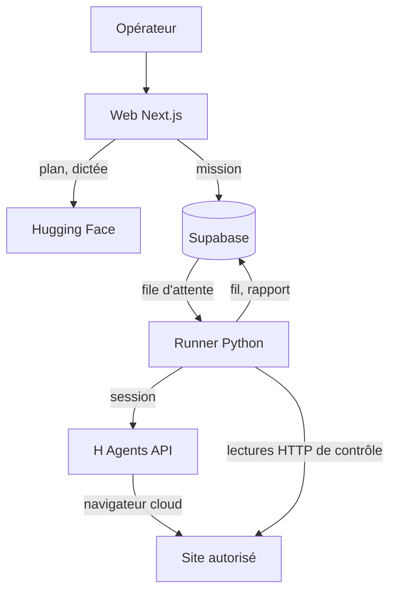
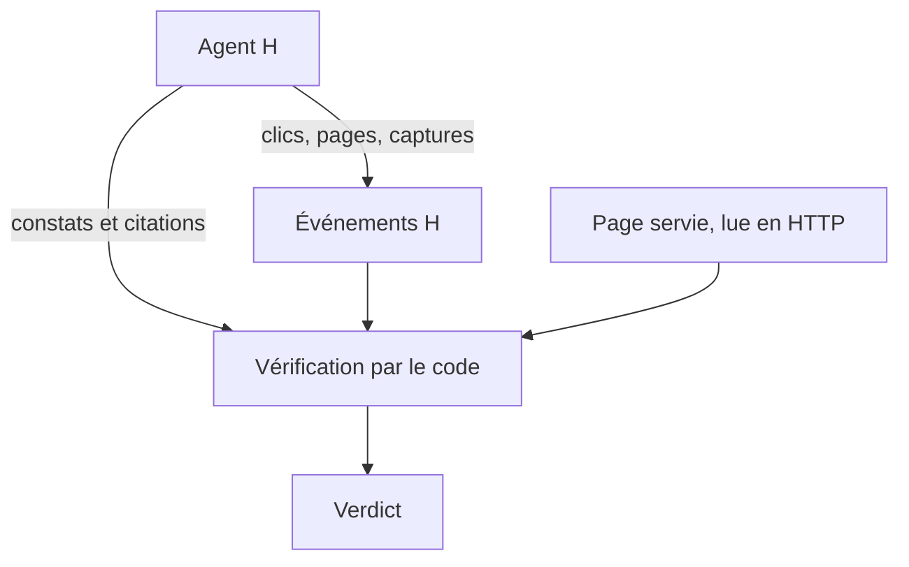
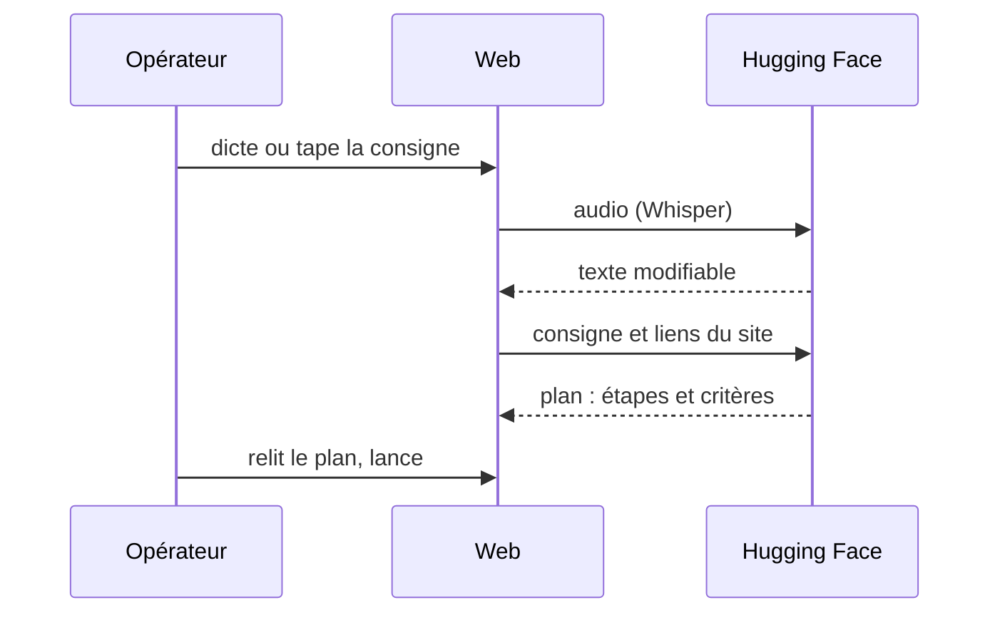
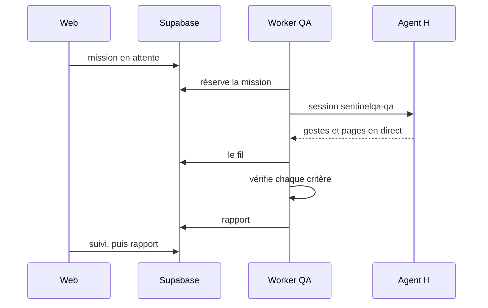
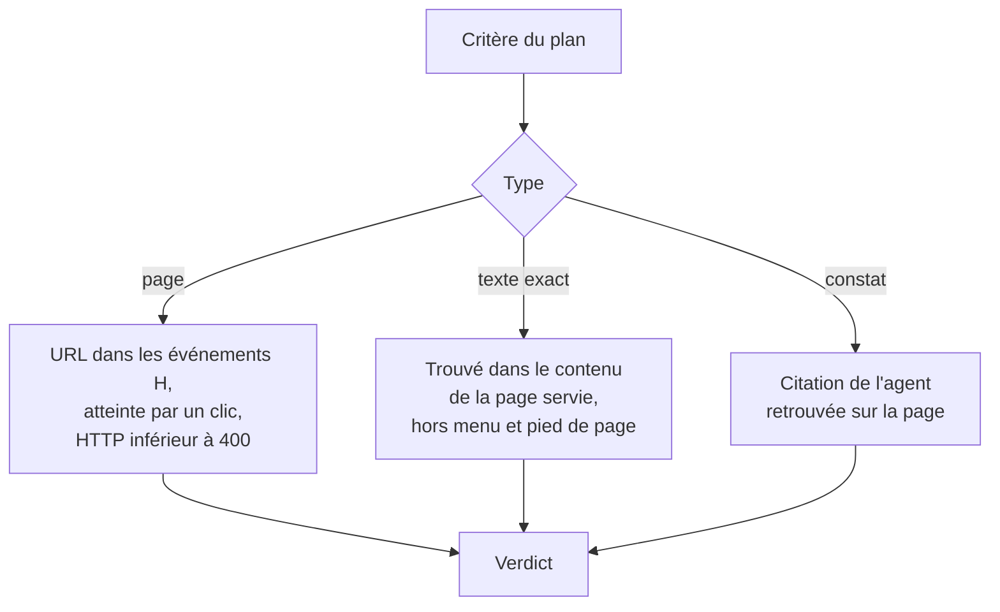
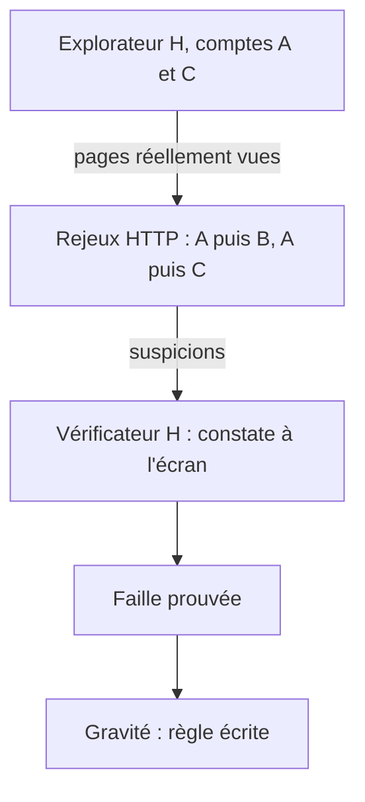
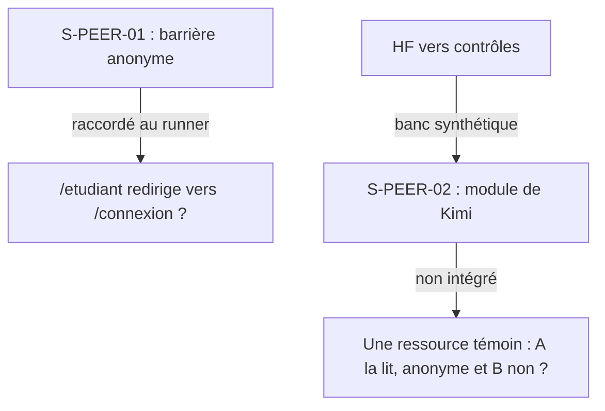
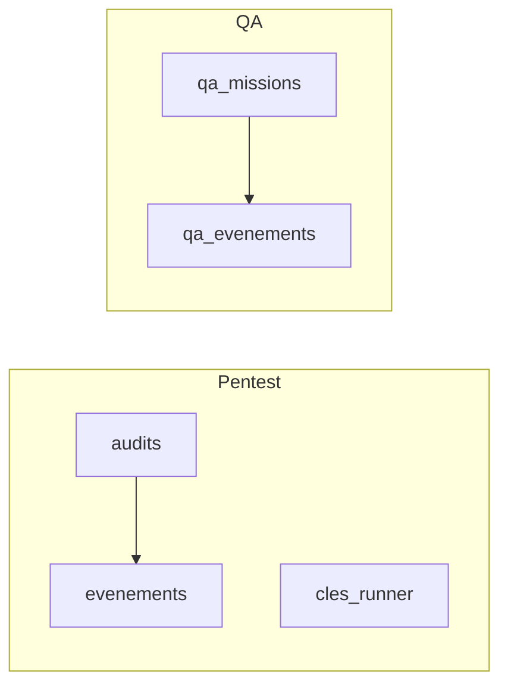
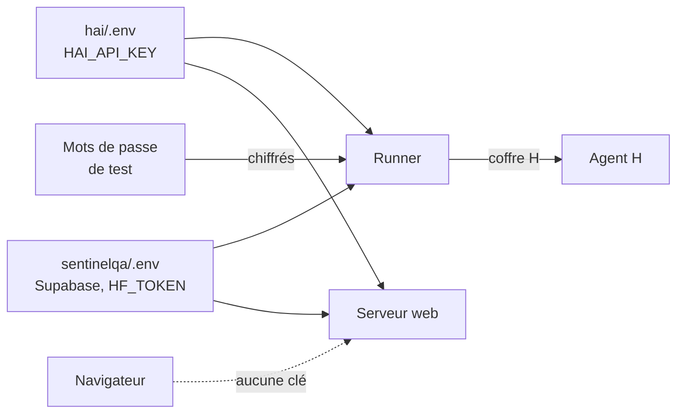

# Architecture de HSentinel

> État au 18/11/2026, 15 h. Ce document décrit ce qui tourne aujourd'hui, brique par brique : une idée par section, avec son schéma, ses fichiers et ses mesures. Ce qui reste à faire est dans [SUIVI.md](SUIVI.md).

0. [Ce qui a changé depuis le document du 17/11](#0-ce-qui-a-changé-depuis-le-document-du-1711)
1. [Vue d'ensemble](#1-vue-densemble)
2. [Le principe : l'agent montre, le code décide](#2-le-principe--lagent-montre-le-code-décide)
3. [Volet QA : le trajet d'une mission](#3-volet-qa--le-trajet-dune-mission)
4. [Volet QA : comment un critère est vérifié](#4-volet-qa--comment-un-critère-est-vérifié)
5. [Volet Pentest : le banc Paie Express](#5-volet-pentest--le-banc-paie-express)
6. [Volet Pentest : Peer Review, en cours](#6-volet-pentest--peer-review-en-cours)
7. [Les agents H](#7-les-agents-h)
8. [Les données dans Supabase](#8-les-données-dans-supabase)
9. [Les secrets](#9-les-secrets)
10. [Hugging Face : trois usages, aucun verdict](#10-hugging-face--trois-usages-aucun-verdict)
11. [La web](#11-la-web)
12. [L'état de chaque brique](#12-létat-de-chaque-brique)
13. [La carte du code](#13-la-carte-du-code)

---

## 0. Ce qui a changé depuis le document du 17/11

Le grand document illustré déposé sur Notion le 17/11 (24 pages) est périmé : ces décisions en ont changé le fond. Il a été corrigé le 18/11 (27 pages, mêmes revirements en pages 2 et 3) ; c'est la nouvelle version qu'il faut déposer. **En cas de doute, ce document fait foi.**

| Sujet | Document du 17/11 | Aujourd'hui | Décision |
|---|---|---|---|
| Ce qu'est HSentinel | Un agent qui se comporte comme un client malveillant et vérifie qu'aucun client n'atteint les données d'un autre | Deux volets de même importance : le **QA** (le site fait-il ce qu'on attend ?) et le **Pentest** (un accès interdit est-il possible ?) | D-25, D-26 |
| Le volet QA | Le test T0, l'isolation entre entreprises : cartographie, puis rejeu | Un **test fonctionnel** : parcours dicté ou exploration bornée, vérifiés par le code ; construit et exécuté en réel | D-25, D-30 |
| Le volet Pentest | Exploration libre guidée par Hugging Face, et T1 (un accès qui reste après un changement de droits) | Des **contrôles d'accès en lecture** sur Peer Review : la barrière anonyme (S-PEER-01), et une ressource témoin lue par A mais pas par un anonyme ni par B (S-PEER-02). **T1 est retiré** des sites réels | D-24, D-26 |
| Les cibles | Une préproduction du client ; la démo sur le cobaye Paie Express | **Des sites réels autorisés** : eugeniaschool.com et Peer Review, en consultation seule. Paie Express devient un banc de calibration | D-24 |
| Les écritures | Permises sur des données de test, avec le feu vert donné au cadrage, puis remise en état | **Aucune écriture** ni aucun changement de droits sur les sites réels | D-24 |
| Les agents H | Explorateur, Vérificateur, et le Préparateur à venir pour T1 | `sentinelqa-qa` pour le QA ; l'Explorateur et le Vérificateur pour le banc ; `sentinelqa-pentest-acces` pour S-PEER-02. **Le Préparateur est abandonné** | D-24, D-30 |
| Le verdict | Un rejeu HTTP (pages similaires à 95 % ou plus), puis une preuve à l'écran | Banc : inchangé. QA : les preuves du code (événements H, page servie, citation de l'agent retrouvée). Peer Review : une règle d'accès écrite, vérifiée sur une ressource témoin | D-24, D-30 |
| Hugging Face | Il dit où chercher dans le pentest, et il rédige l'explication | Il prépare le **plan QA**, transcrit la **dictée** et propose des contrôles d'accès (module en cours). Il ne rend jamais le verdict | D-23, D-30 |
| La voix | Absente | Une **dictée** dans la web, qui écrit dans le même champ que la saisie | D-30, D-32 |
| n8n | Les déclencheurs : un audit à chaque déploiement (W1), les alertes (W3), un pentest régulier (W4) | **Non construit.** Les missions partent de la web | — |
| Supabase | 3 tables, et une extension prévue (Auth, RLS par organisation, Storage) | Une **file QA séparée** (`qa_missions`, `qa_evenements`) ; l'extension prévue n'est pas faite | D-30 |
| La web | La salle de contrôle : cadrer un audit avec trois comptes de test | Deux onglets : **QA** (studio, dictée, plan, suivi en direct, arrêt, rapport) et Pentest. Pas encore déployée | D-27, D-30 |
| La preuve de propriété de la cible | Un fichier à déposer sur la préproduction | Pour ces deux sites, l'accord écrit de l'école | D-24 |
| Le plan et les questions ouvertes | Neuf livrables et sept questions, dans le document | Tenus dans [SUIVI.md](SUIVI.md) | — |

---

## 1. Vue d'ensemble



- **Web** (`sentinelqa/web`) : on y lance une mission, on la suit en direct, on l'arrête, et on lit le rapport. Elle tourne en local et n'est pas encore déployée.
- **Runner** (`sentinelqa/runner`) : un processus Python sur un poste de l'équipe. Il prend les missions dans Supabase, pilote les agents H et vérifie les résultats.
- **H Agents API** : des agents qui voient l'écran et cliquent, dans un navigateur cloud que H fournit à chaque session.
- **Supabase** : les files de missions, le fil en direct et les rapports. Le QA et le pentest ont chacun leurs tables.
- **Hugging Face** : il prépare et transcrit, mais ne rend jamais de verdict (section 10).

## 2. Le principe : l'agent montre, le code décide



Un agent peut se tromper ou inventer. Le verdict ne repose donc jamais sur son seul texte : il repose sur ce que H a **enregistré** et sur ce que le site **sert**.

| Verdict | Condition |
|---|---|
| **Conforme** | Une preuve relevée par le code : page atteinte dans les événements H, texte trouvé dans la page, citation de l'agent retrouvée mot pour mot |
| **Écart constaté** | Une preuve d'écart relevée par le code : erreur HTTP, texte absent de la page servie alors que c'est bien la page vue, texte anormal affiché |
| **Non concluant** | Tout le reste, y compris un écart que l'agent voit seul (« à confirmer ») |
| **Non exécuté** | La mission s'est arrêtée avant ce critère |

Ce principe est né d'une erreur réelle. Le 18/11, l'agent a vu « 3 étapes » en manquant la FAQ de la page, puis « Quatre étapes » une heure plus tard. Avec la règle, aucune de ses deux lectures n'est devenue un faux écart.

## 3. Volet QA : le trajet d'une mission

**La préparation**, avant tout agent :



**L'exécution** :



- **Deux pilotages.** Le *parcours guidé* suit la consigne de l'utilisateur. L'*exploration bornée* fonctionne sans consigne : l'agent ouvre le menu principal, 6 pages au plus, et relève les problèmes visibles.
- **Deux écrans.** Ordinateur en 1280 × 800, mobile en 390 × 844. On change de valeur par session (`overrides`), sans dupliquer l'agent.
- **Arrêt.** Le bouton de la web met `arret_demande` à vrai. Le worker annule alors la session H et garde les preuves déjà recueillies.
- **Mesures réelles du 18/11 sur eugeniaschool.com : 9 missions complètes, 0,300 $ au total, 0,033 $ et 76 s en moyenne.** Parcours guidé : 37 à 81 s, 0,011 à 0,039 $. Exploration : 86 à 160 s, 0,045 à 0,070 $. Plan Hugging Face : environ 1 s. Dictée : 1,1 à 1,6 s.
- Fichiers :
  - `runner/qa_moteur.py` : mission, session, vérification, rapport, CLI ;
  - `runner/qa_worker.py` : la file ;
  - `web/app/qa/`, `web/app/api/qa/` : le studio, le suivi et le rapport.

## 4. Volet QA : comment un critère est vérifié



- **Page atteinte.** L'URL doit figurer dans les observations du navigateur. Une page ouverte en tapant son adresse ne compte pas comme atteinte par l'interface.
- **Texte exact.** Il s'agit des mots que l'utilisateur met entre guillemets. On les cherche dans la page servie, sans `nav`, `header` ni `footer` : le menu de chaque page cite les autres pages. La comparaison est normalisée : casse, accents, « Quatre » vaut « 4 ».
- **Constat.** L'agent doit citer le texte vu mot pour mot. Le code retrouve la citation, entière ou fragment par fragment.
- **Contrôles automatiques**, dans les deux pilotages :
  - chaque page visitée répond sans erreur ;
  - aucun texte anormal n'est affiché (`undefined`, `lorem ipsum`…) ;
  - en exploration, chaque lien affiché à l'écran mène à une page.
- **Signal de difficulté** : 6 clics ou plus sans changer de page, relevés dans les gestes et signalés « à revoir ». En mobile, 2 explorations sur 2 ont buté sur le menu.

## 5. Volet Pentest : le banc Paie Express



- **Paie Express** (`sentinelqa/cobaye`) : un SaaS de paie, construit par nous, avec des failles injectées et documentées (`VERITE_TERRAIN.json`). Il sert à mesurer la détection avant de toucher un vrai site.
- **Trois thèmes :**
  - **lecture** : B, d'une autre entreprise, lit les données de A ;
  - **écriture** : B modifie les données de A, seulement avec un feu vert humain, et A remet ensuite la valeur d'origine ;
  - **admin** : C, simple salarié, dépasse son rôle.
- **Une faille n'est prouvée que si le rejeu et l'agent la confirment.** La gravité ne vient pas du LLM, qui variait d'un audit à l'autre : elle vient d'une règle écrite (`runner/gravite.py`).
- **Mesures du 17/11**, sur le banc à 6 failles injectées : 59 failles prouvées sur 60 et 0 faux positif, en 10 audits. Un audit coûte de 0,13 à 0,21 $ et dure de 170 à 349 s.
- Fichiers : `runner/sentinelqa.py` (orchestration), `runner/agents_h.py`, `runner/gravite.py`, `runner/hf.py`.

## 6. Volet Pentest : Peer Review, en cours



- **S-PEER-01** (`runner/missions.py`) : vérifie que `/etudiant` refuse l'accès sans session. Le code est raccordé ; aucune exécution complète n'est revendiquée.
- **S-PEER-02** (`contributions/kimi-pentest`) : un compte A légitime, un visiteur anonyme et un compte B. Les preuves HTTP gardent l'empreinte de la réponse, jamais les cookies ni le corps. L'agent `sentinelqa-pentest-acces` est créé et a joué une session réelle (la connexion de A). **Il n'a jamais été exécuté en entier** : la connexion par HTTP n'est pas validée, et le compte B comme la ressource témoin manquent.
- **HF vers contrôles** (`contributions/hf-pentest`) : Hugging Face propose des hypothèses d'accès à partir d'un inventaire, et chacune devient un contrôle S-PEER-02. Il ne tourne que sur un banc synthétique. Tests : 49 sur 49.
- **Règle des sites réels** : consultation seule, aucune écriture métier, aucun changement de droits.

## 7. Les agents H

| Agent | Rôle | Défini dans | État |
|---|---|---|---|
| `sentinelqa-qa` | QA : parcours guidé et exploration | `runner/qa_agent.py` | En service, 2 révisions dans H |
| `sentinelqa-explorateur` | Banc Paie Express : cartographie | `runner/agents_h.py` | En service depuis le 17/11 |
| `sentinelqa-verificateur` | Banc Paie Express : preuve à l'écran | `runner/agents_h.py` | En service depuis le 17/11 |
| `sentinelqa-pentest` | S-PEER-01 | `runner/agents_missions.py` | Défini ; présence dans H non vérifiée |
| `sentinelqa-pentest-acces` | S-PEER-02 | `contributions/kimi-pentest/agent_acces.py` | Créé par Kimi |

- Ils utilisent tous `holo4-35b-a3b`, en mode visuel, avec `markdown: true`. H joint ainsi le texte affiché à chaque capture, et le code peut y retrouver les citations. `holo4-27b` peut être choisi par session.
- **Le réglage de chaque session reste dans notre code** : URL de départ, écran et format de réponse (`answer_schema`, Pydantic). La définition d'un agent est relue après chaque enregistrement. La comparaison tolère les valeurs par défaut que H ajoute, mais refuse un coffre, un profil ou un proxy hérités.
- **Le QA n'utilise aucun coffre.** Le pentest en utilise un par compte de test : l'agent remplit le mot de passe sans jamais le voir (`fill_secret_at`).

## 8. Les données dans Supabase



| Table | Contenu |
|---|---|
| `audits` | Une demande de pentest : cible, comptes sans mot de passe, statut, rapport JSON |
| `evenements` | Le fil d'un audit : étapes, sessions, preuves |
| `cles_runner` | La clé publique du runner, qui chiffre les mots de passe dans le navigateur |
| `qa_missions` | Une mission QA : la demande validée (consigne, plan, écran), `arret_demande`, le rapport |
| `qa_evenements` | Le fil d'une mission QA : étapes, gestes, pages, critères |

- **Une file par volet.** Le worker QA ne lit jamais `audits`, et le runner du pentest ne voit jamais une mission QA.
- **Cycle d'une mission** : `en_attente`, puis `en_cours`, puis `termine` ou `echec`. La réservation est atomique : elle met le statut à jour seulement s'il vaut encore `en_attente`.
- **Sécurité** : le RLS est activé, sans aucune politique. Seule la clé secrète, utilisée par le serveur web et par le runner, lit et écrit ; la clé publique ne voit rien (vérifié dans les deux sens).
- Schémas : `supabase/schema.sql` pour le pentest, `supabase/qa.sql` pour le QA.

## 9. Les secrets



- **Aucune clé dans le dépôt.** Les clés vivent hors du dépôt, avec les droits 600. Le `.gitignore` fonctionne en liste blanche.
- **Le navigateur ne voit aucune clé.** Les appels à Hugging Face, à Supabase et aux captures H passent par le serveur web.
- **Les mots de passe des comptes de test** (pentest) sont chiffrés dans le navigateur avec la clé publique du runner (RSA-OAEP, 3072 bits). Le runner les déchiffre en mémoire, remplit les coffres H, puis efface le texte chiffré.
- Piège connu : `holo login` écrit la clé entre guillemets. Il faut les retirer à la lecture, sinon H répond 403.

## 10. Hugging Face : trois usages, aucun verdict

| Usage | Modèle | Où | Mesure |
|---|---|---|---|
| Plan QA : consigne vers étapes et critères | Llama 3.3 70B, par le routeur HF | `web/lib/qa.js`, `runner/qa_moteur.py` | Environ 1 s |
| Dictée : audio vers texte modifiable | Whisper large v3 turbo (licence MIT) | `web/lib/qa.js` | 1,1 à 1,6 s |
| Pentest : attaques à tenter, avant les rejeux | Qwen2.5-72B | `runner/hf.py` | De 13 à 99,5 s selon les essais |

- Ce que propose Hugging Face est toujours relu : par l'utilisateur pour le plan, par le code pour le verdict.
- Le routeur Hugging Face annonce OpenRouter comme fournisseur réel de Llama 3.3 70B (mesuré le 18/11).

## 11. La web

| Page | Rôle |
|---|---|
| `/` | L'accueil : les derniers relevés |
| `/audits/nouveau` | Lancer une mission : onglet **QA** (le studio, avec la dictée) ou onglet **Pentest** |
| `/qa`, `/qa/[id]` | Le studio QA et l'historique ; le suivi en direct, puis le rapport |
| `/audits/[id]` | Le suivi et le rapport d'un audit pentest |

- **Routes QA** (`app/api/qa/`) : `plan`, `transcription`, `missions`, `missions/[id]`, `missions/[id]/arret`, `captures`.
- **Accès** : `proxy.js` réserve tout à l'opérateur. En développement, seule la boucle locale est admise ; en production, il faut le jeton `HSENTINEL_OPERATOR_TOKEN`. Chaque écriture vérifie l'origine de la requête.
- **Captures** : celles de l'agent restent chez H. Le serveur web les relaie (`/api/qa/captures`), et seules les adresses de la trajectoire de la session passent.
- Next.js 16 et React 19, sans autre dépendance.

## 12. L'état de chaque brique

| Brique | État au 18/11, 15 h |
|---|---|
| QA : parcours guidé, exploration, mobile | Exécuté en réel : 9 missions |
| QA : dictée | Exécutée de bout en bout dans un navigateur, avec une voix de synthèse ; à essayer avec une vraie voix |
| QA : vérification par le code | 46 tests Python ; faux écarts trouvés en réel puis corrigés et revérifiés |
| Web QA | 33 tests JavaScript réussis ; compilation réussie à 14 h 37, puis bloquée à 15 h par le téléchargement des polices Google |
| Pentest : banc Paie Express | Exécuté en réel : 59/60 en 10 audits, 0 faux positif |
| Pentest : S-PEER-01 | Code raccordé, aucune exécution complète revendiquée |
| Pentest : S-PEER-02 | Module non intégré, jamais exécuté en entier |
| Pentest : HF vers contrôles | Banc synthétique ; 49 tests sur 49 |
| Déploiement de la web | Pas fait : tout tourne en local |
| Mesure du temps humain gagné | Pas faite |

## 13. La carte du code

```text
sentinelqa/
  runner/
    qa_agent.py         agent H du QA : définition et relecture confirmée
    qa_moteur.py        QA : mission, session, vérification, rapport, CLI
    qa_worker.py        QA : file Supabase, arrêt, fil en direct
    sentinelqa.py       pentest : orchestration du banc et file des audits
    missions.py         pentest : scénarios sur sites réels (S-PEER-01)
    agents_h.py         agents du banc (explorateur, vérificateur)
    agents_missions.py  agents des missions réelles ; le QA reprend qa_agent.py
    gravite.py          règle écrite de gravité
    hf.py               Hugging Face pour le pentest (hypothèses)
    tests/              tests sans réseau, avec de vrais événements H en fixture
  web/
    app/qa/             studio, dictée, suivi, rapport QA
    app/audits/         lancement (QA et pentest), suivi pentest
    app/api/            routes serveur
    lib/                accès Supabase, contrat QA, dictée, formats
  contrats/qa.json      cibles QA, budgets, consignes de préparation
  contrats/catalogue.json  scénarios sur sites réels (pentest)
  supabase/             schémas SQL
  cobaye/               Paie Express, le banc à failles injectées
contributions/          pentest en cours (Kimi), non intégré
```
