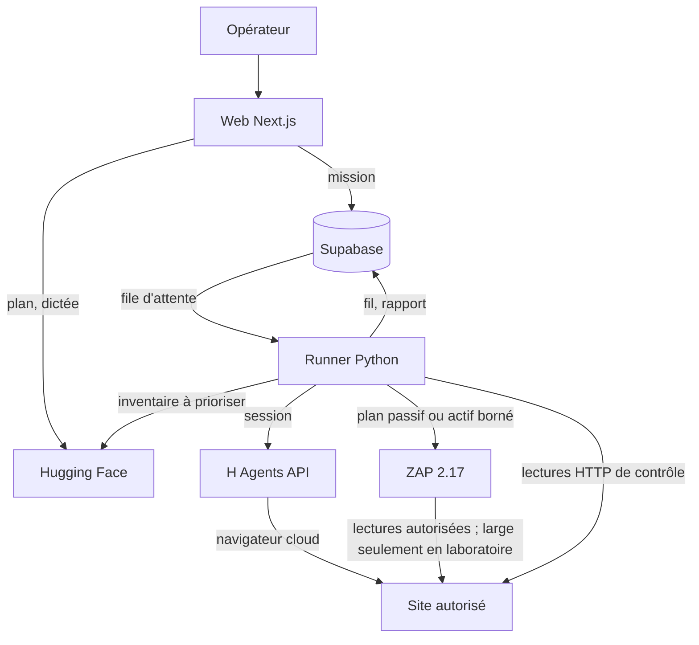
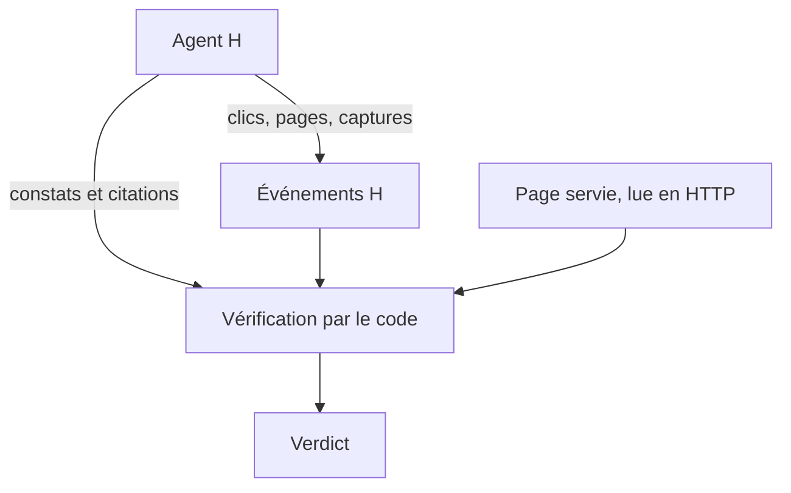
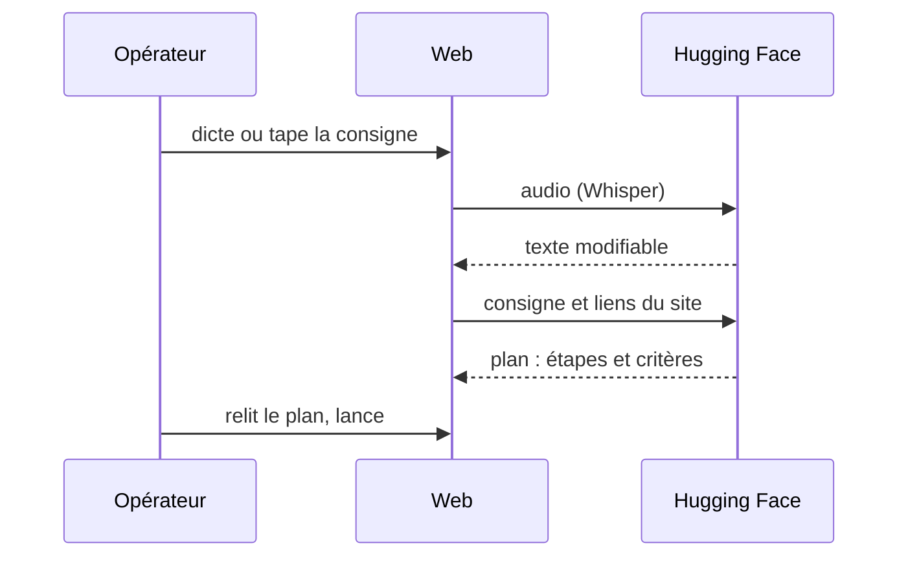
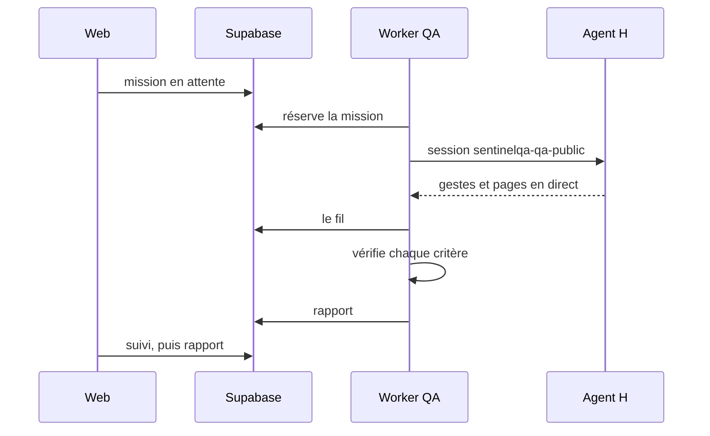
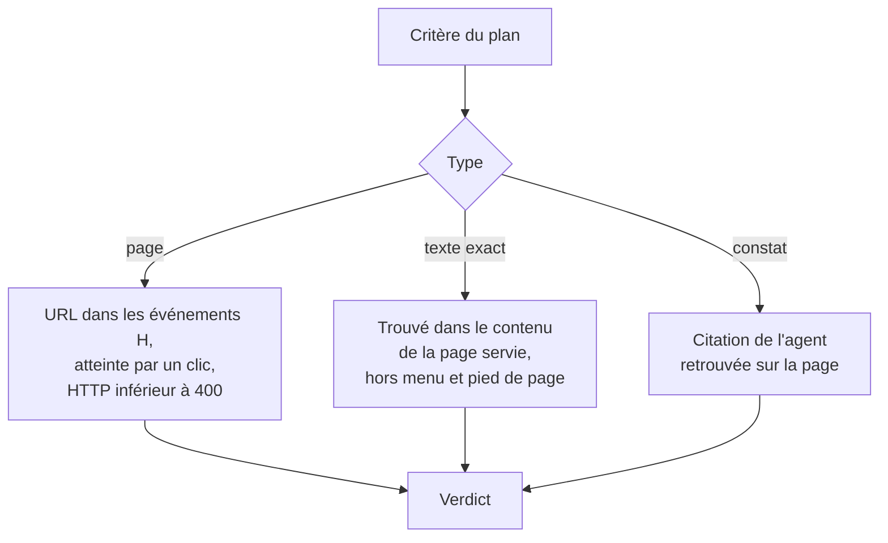
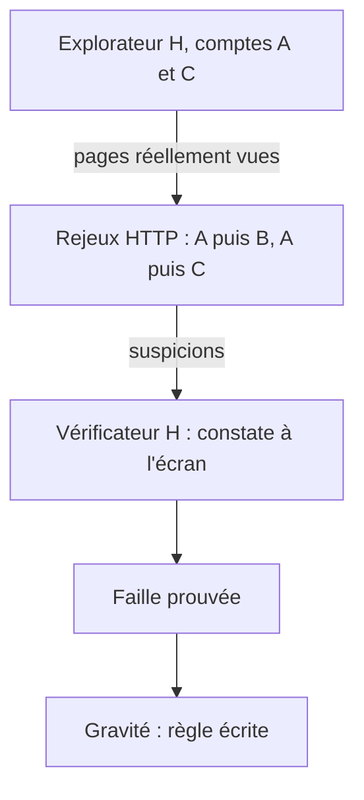
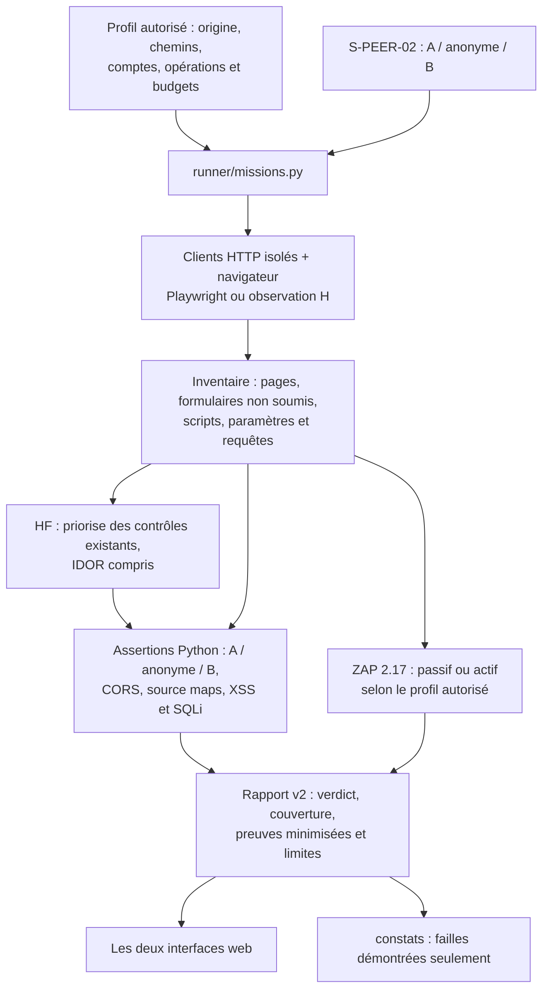
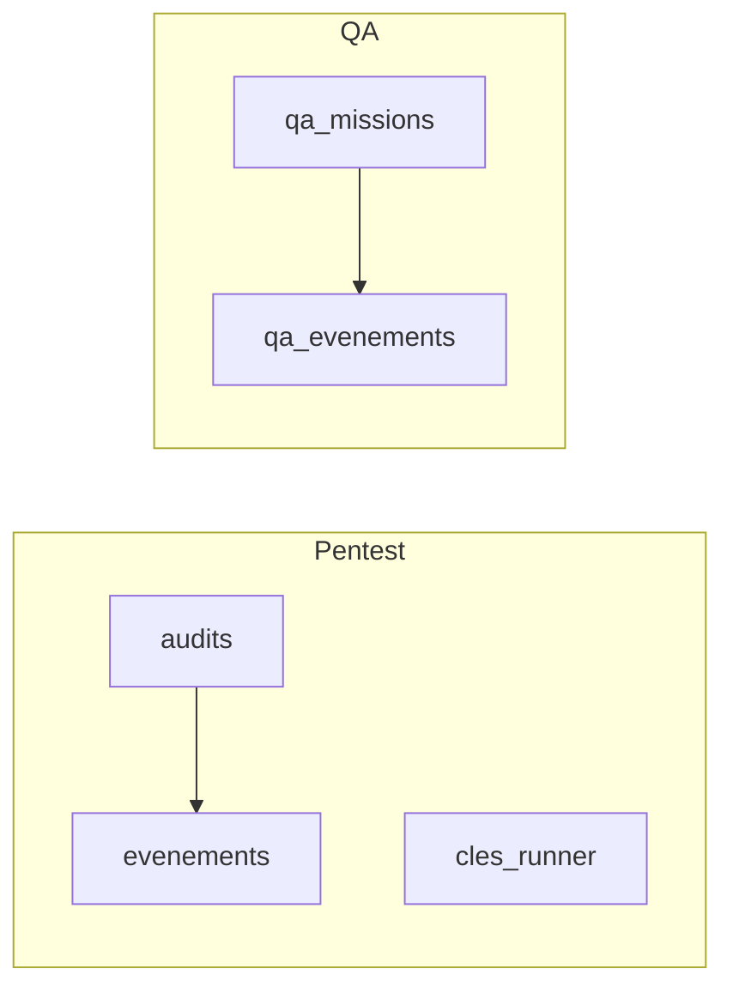
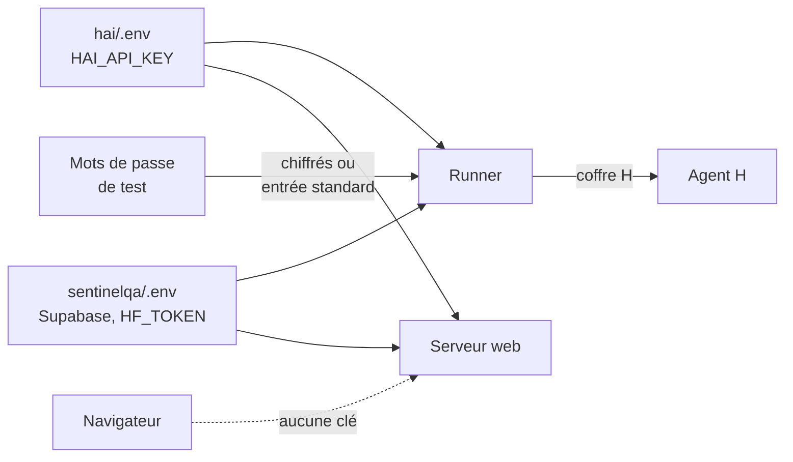

# Architecture de HSentinel

> État au 20/11/2026, 10 h 50 : décisions D-55 à D-59 intégrées (section 11), carte du code à jour (section 13) ; le reste relu contre le code et les rapports d'exécution le 19/11 à 16 h 45. Depuis le 18/11 à 19 h 39, l'équipe travaille dans l'espace H de Jahdiel. Ce document décrit ce qui tourne aujourd'hui, brique par brique : une idée par section, avec son schéma, ses fichiers et ses mesures. Ce qui reste à faire est dans [SUIVI.md](SUIVI.md). La section 6 décrit le scanner générique livré et le contrôle d'accès intégré.

0. [Ce qui a changé depuis le document du 17/11](#0-ce-qui-a-changé-depuis-le-document-du-1711)
1. [Vue d'ensemble](#1-vue-densemble)
2. [Le principe : l'agent montre, le code décide](#2-le-principe--lagent-montre-le-code-décide)
3. [Volet QA : le trajet d'une mission](#3-volet-qa--le-trajet-dune-mission)
4. [Volet QA : comment un critère est vérifié](#4-volet-qa--comment-un-critère-est-vérifié)
5. [Volet Pentest : le banc Paie Express](#5-volet-pentest--le-banc-paie-express)
6. [Volet Pentest : scanner générique et Peer Review](#6-volet-pentest--scanner-générique-et-peer-review)
7. [Les agents H](#7-les-agents-h)
8. [Les données dans Supabase](#8-les-données-dans-supabase)
9. [Les secrets](#9-les-secrets)
10. [Hugging Face : cinq usages, aucun verdict](#10-hugging-face--cinq-usages-aucun-verdict)
11. [La web](#11-la-web)
12. [L'état de chaque brique](#12-létat-de-chaque-brique)
13. [La carte du code](#13-la-carte-du-code)
14. [Les travaux de l'équipe hors de `main`](#14-les-travaux-de-léquipe-hors-de-main)

---

## 0. Ce qui a changé depuis le document du 17/11

Le grand document illustré déposé sur Notion le 17/11 (24 pages) est périmé : ces décisions en ont changé le fond. Il a été corrigé le 18/11 (27 pages, mêmes revirements en pages 2 et 3) ; c'est la nouvelle version qu'il faut déposer. **En cas de doute, ce document fait foi.**

| Sujet | Document du 17/11 | Aujourd'hui | Décision |
|---|---|---|---|
| Ce qu'est HSentinel | Un agent qui se comporte comme un client malveillant et vérifie qu'aucun client n'atteint les données d'un autre | Deux volets de même importance : le **QA** (le site fait-il ce qu'on attend ?) et le **Pentest** (un accès interdit est-il possible ?) | D-25, D-26 |
| Le volet QA | Le test T0, l'isolation entre entreprises : cartographie, puis rejeu | Un **test fonctionnel** : parcours dicté ou exploration bornée, vérifiés par le code ; construit et exécuté en réel | D-25, D-30 |
| Le volet Pentest | Exploration libre guidée par Hugging Face, et T1 (un accès qui reste après un changement de droits) | Des **contrôles d'accès en lecture** sur Peer Review : la barrière anonyme (S-PEER-01), et une ressource témoin lue par A mais pas par un anonyme ni par B (S-PEER-02). **T1 est retiré** des sites réels | D-24, D-26 |
| Les cibles | Une préproduction du client ; la démo sur le cobaye Paie Express | **Des sites réels autorisés** : eugeniaschool.com et Peer Review, en consultation seule. Paie Express devient un banc de calibration | D-24 |
| Les écritures | Permises sur des données de test, avec le feu vert donné au cadrage, puis remise en état | **Aucune écriture** ni aucun changement de droits sur les sites réels | D-24 |
| Les agents H | Explorateur, Vérificateur, et le Préparateur à venir pour T1 | `sentinelqa-qa-public` pour le QA public, `sentinelqa-qa-connecte` pour un site à compte ; l'Explorateur et le Vérificateur pour le banc ; `sentinelqa-pentest-acces` pour S-PEER-02. **Le Préparateur est abandonné** | D-24, D-30 |
| Le verdict | Un rejeu HTTP (pages similaires à 95 % ou plus), puis une preuve à l'écran | Banc : inchangé. QA : les preuves du code (événements H, page servie, citation de l'agent retrouvée). Peer Review : une règle d'accès écrite, vérifiée sur une ressource témoin | D-24, D-30 |
| Hugging Face | Il dit où chercher dans le pentest, et il rédige l'explication | Il prépare le **plan QA**, transcrit la **dictée** et propose des contrôles d'accès (module en cours). Il ne rend jamais le verdict | D-23, D-30 |
| La voix | Absente | Une **dictée** dans la web, qui écrit dans le même champ que la saisie | D-30, D-32 |
| n8n | Les déclencheurs : un audit à chaque déploiement (W1), les alertes (W3), un pentest régulier (W4) | **Construit par Jahdiel** (W1, W3, W4). Les workflows appellent notre base, où le runner publie les failles prouvées. Recette réelle du 19/11 : constat de test → ticket GitHub n° 7, par le rattrapage. Le webhook instantané reste refusé (403, secret à aligner) (section 14) | — |
| Supabase | 3 tables, et une extension prévue (Auth, RLS par organisation, Storage) | Une **file QA séparée** (`qa_missions`, `qa_evenements`) ; l'extension prévue n'est pas faite | D-30 |
| La web | La salle de contrôle : cadrer un audit avec trois comptes de test | Deux onglets : **QA** (studio, dictée, plan, suivi en direct, arrêt, rapport) et Pentest. Pas encore déployée | D-27, D-30 |
| La preuve de propriété de la cible | Un fichier à déposer sur la préproduction | Pour les deux sites de l'école, l'accord écrit. Pour **une application ajoutée par un client**, un jeton publié sur le site (fichier `/.well-known/hsentinel-verification.txt` ou balise meta), relu par notre serveur, plus l'attestation | D-24, D-56 |
| Le plan et les questions ouvertes | Neuf livrables et sept questions, dans le document | Tenus dans [SUIVI.md](SUIVI.md) | — |

---

## 1. Vue d'ensemble



- **Web** (`sentinelqa/web`) : on y lance une mission, on la suit en direct, on l'arrête, et on lit le rapport. Elle tourne en local et n'est pas encore déployée.
- **La console de l'équipe** (`sentinelqa/web-console`, en ligne sur https://hsentinel-console.vercel.app depuis le 19/11 (Vercel, accès par jeton d'opérateur)) : l'interface d'un camarade (v0), que Codex raccorde depuis le 18/11 au soir. Son API `/api/console` réutilise les services de la web : plan, dictée, lancement, suivi, arrêt et rapports (section 11).
- **Runner** (`sentinelqa/runner`) : deux processus Python sur un poste de l'équipe, le worker QA (`qa_worker.py`) et le runner du pentest (`sentinelqa.py --surveiller`). Ils prennent les missions dans Supabase, pilotent les agents H et vérifient les résultats.
- **H Agents API** : des agents qui voient l'écran et cliquent, dans un navigateur cloud que H fournit à chaque session.
- **Supabase** : les files de missions, le fil en direct et les rapports. Le QA et le pentest ont chacun leurs tables.
- **Hugging Face** : il prépare et transcrit, mais ne rend jamais de verdict (section 10).
- **n8n** (Jahdiel) : les déclencheurs et les alertes, branchés sur notre base. Une faille prouvée devient un ticket GitHub (vérifié le 19/11) ; le webhook instantané attend un secret aligné (section 14).

## 2. Le principe : l'agent montre, le code décide



Un agent peut se tromper ou inventer. Le verdict ne repose donc jamais sur son seul texte : il repose sur ce que H a **enregistré** et sur ce que le site **sert**.

| Verdict | Condition |
|---|---|
| **Conforme** | Une preuve relevée par le code : page atteinte dans les événements H, texte trouvé dans la page, citation de l'agent retrouvée mot pour mot |
| **Écart constaté** | Une preuve d'écart relevée par le code : erreur HTTP, texte absent de la page servie alors que c'est bien la page vue, texte anormal affiché |
| **Non concluant** | Tout le reste, y compris un écart que l'agent voit seul (« à confirmer ») |
| **Non exécuté** | La mission s'est arrêtée avant ce critère |

Ce principe est né d'une erreur réelle. Le 18/11, l'agent a vu « 3 étapes » en manquant la FAQ de la page, puis « Quatre étapes » une heure plus tard. Avec la règle, aucune de ses deux lectures n'est devenue un faux écart.

## 3. Volet QA : le trajet d'une mission

**La préparation**, avant tout agent :



**L'exécution** :



- **Deux pilotages.** Le *parcours guidé* suit la consigne de l'utilisateur. L'*exploration bornée* fonctionne sans consigne : l'agent ouvre le menu principal, 6 pages au plus, et relève les problèmes visibles.
- **Deux écrans.** Ordinateur en 1280 × 800, mobile en 390 × 844. On change de valeur par session (`overrides`), sans dupliquer l'agent.
- **La veille des mises à jour (D-43, `runner/veille.py`)**. Elle sait qu'un site a changé sans rien installer chez le client. Le worker QA lit chaque application suivie deux fois de suite, par HTTP et sans agent, toutes les 15 minutes ; `HSENTINEL_VEILLE_S` change ce rythme. L'empreinte ne garde que ce qui est identique dans les deux lectures :
  - l'identifiant de compilation de Next.js (`"b":"…"` dans les données de rendu de l'App Router, ou `/_next/static/<id>/`) ;
  - les ressources JS et CSS ;
  - les titres h1 à h3.

  Ce qui change à chaque requête n'y entre donc jamais. Si l'empreinte change, une mission QA d'exploration est créée et exécutée, et un écart prouvé devient un ticket (D-42). Un site à compte (Peer Review) est seulement signalé. Une erreur de lecture ne vaut ni changement ni mission.

  **Mesuré le 19/11** : la console est redéployée à 5 h 16 min 08 s. La veille détecte la « nouvelle compilation » à 5 h 17 min 04 s, et la mission d'exploration est faite à 5 h 17 min 34 s (2 conformes, 0 écart, 0,010 $). La console en ligne l'affiche.

  Les autres voies de détection, à proposer selon le client : l'intégration (une application GitHub, Vercel, une étape de CI) et le calendrier (W4). La console elle-même est devenue une cible QA, pour ses pages publiques seulement (`/app` et `/api` exclus).
- **Arrêt.** Le bouton de la web met `arret_demande` à vrai. Le worker annule alors la session H et garde les preuves déjà recueillies.
- **Mesures réelles du 18/11 sur eugeniaschool.com : 9 missions complètes, 0,300 $ au total, 0,033 $ et 76 s en moyenne.** Parcours guidé : 37 à 81 s, 0,011 à 0,039 $. Exploration : 86 à 160 s, 0,045 à 0,070 $. Plan Hugging Face : environ 1 s. Dictée : 1,1 à 1,6 s.
- **Répétitions du 18/11 au soir, 10 par scénario, réussite jugée par le code** :
  - parcours guidé « Bac+3 » : 10 sur 10, 29 s (22 à 40) et 0,007 $ en moyenne ;
  - exploration : 10 sur 10, avec au moins 3 pages et aucun arrêt, 103 s (79 à 147) et 0,051 $. Un essai relève un « parcours difficile » sur le menu mobile : il reste non concluant ;
  - Peer Review connecté : connexion et identité 10 sur 10, « Mon parcours » 10 sur 10, aucune évaluation ouverte, 40 s (34 à 47) et 0,015 $. Le titre de l'accueil et l'état des évaluations restent non concluants dans 10 et 5 essais : H tronque ces titres à styles mêlés (`h_text_partial`) ;
  - **piège corrigé** : H passe une session à « idle » avant d'y attacher la réponse de l'agent, jusqu'à 2 s plus tard. Lue trop tôt, une réponse donnée paraissait absente (1 essai sur 10). Le runner relit désormais la session tant qu'elle est « idle » sans réponse, 10 s au plus (`lire_fin`).
- **Site connecté (Peer Review).** Un second agent, `sentinelqa-qa-connecte`, part de la page de connexion et remplit les champs avec `fill_secret_at` : il ne voit jamais les valeurs. Le coffre H est créé pour l'essai, lié à la session, puis supprimé. Le mot de passe arrive par l'entrée standard du terminal et ne va qu'au coffre. Le code prouve la connexion (secrets remplis sur `/connexion`, puis une page de l'espace) et l'identité (un marqueur comparé, jamais recopié). Une saisie, un choix dans une liste ou un clic « envoyer », « noter », « évaluer », « commencer »… arrêtent la session. Le contrat déclare aussi des zones interdites (`chemins_exclus` ; sur Peer Review, la review du soir, `/etudiant/sessions`). Si l'une de ces pages s'affiche, la session s'arrête, quel que soit le libellé cliqué (`forbidden_page`). La mission rappelle ces interdits à l'agent (`interdits_du_site`). H enregistre les événements par lots : il a souvent déjà exécuté le geste quand la garde le voit. L'arrêt borne donc la suite, ce n'est pas un pare-feu (incident du 18/11 à 22 h 48 : une évaluation ouverte, aucune note donnée). Une lecture HTTP anonyme d'une page privée, renvoyée à la connexion, ne sert jamais de preuve. Lancement depuis le terminal, ou par la file web. Dans la file web, la demande porte le compte, et le navigateur chiffre le mot de passe avec la clé publique du runner. Le worker efface le texte chiffré de la base avant de le déchiffrer, crée le coffre, puis le supprime, même en cas d'échec. Mesures : 18 missions réelles avec le compte d'Alec, 0,259 $ au total ; les répétitions sont plus haut. Le compte B retenu pour le pentest est Moha : son authentification et son identité sont vérifiées dans S-PEER-02 le 19/11 à 11 h 45 (section 6.2), sans nouveau parcours QA mesuré avec lui. Les deux échecs historiques de Nathan ne sont plus des essais à reprendre.
- Fichiers :
  - `runner/qa_moteur.py` : mission, session, vérification, rapport, CLI ;
  - `runner/qa_worker.py` : la file ;
  - `web/app/qa/`, `web/app/api/qa/` : le studio, le suivi et le rapport.

## 4. Volet QA : comment un critère est vérifié



- **Page atteinte.** L'URL doit figurer dans les observations du navigateur. Une page ouverte en tapant son adresse ne compte pas comme atteinte par l'interface. Sur un site connecté, une page privée se prouve par la trajectoire du navigateur connecté : une lecture HTTP anonyme n'y voit que la connexion.
- **Texte exact.** Il s'agit des mots que l'utilisateur met entre guillemets. On les cherche dans la page servie, sans `nav`, `header` ni `footer` : le menu de chaque page cite les autres pages. La comparaison est normalisée : casse, accents, « Quatre » vaut « 4 ».
- **Constat.** L'agent doit citer le texte vu mot pour mot. Le code retrouve la citation, entière ou fragment par fragment. Le texte relevé par H tronque les titres à styles mêlés (« Bonne *soirée*, Alec » → « *soirée* ») : une citation introuvable pour cette raison reste non concluante, avec ce motif (`h_text_partial`).
- **Contrôles automatiques**, dans les deux pilotages :
  - chaque page visitée répond sans erreur ;
  - aucun texte anormal n'est affiché (`undefined`, `lorem ipsum`…) ;
  - en exploration, chaque lien affiché à l'écran mène à une page.
- **Signal de difficulté** : 6 clics ou plus sans changer de page, relevés dans les gestes et signalés « à revoir ». En mobile, 2 explorations sur 2 ont buté sur le menu.

## 5. Volet Pentest : le banc Paie Express



- **Paie Express** (`sentinelqa/cobaye`) : un SaaS de paie, construit par nous, avec des failles injectées et documentées (`VERITE_TERRAIN.json`). Il sert à mesurer la détection avant de toucher un vrai site.
- **Trois thèmes :**
  - **lecture** : B, d'une autre entreprise, lit les données de A ;
  - **écriture** : B modifie les données de A, seulement avec un feu vert humain, et A remet ensuite la valeur d'origine ;
  - **admin** : C, simple salarié, dépasse son rôle.
- **Une faille n'est prouvée que si le rejeu et l'agent la confirment.** La gravité ne vient pas du LLM, qui variait d'un audit à l'autre : elle vient d'une règle écrite (`runner/gravite.py`).
- **Mesures du 17/11**, sur le banc à 6 failles injectées : 59 failles prouvées sur 60 et 0 faux positif, en 10 audits. Un audit coûte de 0,13 à 0,21 $ et dure de 170 à 349 s.
- **En ligne depuis le 19/11 (D-45)** : https://hsentinel-banc.vercel.app, sans cobaye local ni tunnel. Sur Vercel, chaque instance a sa propre mémoire. Les seuls champs modifiables, le commentaire d'une fiche et la note d'une facture, vivent donc dans la table `cobaye_ecritures` (`supabase/banc.sql`), et le secret de session est fixé (`SESSION_SECRET`). Le cobaye, volontairement vulnérable, n'a que la clé publishable : la RLS ne lui ouvre que cette table, limitée à six lignes de 500 caractères au plus. En local, sans `SUPABASE_URL`, l'état reste en mémoire, comme avant. Audit réel en ligne : 6 failles prouvées sur 6, 0 faux positif, 283 s, 0,215 $.
- **Lancé depuis la console (D-46, 19/11)** : le scénario `S-BANC-01` du catalogue, sur la cible `paie-express` (`business_writes: true`). Le runner l'aiguille vers `auditer`, avec les comptes fictifs du banc ; la console n'envoie ni compte ni écriture, et lancer ce scénario vaut feu vert pour les écritures de test (le panneau le dit). Le résultat passe dans l'enveloppe v2 que la console affiche : un résultat par faille injectée (F1 à F6) et par contrôle sain (C1 à C4). L'arrêt demandé prend effet au début de l'étape suivante, après remise en état. La garde d'écriture du runner (et `cibleReelle` côté web) ne vise plus que les cibles sans écriture permise : les sites réels de D-24. Un échec pentest s'affiche « Faille prouvée », un échec QA « Écart constaté ». Mission réelle depuis la console : 6 failles prouvées sur 6, 0 faux positif, 298 s, 0,203 $.
- Fichiers : `runner/sentinelqa.py` (orchestration), `runner/agents_h.py`, `runner/gravite.py`, `runner/hf.py`.

## 6. Volet Pentest : scanner générique et Peer Review



### 6.1 Scanner black-box sur profil, livré

Le moteur se trouve dans `sentinelqa/runner/pentest/`, son interface en `python -m pentest.cli`. **Une URL seule ne suffit pas** : il faut un profil relu qui enregistre l'autorisation, l'origine, les chemins, les lectures confirmées, les comptes éventuels, les exclusions et les budgets. Le même code sert au banc fictif, à Juice Shop auto-hébergé et aux sites réels ; seules les données du profil changent.

- **Découverte** : `inventaire.py` lit les liens, formulaires, scripts et source maps déclarés. `navigateur.py` observe le rendu et les requêtes ; `h_decouverte.py` adapte les observations de H. Aucun formulaire métier n'est soumis ; seule la connexion explicitement configurée peut l'être.
- **Authentification générique** : `modeles.py` définit des adaptateurs `form` et `bearer`, sans nom de site ni secret en dur. `authentification.py` crée un client et un cookie jar par compte, vérifie un marqueur d'identité, et tente au plus un renouvellement après expiration. Un jeton Bearer n'est envoyé qu'à l'origine de la cible, jamais à un asset tiers. Les secrets sont référencés par noms de variables d'environnement.
- **Matrice IDOR générique** : `acces.py` exécute A, anonyme et B sur des ressources déclarées ou des opérations `access_control: owner_only` réellement observées dans l'inventaire. A doit recevoir le témoin privé dans une réponse valide ; la réception de ce témoin par B est une fuite même sous HTTP 500. Une coquille 200, une ressource absente, une redirection externe ou une session expirée ne prouvent pas un refus. Chaque preuve porte le rôle et la session Python. La console affiche cette matrice à part, sans la confondre avec `S-BANC-01` ou `S-PEER-02`.
- **Frontière réseau** : `politique.py` refuse les identifiants dans l'URL, les requêtes sensibles, les chemins interdits après décodage, les redirections externes et les réseaux privés hors laboratoire. Les lectures sont en GET ; le seul POST du client générique est le chemin de connexion déclaré. L'IP validée est celle du socket ouvert ; Chromium reçoit la correspondance DNS validée. Durée, requêtes, profondeur, délai et taille sont bornés.
- **Contrôles** : `controles.py` couvre en-têtes et cookies, ressource privée connue, CORS, source maps, XSS réfléchie et SQLi booléenne. Un identifiant présent dans l'URL n'est jamais un témoin privé. Une simple réflexion ou une différence booléenne sans impact ne suffit pas ; la XSS exige l'exécution d'un marqueur JavaScript local, sans exfiltration.
- **ZAP** : `zap.py` utilise l'Automation Framework 2.17.0. Le profil courant du banc allowliste `40012`/`40018`, toutes les autres à `OFF`, et ne cible que la query. Le profil `local-blackbox-complet.json` permet `active_rule_ids: ["*"]` sur notre laboratoire. Ce mode large reste réservé au laboratoire : la campagne réelle a montré que des règles peuvent émettre des POST malgré `postData: false`. L'API locale jetable de ZAP lit `ascan/view/scans` et enregistre `reqCount`, la progression et l'état ; les rapports bruts restent hors du dépôt et de Supabase.
- **HF** : `hf.py` accepte `xss_reflected`, `sqli_read` et `idor_access`, uniquement sur un `endpoint_id` et un contrôle déjà autorisés, avec preuve liée. Le modèle ne fournit ni cible, ni commande, ni charge utile, ni verdict. Les propositions IDOR déclenchent réellement la matrice, y compris sans scan actif ; les autres ressources restent couvertes par le chemin déterministe. Erreur, jeton absent ou JSON invalide produisent `deterministic_fallback`. Latence, tokens et `usage.cost` sont conservés quand HF les retourne.
- **Verdicts** : `demonstrated_vulnerability`, `configuration_weakness`, `observation` et `tool_candidate` restent distincts. Une alerte ZAP reste non concluante jusqu'à une assertion déterministe. Les preuves ne conservent ni corps, cookies, identifiants, valeurs de query, charges utiles ou secrets.
- **Intégration et mesures** : `S-GEN-DISCOVERY-01` reste disponible pour `peer-review` et `eugenia-public` ; `S-GEN-ACTIVE-01` reste indisponible sur ces cibles. Le rapport porte couverture IDOR, sources, méthodes et compteurs ZAP. Les mutations sont mesurées par un observateur du banc, pas devinées ; en actif sans observateur, elles restent non mesurées. La mission `f2d78555-d0f7-4ffb-befd-c265193192c9` a validé le trajet Chromium → Supabase → worker → console.
- **Alertes** : seules les violations `failed + demonstrated_vulnerability` deviennent des constats `http`. Le test du worker vérifie le rejet des candidats et de la configuration ; aucune nouvelle publication W3 réelle n'a été déclenchée pendant cette validation.

**Campagnes réellement exécutées** (quatre compteurs : `passed / failed / inconclusive / skipped` ; un `failed` de configuration n'est pas une vulnérabilité) :

| Cible et rapport local | Résultats | Preuves et couverture |
|---|---|---|
| Banc complet, IDOR + DAST large — `sentinelqa/rapports/rapport-20261119-163636-562026.json` | **35 / 10 / 24 / 0** ; **6 vulnérabilités fictives uniques**, 3 assertions de configuration et 17 candidats | Campagne `daa3bb11-5bf4-422b-be87-25be32aa1cd9` ; 7 ressources IDOR dont une découverte, deux identités vérifiées, 4/4 opérations actives. HF réel : 2 419 tokens, 42,842 s, 0,00049728 $ ; ZAP : 1 028 requêtes actives, terminé à 100 % ; 1 116 requêtes au total, 215,51 s et 0 mutation mesurée par le banc |
| Peer Review, passif, nouveau parcours — `sentinelqa/rapports/rapport-20261119-163834-769931.json` | **5 / 0 / 7 / 0** ; **0 vulnérabilité démontrée**, 7 candidats | Campagne `16c90a28-d7d6-4515-a7c4-3d91375f4ae4` ; session H `901fd157-cb65-47b2-8ff5-fb366845da11`. 2 ressources, 5 requêtes Python, 2 passives ZAP, 0 actif et 0 mutation ; 82,9 s, 0,00645764 $ H |
| Banc fictif, actif — `sentinelqa/rapports/pentest-blackbox-local.json` | **16 / 12 / 15 / 0** ; **5 vulnérabilités fictives uniques**, 5 assertions de configuration et 15 candidats | Campagne `8c5da44c-4889-46de-9b69-9772105805e0` ; XSS, SQLi, fuite privée sous 500, CORS privé et source map privée ; les 4 contrôles sains passent. 14 ressources, 4 opérations actives sur 4, 2 formulaires vus sans soumission, 60 requêtes Python/navigateur et 4 `requestor` ZAP. Aucune mutation |
| Peer Review, passif — `sentinelqa/rapports/pentest-peer-review.json` | **5 / 0 / 7 / 0** ; **0 vulnérabilité démontrée**, 0 écart de configuration, 7 candidats non confirmés | Campagne `47d2c9b2-add7-4ab8-b345-6992e237002a` ; session H réelle `f8857811-3a2c-41ba-b84e-17835498b338`. 2 ressources, 2 formulaires vus sans soumission, 5 requêtes Python et 2 passives ZAP. ZAP `completed`, `active: false`. Le petit budget a limité les assets |
| Juice Shop auto-hébergé, actif — `sentinelqa/rapports/pentest-juice-shop.local.json` | **3 / 1 / 3 / 0** ; **0 vulnérabilité démontrée**, 1 assertion de configuration, 2 candidats | Campagne `2a04dfdd-59c5-4ac5-867f-f45237e29edc`, 27,52 s. 4 ressources, 1 opération active sur 1, 11 requêtes Python et 1 `requestor` ZAP. SQLi `inconclusive / sql_injection_impact_unverified` ; alertes ZAP `40018` et `10098` non promues en failles. Instance locale arrêtée après le contrôle |
| Peer Review, passif, console et file réelles — `sentinelqa/rapports/rapport-20261119-110201-825934.json` | **5 / 0 / 7 / 0** ; **0 vulnérabilité démontrée**, 0 écart de configuration, 7 candidats | Mission `f2d78555-d0f7-4ffb-befd-c265193192c9`, campagne `e0bdaa16-6365-4f6b-bf6d-2e859a135689`, session H `8e3a2083-b5ac-4b3a-a068-88c0136d7c8b`. 11 ressources, 14 requêtes Python/navigateur, 2 `requestor` ZAP, 2 formulaires vus sans soumission, 0 mutation. 66,71 s, 0,00703552 $ H. L'API et l'écran de la console restituent les 12 résultats et leurs limites |

Sur le banc, les 117 GET vus par le serveur n'ont touché ni `/mutate`, ni `/logout`, ni `/reviews`. Les 12 lignes `failed` ne signifient donc pas 12 vulnérabilités : les 5 failles uniques, la configuration et les candidats sont comptés séparément. **Aucune absence de vulnérabilité démontrée sur Juice Shop ou Peer Review ne signifie que le site est sûr.**

Les rapports locaux sont ignorés par Git. Dans les quatre campagnes initiales, HF était absent ou désactivé et le compteur actif de ZAP n'était pas collecté. Depuis la campagne `daa3bb11-5bf4-422b-be87-25be32aa1cd9`, l'appel HF, ses tokens, son coût et les 1 028 requêtes actives ZAP sont mesurés. Le nouveau Peer Review passif n'appelle pas HF, faute de contrôle éligible configuré. Le secours déterministe et les erreurs de fournisseur restent couverts par les tests.

### 6.2 Contrôle d'accès A / anonyme / B

- **S-PEER-01** (`runner/missions.py`) : un GET anonyme de `/etudiant`, puis un constat à l'écran par `sentinelqa-pentest`. Exécuté en réel le 19/11 à 2 h 52 depuis la console : 307 vers `/connexion`, page de connexion vue par H, 24 s et 0,004 $.
- **S-PEER-02 est intégré** : `runner/missions.py` appelle `contributions/kimi-pentest/controle_acces.py` ; les deux interfaces le proposent. Le scénario exécute `legitimate_read`, `anonymous_read` puis `cross_actor_read`, avec clients HTTP isolés, contrôle positif et preuves attribuables. Une observation H anonyme inutilisable n'interrompt plus B ; une fuite sous HTTP 500 prime sur le statut ; une règle incomplète donne `skipped` au lieu de planter. Un identifiant présent dans l'URL ne peut pas servir de témoin privé : cette entrée est rejetée avant toute requête. Les 25 tests du module passent, revue de Codex incluse.
- **Entrées privées** : uniquement `HSENTINEL_PEER_ENTREES`, dans l'environnement du runner ; aucun compte ou mot de passe dans le catalogue, la mission ou le rapport. Sans ces entrées, le rapport local `pentest-peer-acces-sans-prerequis.json` contient exactement 3 lignes `skipped / missing_preconditions`, sans requête HTTP ni session H.
- **Exécution complète via `missions.executer_mission` (19/11, 11 h 45), avec Alec (A) et Moha (B)** : 9 requêtes HTTP Python et trois observations H vérifiées. A reçoit le témoin privé attendu (`passed`), l'anonyme est redirigé vers `/connexion` (`passed`), et Moha, correctement authentifié et identifié, reçoit HTTP 200 sans le témoin privé de A (`inconclusive / denial_unverified`). Ce 200 n'est pas un refus explicite : **aucune fuite n'est démontrée**, et le contrôle ne porte que sur cette ressource. Bilan 2/0/1/0 (`passed/failed/inconclusive/skipped`), 106,27 s, 0,0346595 $ H, aucune écriture métier. Sessions H : A `b492c9bb-2288-4cfd-8bd0-61e5af16cd2a`, anonyme `f4499e68-6b45-445f-a00d-ac3cb474eae7`, B `f6c42e1d-ff72-487e-87e2-458f9e7e965c`. Rapport local expurgé : `sentinelqa/rapports/rapport-20261119-114623-971079.json`.
- **Témoin et historique** : le marqueur de la ressource est le texte d'identité privée de A, absent de l'URL ; l'identifiant de session dans l'URL ne sert pas de témoin. Le triplet HTTP du 18/11, sans nouvelles navigations H, reste dans `contributions/kimi-pentest/preuves/rapport-acces-http-reel-2026-11-18.json`. Nathan n'est plus le compte B à tester.
- **Session H** : la course `idle` sans réponse est corrigée dans le runner et dans `agent_acces.py`. La définition de `sentinelqa-pentest-acces` ne contient plus `about:blank` ; sa relecture tolère notamment le `start_url` ajouté par H. L'agent a été confirmé dans l'espace de Jahdiel le 18/11 à 20 h 38.
- **Ancienne contribution HF** : `contributions/hf-pentest/` reste un banc distinct de compilation d'hypothèses vers S-PEER-02. Son appel réel synthétique (23,7 s, 1 492 tokens) ne doit pas être confondu avec le secours HF du nouveau scanner générique.

**Règle inchangée sur les sites réels** : découverte passive uniquement dans le scanner générique, aucune écriture métier ni changement de droits. Le seul POST du contrôle d'accès spécialisé est celui de la connexion autorisée.

## 7. Les agents H

| Agent | Rôle | Défini dans | État |
|---|---|---|---|
| `sentinelqa-qa-public` | QA : parcours guidé et exploration d'un site public | `runner/qa_agent.py` | Créé et confirmé à 19 h 40 ; mission réelle conforme à 19 h 41 |
| `sentinelqa-qa-connecte` | QA sur un site à compte : connexion par coffre, puis consultation | `runner/qa_agent.py` | Créé et confirmé à 19 h 40 ; mission réelle à 19 h 42 (connexion et identité prouvées) |
| `sentinelqa-explorateur` | Banc Paie Express : cartographie | `runner/agents_h.py` | Créé et confirmé à 19 h 40 |
| `sentinelqa-verificateur` | Banc Paie Express : preuve à l'écran | `runner/agents_h.py` | Créé et confirmé à 19 h 40 |
| `sentinelqa-pentest` | S-PEER-01 | `runner/agents_missions.py` | Créé et confirmé à 19 h 40, définition corrigée (sans `about:blank`) ; exécuté en réel le 19/11, conforme |
| `sentinelqa-pentest-acces` | S-PEER-02 | `contributions/kimi-pentest/agent_acces.py` | Définition locale sans `start_url` ; relecture compatible avec la valeur Bing ajoutée par H, test complet sans PATCH ; 25 tests du module réussis le 19/11. Présent dans l'espace de Jahdiel, confirmé conforme à 20 h 38 |
| `hsentinel-explorateur`, `-verificateur`, `-preparateur` | Le bac à sable de Mohamed : cartographie, preuve, T1 | branche `agents-ia-qa-pentest` | Dans l'ancien espace seulement ; hors de `main` (section 14) |

- Tous utilisent `holo4-35b-a3b`, en mode visuel. Le texte affiché (`markdown: true`), que H joint à chaque capture, n'est demandé que par les agents QA et par `sentinelqa-pentest-acces` : c'est là que le code retrouve les citations. Les agents du banc et `sentinelqa-pentest` ne le demandent pas. En QA, `holo4-27b` peut être choisi par session.
- **Le réglage de chaque session reste dans notre code** : URL de départ, écran et format de réponse (`answer_schema`, Pydantic). La définition d'un agent QA est relue après chaque enregistrement : la comparaison tolère les valeurs par défaut que H ajoute, mais refuse un coffre, un profil ou un proxy hérités.
- **L'espace H.** Depuis le 18/11 à 19 h 39, l'équipe travaille dans l'espace de Jahdiel (Aurian administrateur ; 3 sessions simultanées). Les agents dont l'état ci-dessus indique « créé et confirmé » y ont été créés par le code lui-même ; les sessions et replays d'avant restent dans l'ancien espace.
- **Aucune page de départ dans une définition.** Le 18/11 vers 18 h 40, l'ancien espace a cessé de relire les agents enregistrés avec `about:blank` (500 au GET comme au PATCH), et H refuse désormais cette valeur à la création (422). Chaque session impose sa page de départ (`overrides`), et un test le garantit pour tous les agents du runner.
- **Le QA public n'utilise aucun coffre ; le QA connecté, un par essai.** Le pentest en utilise un par compte de test : l'agent remplit le mot de passe sans jamais le voir (`fill_secret_at`).

## 8. Les données dans Supabase



| Table | Contenu |
|---|---|
| `audits` | Une demande de pentest (cible, comptes sans mot de passe, statut, rapport JSON), ou une mission du premier lot (`rapport.schema_version` 2) |
| `evenements` | Le fil d'un audit : étapes, sessions, preuves |
| `cles_runner` | La clé publique du runner, qui chiffre les mots de passe dans le navigateur |
| `qa_missions` | Une mission QA : la demande validée (consigne, plan, écran), `arret_demande`, le rapport |
| `qa_evenements` | Le fil d'une mission QA : étapes, gestes, pages, critères |
| `applications` | Ce qu'on a le droit de tester, et comment : autorisation (D-24), profils QA et pentest, destinataire des alertes (`supabase/alertes.sql`, appliqué le 18/11). Depuis D-56, aussi les applications ajoutées par un client : `profil_qa`, attestation, jeton et date de vérification, retrait doux (`supabase/applications-client.sql`, appliqué le 20/11) |
| `comptes_test` | Les comptes de test d'une application ajoutée : libellé, identifiant, nom affiché, et le mot de passe **chiffré pour le runner** (jamais en clair) avec la clé qui l'a chiffré (D-56) |
| `constats` | Une ligne par faille prouvée ou par écart QA prouvé par le code, avec le suivi de son alerte n8n (ticket GitHub, e-mail). Thèmes `lecture`, `ecriture`, `admin`, `compte`, `qa`, `http` ; un écart QA porte son `critere`, qui entre dans l'empreinte. Jamais de donnée du site testé |

- **Une file par volet, côté interface.** La web envoie le QA dans `qa_missions`, que seul le worker QA lit, et le pentest dans `audits`, que lit le runner du pentest. L'ancien parcours QA du premier lot (Q-PUB-01, D-27) existe encore dans le code : `/api/audits` l'accepte et le runner du pentest le traiterait, mais l'interface ne le propose plus.
- **Cycle d'une mission** : `en_attente`, puis `en_cours`, puis `termine` ou `echec`. La réservation est atomique : elle met le statut à jour seulement s'il vaut encore `en_attente`.
- **Sécurité** : le RLS est activé, sans aucune politique. Seule la clé secrète, utilisée par le serveur web et par le runner, lit et écrit ; la clé publique ne voit rien (vérifié dans les deux sens). Une exception depuis le 19/11 (D-45) : la table du banc en ligne, `cobaye_ecritures`, est ouverte à la clé publishable ; les autres tables lui restent fermées (vérifié).
- Schémas : `supabase/schema.sql` pour le pentest, `supabase/qa.sql` pour le QA.
- **Les alertes vivent dans notre base** (choix d'Aurian, 18/11 à 21 h, D-38). `supabase/alertes.sql` y est appliqué : tables `applications` et `constats`, fonctions appelées par n8n, déclencheur `constat_ajoute`. Les deux secrets du webhook W3 sont dans le coffre Supabase depuis 21 h 51, et le runner publie chaque faille prouvée du banc (`runner/constats.py`). **Recette réelle (19/11, 1 h 36 à 1 h 49)** : un constat de test du banc (Paie Express, `GET /fiches-de-paie/1041`, critique) est écrit par `constats.py`. Le déclencheur appelle bien W3, mais n8n refuse l'appel : le webhook instantané de W3 est refusé par n8n (403 « Authorization data is wrong! ») : son identifiant « Secret webhook Supabase W3 » ne porte pas l'en-tête `x-hsentinel-secret` avec la valeur de notre coffre (Jahdiel). Le rattrapage de W3, toutes les 15 min, a repris le constat. Il a créé le ticket GitHub n° 7 : étiquettes, raisons, preuve, piste de correction, aucune donnée du site testé. Il a ensuite noté l'état « traitée » dans la base, sans e-mail faute de destinataire. La page Alertes de la console l'affiche avec son lien. Republié une seconde fois, le même constat ajoute au ticket n° 7 le commentaire « Toujours présente », sans nouveau ticket (2 h 04).
- **Aucune faille publique sur un site tiers (D-44, 19/11)**. Le dépôt des tickets est public. `applications.tickets_publics` vaut vrai pour nos seules applications : le banc Paie Express, le banc boîte noire et notre console. Pour un site tiers (Eugenia, Peer Review), `preparer_alerte` ne crée aucun ticket. Le constat passe à l'état `reservee` et reste visible dans la console ; l'équipe prévient le propriétaire directement. Le scanner HTTP (`runner/pentest`) est branché sur les tickets par `constats.lignes_scan` : seules ses failles démontrées (`failed + demonstrated_vulnerability`) comptent, jamais un candidat ZAP ni une faiblesse de configuration, avec une gravité écrite par contrôle (injection SQL « critique », XSS, CORS et ressource privée « élevée », source map « moyenne »). Le worker appelle cette conversion pour `S-GEN-*` ; le test local couvre le filtrage, sans déclencher W3.
- **Trois sources de constats (D-42, 19/11)** :
  - les failles prouvées du banc (`constats.publier`) ;
  - les écarts QA prouvés par le code, publiés par le worker QA à la fin de chaque mission (`constats.lignes_qa`) ;
  - les failles prouvées d'une mission pentest, publiées par le worker pentest (`constats.lignes_mission`).

  Pour un écart QA, la règle de gravité est écrite : une page en erreur 5xx est « élevée », un lien cassé « faible », le reste « moyenne ». K1 et K2, qui décrivent la mise en place du test, n'ouvrent jamais de ticket. Sur un site connecté, le texte attendu n'est pas recopié : une référence courte le remplace. Le ticket QA porte les étiquettes `qa` et `regression`, et une ligne « Critère ». S-PEER-01 ne peut pas prouver de faille (il rend conforme ou non concluant) ; S-PEER-02, désormais raccordé, le peut sous le thème `compte`. Recette réelle du 19/11 : une mission lancée depuis la console en ligne, avec un critère volontairement faux (« Bac+8 »), est rapportée en écart et publiée comme constat. Le rattrapage de W3 en fait le ticket n° 8 (3 h 33) : étiquettes `qa` et `regression`, ligne « Critère », preuve par le code et par le parcours. La console en ligne l'affiche. Ce ticket de recette est ensuite fermé avec une explication, et le constat de recette est retiré. Restent : aligner le secret du webhook, poser `github_webhook_secret` pour W1 et choisir un destinataire d'e-mail.

## 9. Les secrets



- **Aucune clé dans le dépôt.** Les clés vivent hors du dépôt, avec les droits 600. Le `.gitignore` fonctionne en liste blanche.
- **Le navigateur ne voit aucune clé.** Les appels à Hugging Face, à Supabase et aux captures H passent par le serveur web.
- **Les mots de passe des comptes de test** suivent trois chemins, et finissent toujours dans un coffre H : l'agent les remplit sans les voir (`fill_secret_at`).
  - **Banc Paie Express, depuis la web** : chiffrés dans le navigateur avec la clé publique du runner (RSA-OAEP, 3072 bits). Supabase ne garde que le texte chiffré ; le runner le déchiffre en mémoire, remplit les coffres, puis l'efface.
  - **QA connecté, depuis le terminal** : le mot de passe arrive sur l'entrée standard du runner et va dans un coffre créé pour l'essai, supprimé à la fin. Il n'est écrit nulle part.
  - **QA connecté, par la file web** : chiffré dans le navigateur (RSA-OAEP, SHA-256, clé publique de `cles_runner`, que le worker publie au démarrage). Le worker retire le compte de `qa_missions` avant de le déchiffrer en mémoire, le verse dans un coffre propre à la mission, puis supprime ce coffre. Les lectures de la web retirent le texte chiffré (`sansSecret`).
  - **Application ajoutée par un client (D-56)** : chiffré dans le navigateur à l'enregistrement du compte (même clé), gardé chiffré dans `comptes_test` pour les missions suivantes. À chaque mission, le worker le déchiffre en mémoire et le verse dans un coffre H propre à la mission, supprimé à la fin ; le retrait de l'application supprime ses comptes.
  - **S-PEER-02 (intégré au runner)** : `HSENTINEL_PEER_ENTREES` fournit les comptes A et B uniquement à l'environnement privé du processus. Un coffre par acteur, `sentinelqa-peer-review-a` et `-b`, est rempli à chaque exécution ; HF ne reçoit jamais ces entrées. Sans elles, aucun coffre ni requête n'est créé.
- Piège connu : `holo login` écrit la clé entre guillemets. Il faut les retirer à la lecture, sinon H répond 403.

## 10. Hugging Face : cinq usages, aucun verdict

| Usage | Modèle | Où | Mesure |
|---|---|---|---|
| Plan QA : consigne vers étapes et critères | Llama 3.3 70B, par le routeur HF | `web/lib/qa.js`, `runner/qa_moteur.py` | Environ 1 s |
| Dictée : audio vers texte modifiable | Whisper large v3 turbo (licence MIT) | `web/lib/qa.js` | 1,1 à 1,6 s |
| Banc Paie Express : attaques à tenter, avant les rejeux | Qwen2.5-72B | `runner/hf.py` | De 13 à 99,5 s selon les essais |
| Peer Review : contrôles d'accès à jouer, à partir d'un inventaire | Qwen3-32B | `contributions/hf-pentest`, banc distinct | 23,7 s pour un appel réel, sur un inventaire synthétique |
| Scanner générique : priorisation XSS, SQLi et IDOR | Qwen3-32B par défaut, configurable par profil | `runner/pentest/hf.py` | **Appel réel mesuré** dans `daa3bb11-5bf4-422b-be87-25be32aa1cd9` : 2 419 tokens, 42,842 s, 0,00049728 $ ; route IDOR découverte exécutée. Schémas valides, invalides et erreurs aussi testés |

- Ce que propose Hugging Face est toujours relu : par l'utilisateur pour le plan, par le code pour le verdict. Dans le scanner, le modèle ne crée aucune permission et ne choisit que des identifiants existants.
- Le routeur Hugging Face annonce OpenRouter comme fournisseur réel de Llama 3.3 70B (mesuré le 18/11).

## 11. La web

| Page | Rôle |
|---|---|
| `/` | L'accueil : les derniers relevés |
| `/audits/nouveau` | Lancer une mission : onglet **QA** (le studio, avec la dictée) ou onglet **Pentest** |
| `/qa`, `/qa/[id]` | Le studio QA et l'historique ; le suivi en direct, puis le rapport |
| `/audits/[id]` | Le suivi et le rapport d'un audit pentest |
| `/examen` | L'index des relevés pentest, par date, application ou thème |

- **Routes QA** (`app/api/qa/`) : `plan`, `transcription`, `missions`, `missions/[id]`, `missions/[id]/arret`, `captures`.
- **Accès** : `proxy.js` réserve tout à l'opérateur. En développement, seule la boucle locale est admise ; en production, il faut le jeton `HSENTINEL_OPERATOR_TOKEN`. Chaque écriture vérifie l'origine de la requête contre l'hôte réellement appelé (`Host`, ou `X-Forwarded-Host` derrière un proxy). Elle ne compare jamais à `request.url`, que Next réécrit en « localhost » en développement : le 19/11, toutes les écritures de la console étaient ainsi refusées sur 127.0.0.1, dictée comprise. Une seule garde, `web/lib/acces-operateur.js`, sert les deux webs.
- **Captures** : celles de l'agent restent chez H. Le serveur web les relaie (`/api/qa/captures`), et seules les adresses de la trajectoire de la session passent.
- Next.js 16 et React 19, sans autre dépendance. Le build de cette web utilise `next build --webpack` : Turbopack échouait au téléchargement des trois polices Google alors que le réseau et le téléchargeur de Next fonctionnaient isolément. Webpack, déjà utilisé par la console, préserve les mêmes polices et le même rendu ; les deux builds de production passent le 19/11.
- **Rapport du scanner dans les deux interfaces** : choix explicite de la cible, couverture, règles sautées, classifications, détail HF et compteurs. `web-console/lib/access-matrix.mjs` construit la matrice IDOR générique, rendue dans les audits et dans `mission-detail.tsx` ; les identités et les méthodes réellement envoyées sont affichées. Les failles, la configuration et les candidats ZAP ne sont pas fusionnés ; les URL de preuves perdent query et fragment. La console a **43 tests unitaires**, une recette Chromium dédiée à la matrice, TypeScript et build de production réussis. La recette réelle `f2d78555-d0f7-4ffb-befd-c265193192c9` conserve le trajet Chromium → Supabase → worker → console ; le laboratoire est affiché avec une mission fictive isolée, sans écrire dans Supabase.

**La console de l'équipe, `sentinelqa/web-console`** : l'interface d'un camarade, exportée de v0 (TypeScript, Tailwind, shadcn), que Codex raccorde depuis le 18/11 au soir. **En ligne : https://hsentinel-console.vercel.app**, sur Vercel, depuis le 19/11 à 3 h.

- **Déploiement** : le projet Vercel `hsentinel-console` est réglé sur `rootDirectory = web-console` et Node 24.x. On compile en local, où les modules voisins (`web/lib`, `contrats/`) existent, puis on publie le résultat compilé : `cd sentinelqa && vercel build --prod && vercel deploy --prebuilt --prod`.
- **Le style (D-48, 19/11)** : celui de « project 2 », une itération v0. Le thème est clair par défaut et sombre au choix : `AppShell` lit le cookie `hs_theme` côté serveur et pose `#console-root[data-theme]` avec la classe `.theme-console`, ce qui évite tout flash ; la bascule (`theme-toggle.tsx`) réécrit le cookie et l'attribut. Les jetons sont dans `app/globals.css`, dont `--warn` (ambre) et `--high` (orange) pour la gravité. Les polices de la marque sont servies par `next/font/local` depuis `app/polices` : la compilation ne dépend plus de Google Fonts, dont la récupération échoue sur nos postes (D-32). Les données fictives de project 2 (crédits, facturation, diagnostic) n'ont pas été reprises. Tant qu'un autre agent a des changements en cours dans le catalogue ou la console, on compile depuis une copie propre (HEAD et ses propres changements).
- **Tester le SaaS de son choix (D-56, 20/11)** : « Ajouter une application » (`/app/applications/nouvelle`) en trois gestes. (1) L'adresse https d'un nom de domaine public et l'attestation. (2) Le jeton de vérification, aléatoire et stable pour l'adresse, que le client publie ; « Vérifier » le relit depuis notre serveur. (3) Les comptes de test, chiffrés dans le navigateur pour le runner (`comptes_test`), choisis ensuite dans le studio. Le profil QA de l'application est construit par le serveur (`web/lib/applications-contrat.mjs`, consultation seule, budgets fixes) et revérifié par le runner (`runner/applications.py`), qui refuse aussi toute adresse privée. Aucun pentest n'est ouvert sur une application ajoutée. L'expert propose « Ajouter cette application » (adresse citée, pré-remplie) ou « Ajouter un compte de test » au lieu de bloquer : la règle est écrite dans `web-console/lib/expert/actions.mjs`. Victime de démo : Ardoise (`sentinelqa/ardoise/`, https://ardoise-demo-ruddy.vercel.app), trois défauts plantés documentés dans `DEFAUTS.md`.
- **La visite guidée (D-59, 20/11)** : `web-console/lib/visites.ts` décrit une visite par page (des cibles par sélecteurs stables, une bulle courte) ; `components/console/visite-guidee.tsx` place un « ? » dans la barre du haut, puis un voile, un halo, un curseur (transform seul) et la bulle, rendus dans `#console-root` pour garder les couleurs de la console. Une cible absente ou cachée est sautée ; la visite ne clique ni ne lance rien ; la visite vue est mémorisée dans le navigateur.
- **Pertinence avant lancement (D-57 bis, 20/11)** : avant le modèle, des règles écrites (`lib/expert/actions.mjs`) traitent la dictée coupée (`questionTronquee`, on redemande) et la chasse aux bugs (`intentionExploration`, une exploration proposée et prouvée par le code). Après lui, une consigne guidée ne part seule que si `consigneProche` la juge fidèle à la demande (mots repris, aucune citation inventée).
- **L'expert propose et lance (D-57, 20/11)** : une question de précision au plus par conversation (règle écrite `questionDejaPosee`, et une seconde demande au modèle s'il en repose une), puis une consigne à cliquer. Choisir la consigne ferme la voix. Quand tout est prêt (`lancementPossible` : site public, ou application ajoutée vérifiée avec un compte de test), la consigne part seule après un compte à rebours de 4 s, annulable ; le studio prépare le plan Hugging Face puis lance la mission. Ceci remplace « l'expert ne lance rien » de D-51.
- **L'expert du studio (D-51, 19/11)** : dans `/app/nouveau`, un expert QA ou Pentest selon le volet choisi. On lui parle (même transcription Whisper que la dictée) ou on lui écrit ; sa réponse s'affiche et se lit à voix haute par Kokoro-82M sur Hugging Face (voix française `ff_siwis`, servie par deepinfra ; route `api/console/expert/voix`, la clé reste sur le serveur). Si la voix Hugging Face manque, la synthèse du système prend le relais, réglée comme la Voix du Sommet de LEVELS (`lib/expert/voix.mjs` : voix stable, version améliorée d'abord, débit 1,1, une phrase par énoncé). Toute la boucle vocale passe ainsi par le partenaire : Whisper écoute, Llama répond, Kokoro parle. La mécanique est celle du RAG de LEVELS : un corpus canonique, `web-console/lib/expert/manuel.mjs` (25 fiches : id, alias, faits, sans chiffre qui bouge), une recherche lexicale par alias (embeddings inutiles à ce volume), un digest de la mission (cible du catalogue, consigne, 3 dernières missions lues dans Supabase), puis Llama 3.3 70B via Hugging Face (`lib/expert/expert.ts`, route `api/console/expert`). Garde-fous : il ne lance rien, n'invente ni page ni chiffre, refuse toute cible ou attaque hors catalogue ; sa consigne ne remplace la vôtre que sur « Reprendre dans la consigne ». Si le fournisseur imposé répond 429 ou 5xx, l'expert et le plan QA (`web/lib/qa.js`) reposent la question au même modèle chez un autre fournisseur.
- **Le mode conversation (D-52, 19/11)** : « Converser à la voix » ouvre un plein écran qui naît du bouton (le dépliage de la Voix de LEVELS, `openVoice`). L'expert ouvre la conversation à voix haute, d'après la cible à l'écran ; sa phrase entre dans l'historique partagé. Puis on se répond : le silence mesuré au micro clôt votre phrase, et la réponse s'écrit mot à mot au rythme de l'audio Kokoro (`lib/expert/conversation.mjs`, part dite au prorata des lettres). L'écoute reprend seule en mains libres. La voix du système prend le relais si Kokoro tarde plus de 6 s, et la garde jusqu'au bout. Les phrases fantômes de Whisper (« Thank you. », sous-titres) ne déclenchent aucune réponse. Composant : `web-console/components/console/expert-conversation.tsx`.
- **Notre console testée par notre agent QA (D-53, 19/11)** : la cible `hsentinel-console-app` (`contrats/qa.json`) fait entrer `sentinelqa-qa-connecte` avec le code de l'équipe, rangé dans un coffre H créé pour l'essai puis supprimé. Il consulte seulement : `/api`, `/signup` et `/demo` sont exclus, et « Arrêter » ou « Se déconnecter » arrêtent la session. On le lance en ligne de commande (code lu sur l'entrée standard) ou depuis le studio de la console.
- **Demandes d'accès et de démo (D-50, 19/11)** : il n'existe pas de compte client. « Créer un compte » devient « Demander un accès », sans mot de passe ; le formulaire de démo n'affiche plus « Demande reçue » sans rien garder. Les deux écrivent dans `demandes_acces` (`supabase/acces.sql`, RLS sans politique), par la clé secrète, côté serveur (`web-console/lib/demandes.ts`). W5 (`n8n/import/w5-demandes-acces.json`) prend les nouvelles demandes toutes les 5 minutes, d'un seul geste (`prendre_demandes_acces`, 20 au plus), et envoie un seul e-mail récapitulatif, champs échappés. **Ce qui manque pour vendre**, en tête de la roadmap : des comptes clients séparés, avec Supabase Auth, une organisation par client, l'isolation imposée par la base (RLS par organisation) sur chaque table, des pages et des lancements filtrés par client, et des quotas d'audits.
- **Les pages de la web app v0, sur nos données (D-49, 19/11)** : la référence est https://h-xi-orcin.vercel.app (le dossier « project 2 »). Le site (accueil, plateforme, solutions, sécurité, tarifs, démo, connexion) en est la copie. La console en reprend les pages : vue d'ensemble, audits, diagnostics, applications, crédits, compte. Elles lisent la base côté serveur par un seul adaptateur, `web-console/lib/console-reel.ts` : missions QA et pentest, constats, applications et catalogue. Aucun chiffre n'est inventé, et un champ que nous ne mesurons pas (commit, auteur, date d'introduction d'une faille) n'est pas affiché. La page Audits refait le pipeline et la matrice action × compte de v0 à partir des rapports du banc (identifiants F1 à F6 et C1 à C4 de `VERITE_TERRAIN.json`). Le diagnostic d'une faille reprend son empreinte, son ticket GitHub et l'état de son alerte, avec les libellés de `web/lib/alertes-format.mjs`. Son rejeu suit les vraies étapes de la méthode et ne montre que des catégories de données. Les crédits restent un modèle de prix : la page montre les coûts mesurés (API H, Hugging Face) et les offres, sans paiement. Si la base ne répond pas, la page le dit et propose « Réessayer » ; `/app/alertes` et `/app/cibles` redirigent vers les diagnostics et les applications. Pour l'adresse d'une cible, le catalogue fait foi : la table `applications` garde l'ancienne adresse locale du banc.
- **Piège du 19/11** : le builder Vercel ignore un `distDir` personnalisé et empaquette `.next/`. Avec `HSENTINEL_BUILD_DIR=.next-production`, il a empaqueté une compilation périmée du 18/11 tout en annonçant un succès. Il faut donc toujours compiler dans `.next`. Avant de publier, vérifier dans `.vercel/output/functions/api/console/[...path].func/.vc-config.json` que la route pointe vers un fichier du jour.
- **Secrets** : cinq variables de production, sensibles et chiffrées, posées par l'entrée standard (`SUPABASE_URL`, `SUPABASE_SECRET_KEY`, `HF_TOKEN`, `HAI_API_KEY`, `HSENTINEL_OPERATOR_TOKEN`). Le jeton d'opérateur (43 caractères) est aussi rangé dans `~/.config/sentinelqa/.env`. `vercel pull` écrit un jeton OIDC dans `.vercel/` : ce dossier est exclu du dépôt, et ce fichier est supprimé après usage.
- **Recette en production (19/11, 3 h 06)**, en HTTPS : faux code refusé, connexion par jeton, dictée transcrite, plan (200, 1,2 s), mission publique lancée en ligne et exécutée par le worker du Mac (3 sur 3, 28 s, 0,011 $), captures de l'agent chargées, page Alertes avec le ticket n° 7, aucune réponse en erreur. Sa note de raccordement : `web-console/INTEGRATION.md`.

| Page | Rôle |
|---|---|
| `/`, `/login`, `/onboarding` | L'accueil du produit, une connexion d'équipe provisoire, puis une redirection vers le studio pour l'onboarding |
| `/app` | Le tableau de bord |
| `/app/nouveau` | Le studio de mission : QA (consigne, dictée, plan) ou pentest |
| `/app/missions/[module]/[id]` | Le suivi, puis le rapport d'une mission |
| `/app/cibles` | Les cibles autorisées |
| `/app/alertes` | Les constats, états d’envoi et tickets GitHub, filtrables par application |

- **Son API `/api/console` réutilise les services de la web**, importés directement : `web/lib/qa.js` (plan, dictée, lancement, suivi, arrêt, captures), `web/lib/missions.js` et `audits.js` pour le pentest. Le QA part dans `qa_missions`, le pentest dans `audits`, et les deux workers existants les traitent. Elle ne calcule aucun verdict : elle traduit les statuts des rapports.
- **Les anciens widgets de démonstration** ne sont plus utilisés par les routes actives. `/api/audit` répond 410 ; `ORCHESTRATOR_URL` n’est pas requis.
- **Prêt côté serveur pour la console** (Claude, 18/11 à 23 h ; tests `web/tests/qa.test.mjs` et `alertes.test.mjs`) :
  - **le QA connecté.** `validerMissionQa` accepte `compte: { identifiant, secret_chiffre, identite }`, et `cleRunner()` (`web/lib/qa.js`) donne la clé publique `{ id, jwk }`. Le navigateur chiffre `JSON.stringify({ mot_de_passe })` en RSA-OAEP SHA-256, comme `web/app/audits/nouveau/formulaire-cobaye.js`. Les nouveaux résultats sont `connexion` (K1) et `identite` (K2), et `rapport.interruption` peut valoir `write_risk` ou `forbidden_page` ;
  - **les alertes.** Côté serveur, `web/lib/alertes.js` fournit `listerAlertes({ application, limite })`, `bilanAlertes()` et `listerApplications()`. Chaque ligne donne la gravité, l'accès, le type, l'état de l'alerte et le ticket GitHub, sans aucune donnée du site testé.
- **Raccordé côté console (Codex)** : les cibles connectées sont proposées avec l’adresse, le mot de passe et jusqu’à trois noms attendus. `/api/console/cle-runner` fournit uniquement la clé publique ; elle est relue avant le chiffrement et une clé absente bloque le lancement. Le rapport distingue K1/K2 et utilise les libellés de `h_text_partial`, `write_risk` et `forbidden_page`. `/api/console/alertes` et `/app/alertes` réutilisent les services d’alertes en lecture.
- **État vérifié dans ce lot** : 28 tests locaux réussis, dont un chiffrement WebCrypto déchiffré avec une clé de test ; TypeScript et compilation Webpack réussis. **Recette réelle par Claude (19/11, 0 h 05)**, sans simulation, dans Chrome sans fenêtre (Playwright) :
  - dictée sur micro synthétique : une phrase lue par macOS, transcrite par Whisper ;
  - plan préparé par Hugging Face ;
  - mission publique : 3 sur 3 conformes, 35 s, 0,010 $ ;
  - mission connectée sur Peer Review : K1 et K2 conformes, « Mon parcours » conforme, titre de l'accueil tronqué par H, 39 s, 0,015 $ ;
  - captures et journal visibles, et aucune réponse en erreur de la console.

  Les 12 tests navigateur de Codex passent en production (`next start`). Deux sélecteurs de test y étaient faux : l'annonceur de route de Next porte lui aussi `role="alert"`, et un `<select>` placé dans son `<label>` échappe à `getByLabel` exact. Restent à recetter l'arrêt d'une mission réelle et la page Alertes avec de vrais constats. Les modules de Kimi restent un chantier distinct. L’accès est réservé à l’opérateur ; le développement local peut fonctionner sans jeton.

## 12. L'état de chaque brique

| Brique | État vérifié au 19/11, 11 h 46, sauf mesure historique indiquée |
|---|---|
| QA : parcours guidé, exploration, mobile | Exécuté en réel : 33 missions sur eugeniaschool.com le 18/11, 0,904 $ au total, dont 10 répétitions par scénario (guidé 10/10, exploration 10/10) |
| QA connecté : Peer Review | Compte d'Alec : 18 missions réelles (0,259 $), depuis le terminal et la file web. Répétitions : connexion et identité 10/10, aucune évaluation ouverte depuis le renforcement de la garde. Ancien compte de Nathan refusé par le site (2 essais historiques) ; **Moha est retenu pour le pentest S-PEER-02**, sans nouveau parcours QA mesuré avec lui. Formulaire du compte et chiffrement raccordés à la console ; recette réelle de cette interface faite (section 11) |
| QA : dictée | Exécutée de bout en bout dans un navigateur, avec une voix de synthèse ; à essayer avec une vraie voix |
| QA : vérification par le code | 66 tests Python ; faux écarts trouvés en réel puis corrigés et revérifiés |
| Web QA | 39 tests JavaScript réussis ; compilation réussie à 14 h 37, puis bloquée à 15 h par le téléchargement des polices Google |
| Pentest : banc Paie Express | Exécuté en réel : 59/60 en 10 audits, 0 faux positif ; en ligne le 19/11 : 6 failles prouvées sur 6, 0 faux positif, 283 s, 0,215 $ ; lancé depuis la console : 6/6, 298 s, 0,203 $ |
| Pentest : S-PEER-01 | Exécuté en réel le 19/11 à 2 h 52, lancé depuis la console : conforme. Le GET anonyme reçoit un 307 vers `/connexion`, et l'agent voit la page de connexion. 24 s, 0,004 $ |
| Pentest : scanner générique | Livré dans `runner/pentest`, avec authentification générique, matrice IDOR, HF et ZAP. Campagne complète `daa3bb11` : 6 failles fictives uniques, 1 028 requêtes actives ZAP, HF réel, 0 mutation mesurée ; Peer passif `16c90a28` : 0 faille, session H réelle. 31 tests scanner, recette Chromium de la matrice et build console réussis |
| Pentest : S-PEER-02 | Exécuté en entier via `missions.executer_mission` le 19/11 à 11 h 45, avec Alec et **Moha (B)**. A et l'anonyme passent en HTTP et H ; Moha est authentifié et identifié, reçoit HTTP 200 sans le témoin de A, mais sans refus explicite (`denial_unverified`). Aucune fuite démontrée. Bilan 2/0/1/0, 106,27 s, 0,0346595 $ H, aucune écriture métier ; rapport `sentinelqa/rapports/rapport-20261119-114623-971079.json`. Sans entrées privées : 3 `skipped`, zéro requête |
| Pentest : HF vers contrôles | Ancienne contribution : appel réel sur inventaire synthétique, 50 tests. Nouveau scanner : appel Qwen3-32B réel dans `daa3bb11`, 2 419 tokens, 42,842 s, 0,00049728 $ ; priorise aussi `idor_access` et exécute la route découverte |
| Modules de Kimi | 25 tests sur 25, dont les régressions de la revue Codex, la course `idle` et le refus d'un identifiant d'URL comme témoin privé ; confirmation H testée avec le `start_url` ajouté par défaut, sans PATCH inutile |
| Déploiement de la console | En ligne : https://hsentinel-console.vercel.app (Vercel), recette réelle faite en HTTPS. Les workers tournent sur le Mac d'Aurian |
| Console de l'équipe (`web-console`) | Raccordée par Codex aux services de la web, avec QA connecté. Recette réelle faite le 19/11 : dictée, mission publique, mission connectée. Depuis D-49, les pages de la web app v0 sur nos données : 30 tests, TypeScript, 14 tests navigateur, dont une fausse base PostgREST (données, base vide, panne). En ligne : https://hsentinel-console.vercel.app |
| n8n : W1, W3, W4 (Jahdiel) | Branchés sur notre base. W3 vérifié en réel le 19/11 : constat → ticket GitHub n° 7 → état noté, par le rattrapage. Le webhook instantané est refusé (403) tant que son secret n'est pas aligné ; W1 attend son secret |
| Mesure du temps humain gagné | Pas faite |

## 13. La carte du code

```text
sentinelqa/
  runner/
    qa_agent.py         agent H du QA : définition et relecture confirmée
    qa_moteur.py        QA : mission, session, vérification, rapport, CLI
    qa_worker.py        QA : file Supabase, arrêt, fil en direct
    base.py             accès à Supabase (REST et psql)
    cle_runner.py       la clé RSA du runner, qui déchiffre les mots de passe du banc
    applications.py     applications ajoutées par un client (D-56) : relecture, profil imposé, garde réseau, comptes de test
    veille.py           la veille des mises à jour : empreinte HTTP toutes les 15 min, une exploration QA quand elle change (D-43)
    sentinelqa.py       pentest : orchestration du banc et file des audits
    pentest_libre.py    pentest passif S-GEN-DISCOVERY-01 sur une application ajoutée et vérifiée
    missions.py         pentest : scénarios, routage du scanner et S-PEER-02
    pentest/            scanner : profils, réseau, authentification.py, acces.py, navigateur, contrôles, HF, ZAP et rapport
    agents_h.py         agents du banc (explorateur, vérificateur)
    agents_missions.py  agents des missions réelles ; le QA reprend qa_agent.py
    gravite.py          règle écrite de gravité
    constats.py         failles prouvées du banc → table constats → alertes n8n (W3)
    hf.py               Hugging Face pour le pentest (hypothèses)
    tests/              tests sans réseau, avec de vrais événements H en fixture
  web/
    app/qa/             studio, dictée, suivi, rapport QA
    app/audits/         lancement (QA et pentest), suivi pentest
    app/examen/         index des relevés pentest
    app/api/            routes serveur
    lib/                accès Supabase, contrat QA, dictée, formats ; applications.js et applications-contrat.mjs (ajout, jeton, comptes, D-56) ; pentest-libre.mjs
  web-console/          la console de l'équipe, en ligne sur Vercel :
    lib/expert/         l'expert du studio : Manuel, voix, conversation, et actions.mjs (orientation, pertinence, lancement : règles écrites)
    lib/visites.ts      les visites guidées, une par page (D-59) ; le « ? » est dans components/console/visite-guidee.tsx
    components/console/applications/  « Ajouter une application » et « Vos applications » (D-56)
  contrats/qa.json      cibles QA, budgets, consignes de préparation
  contrats/catalogue.json  scénarios sur sites réels (pentest)
  contrats/pentest/     profils autorisés : banc local, Juice Shop local, Peer Review et Eugenia
  supabase/             schémas SQL ; alertes.sql : applications, constats et les fonctions de n8n ; applications-client.sql : applications ajoutées et comptes de test (D-56)
  n8n/                  les workflows W1, W3 et W4 exportés, et leur mise en service
  cobaye/               Paie Express, le banc à failles injectées
  cobaye_blackbox/      banc HTTP fictif : 5 failles, 4 contrôles sains et opérations interdites
  ardoise/              Ardoise, SaaS fictif de démonstration (https://ardoise-demo-ruddy.vercel.app) : trois défauts fonctionnels plantés, documentés dans DEFAUTS.md (D-56)
contributions/
  kimi-pentest/         S-PEER-02 : A, anonyme et B, en HTTP et dans le navigateur H ; raccordé au runner
  hf-pentest/           banc distinct : d'un inventaire aux contrôles S-PEER-02
  defense-cto/          dossier de défense technique et fiche orale du CTO
  design-console/       le brief de la refonte Lovable de l'espace connecté (D-55)
```

## 14. Les travaux de l'équipe hors de `main`

| Travail | Où | Ce qu'il fait | État |
|---|---|---|---|
| Les alertes n8n (Jahdiel) | n8n ; les trois exports, leur contrat et leur SQL réécrit pour notre base sont dans [`sentinelqa/n8n/`](sentinelqa/n8n/README.md) et `supabase/alertes.sql` | W1 : un déploiement prêt (`deployment_status` GitHub, signature vérifiée) devient une demande d'audit. W3 : une faille prouvée (table `constats`) devient un ticket GitHub et un e-mail, rouvert si elle revient. W4 : chaque nuit à 2 h, une demande de pentest pour chaque application abonnée | Testés en réel sur `hsentinel-dev` (rapporté par Jahdiel, non vérifié ici). Branchés sur notre base ; W3 vérifié en réel le 19/11 (ticket n° 7, par le rattrapage). Webhook instantané refusé (403) tant que son secret n'est pas aligné |
| Le bac à sable des agents (Mohamed) | Branche `agents-ia-qa-pentest`, historique séparé (18 fichiers) | Ses propres agents `hsentinel-explorateur`, `-verificateur` et `-preparateur`, des coffres par compte, et deux cibles : Paie Express et une instance Juice Shop à déployer soi-même | Ses agents sont dans l'ancien espace H. Non fusionné. Son README donne en exemple `auditer.py cadence` : Cadence n'est pas une cible autorisée (D-24) |
| La console de l'équipe | `sentinelqa/web-console`, en ligne sur https://hsentinel-console.vercel.app depuis le 19/11 (Vercel, accès par jeton d'opérateur) | L'interface d'un camarade (v0), raccordée par Codex aux services de la web (section 11) | Tests de contrat ; validation réelle à faire (`INTEGRATION.md`) |

**La revue de la branche de Mohamed par Codex** (`revues/agents-ia-qa-pentest/REVUE.md`, locale ; *rapporté* : ses huit cas n'ont pas été reproduits ici) :
- **À reprendre dans le moteur actuel** : le guidage Hugging Face des explorations, avec une comparaison activé et désactivé à budget égal ; le comparatif des modèles ; la distinction entre ressources privées et partagées ; Juice Shop comme banc supplémentaire.
- **Bloquants** : une similarité de 100 % entre deux textes vides, ou deux messages d'erreur identiques, devient une « fuite » ; une session d'agent échouée devient « accès refusé attendu » ; les budgets `max_steps` et `max_time_s` ne sont pas transmis à H ; les noms d'agents divergent (`hsentinel-*` créés, `sentinelqa-*` configurés). Un 401 entre aussi dans les moyennes du comparatif comme un essai à coût nul.
- **Cadrage** : la branche appelle encore « QA » la vérification d'isolation entre comptes, qui relève du pentest dans l'architecture actuelle.
