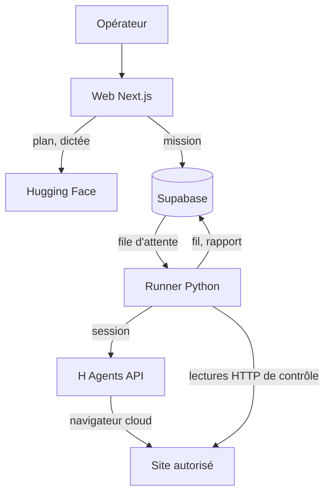
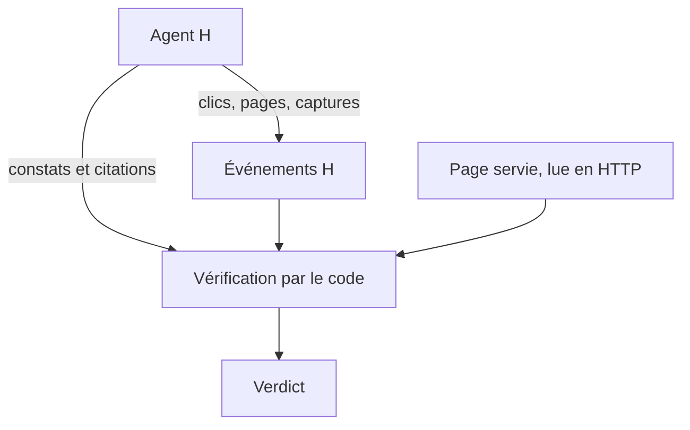
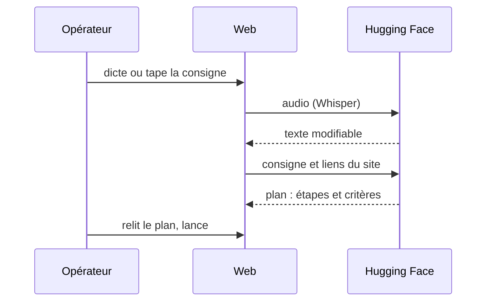
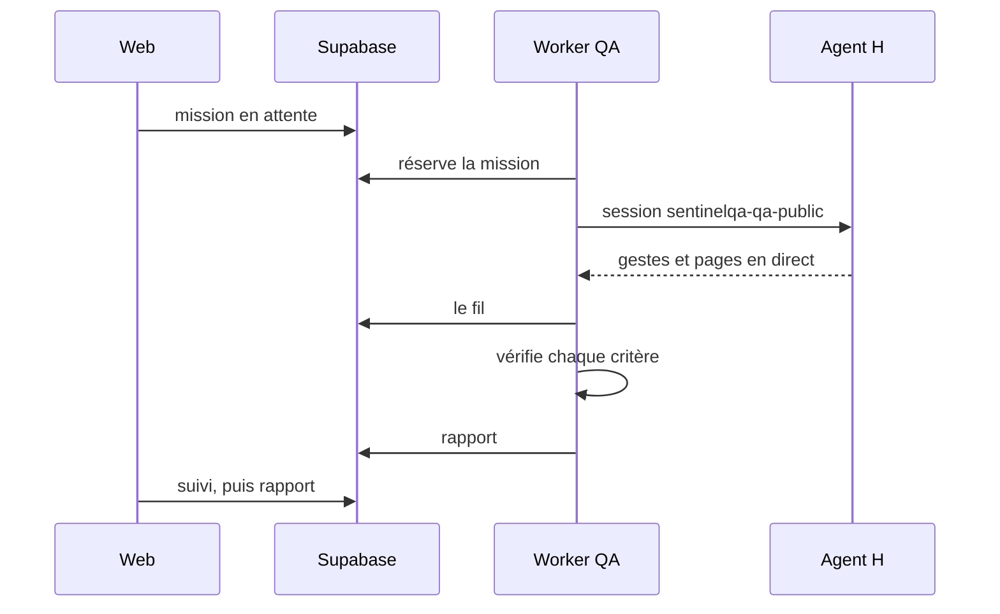
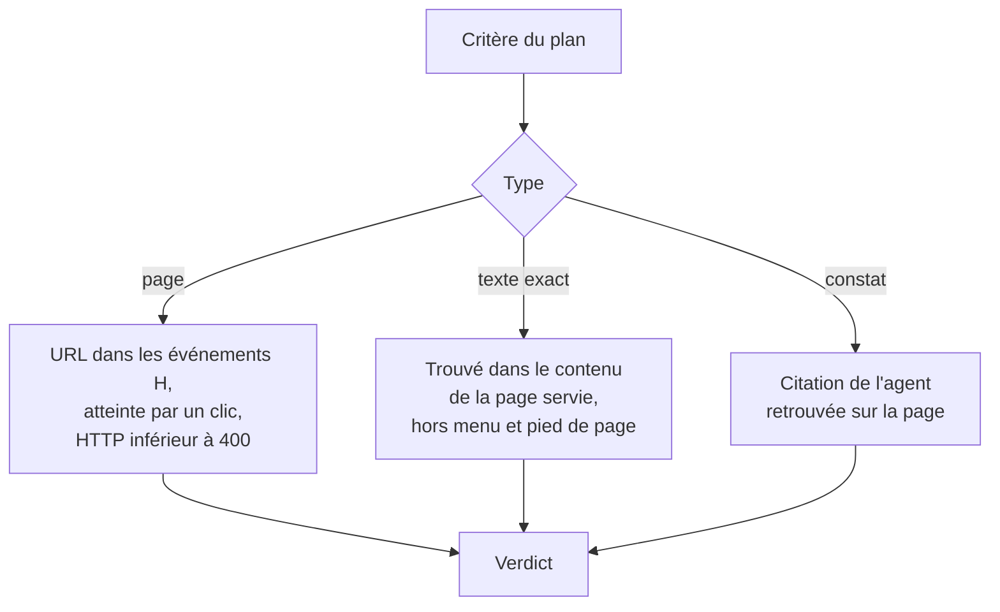
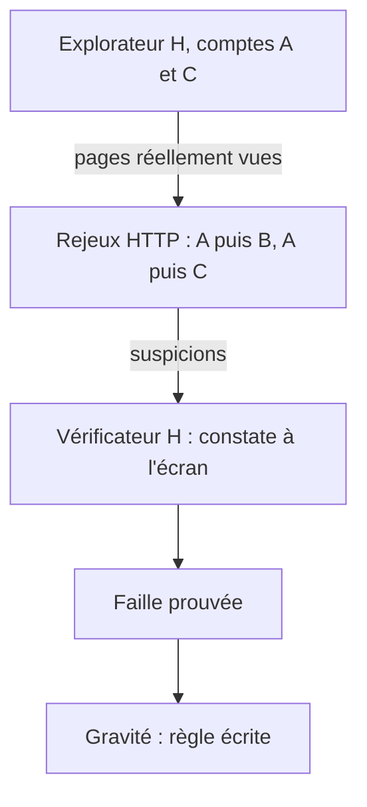
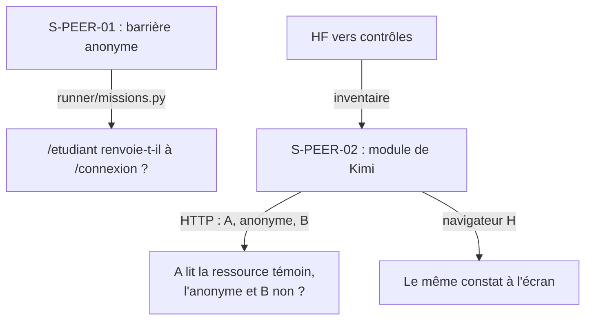
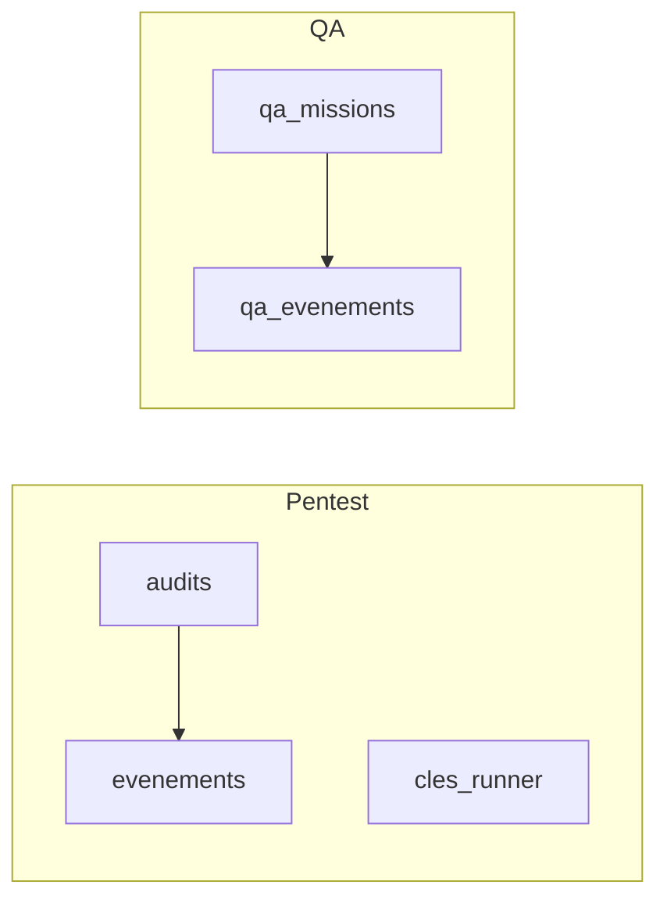
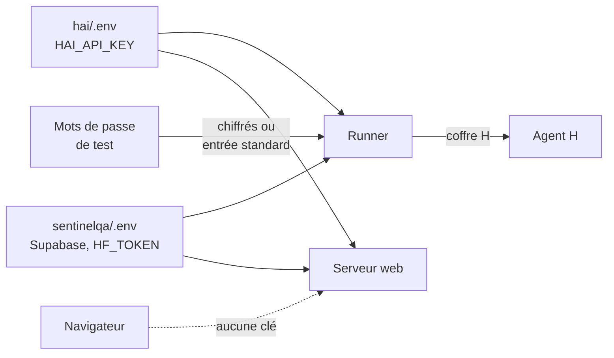

# Architecture de HSentinel

> État au 18/11/2026, 19 h 10, relu contre le code à cette heure. Ce document décrit ce qui tourne aujourd'hui, brique par brique : une idée par section, avec son schéma, ses fichiers et ses mesures. Ce qui reste à faire est dans [SUIVI.md](SUIVI.md). Kimi corrige `contributions/kimi-pentest` en ce moment : la section 6 décrit l'état lu à 19 h 05.

0. [Ce qui a changé depuis le document du 17/11](#0-ce-qui-a-changé-depuis-le-document-du-1711)
1. [Vue d'ensemble](#1-vue-densemble)
2. [Le principe : l'agent montre, le code décide](#2-le-principe--lagent-montre-le-code-décide)
3. [Volet QA : le trajet d'une mission](#3-volet-qa--le-trajet-dune-mission)
4. [Volet QA : comment un critère est vérifié](#4-volet-qa--comment-un-critère-est-vérifié)
5. [Volet Pentest : le banc Paie Express](#5-volet-pentest--le-banc-paie-express)
6. [Volet Pentest : Peer Review, en cours](#6-volet-pentest--peer-review-en-cours)
7. [Les agents H](#7-les-agents-h)
8. [Les données dans Supabase](#8-les-données-dans-supabase)
9. [Les secrets](#9-les-secrets)
10. [Hugging Face : quatre usages, aucun verdict](#10-hugging-face--quatre-usages-aucun-verdict)
11. [La web](#11-la-web)
12. [L'état de chaque brique](#12-létat-de-chaque-brique)
13. [La carte du code](#13-la-carte-du-code)
14. [Les travaux de l'équipe hors de `main`](#14-les-travaux-de-léquipe-hors-de-main)

---

## 0. Ce qui a changé depuis le document du 17/11

Le grand document illustré déposé sur Notion le 17/11 (24 pages) est périmé : ces décisions en ont changé le fond. Il a été corrigé le 18/11 (27 pages, mêmes revirements en pages 2 et 3) ; c'est la nouvelle version qu'il faut déposer. **En cas de doute, ce document fait foi.**

| Sujet | Document du 17/11 | Aujourd'hui | Décision |
|---|---|---|---|
| Ce qu'est HSentinel | Un agent qui se comporte comme un client malveillant et vérifie qu'aucun client n'atteint les données d'un autre | Deux volets de même importance : le **QA** (le site fait-il ce qu'on attend ?) et le **Pentest** (un accès interdit est-il possible ?) | D-25, D-26 |
| Le volet QA | Le test T0, l'isolation entre entreprises : cartographie, puis rejeu | Un **test fonctionnel** : parcours dicté ou exploration bornée, vérifiés par le code ; construit et exécuté en réel | D-25, D-30 |
| Le volet Pentest | Exploration libre guidée par Hugging Face, et T1 (un accès qui reste après un changement de droits) | Des **contrôles d'accès en lecture** sur Peer Review : la barrière anonyme (S-PEER-01), et une ressource témoin lue par A mais pas par un anonyme ni par B (S-PEER-02). **T1 est retiré** des sites réels | D-24, D-26 |
| Les cibles | Une préproduction du client ; la démo sur le cobaye Paie Express | **Des sites réels autorisés** : eugeniaschool.com et Peer Review, en consultation seule. Paie Express devient un banc de calibration | D-24 |
| Les écritures | Permises sur des données de test, avec le feu vert donné au cadrage, puis remise en état | **Aucune écriture** ni aucun changement de droits sur les sites réels | D-24 |
| Les agents H | Explorateur, Vérificateur, et le Préparateur à venir pour T1 | `sentinelqa-qa-public` pour le QA public, `sentinelqa-qa-connecte` pour un site à compte ; l'Explorateur et le Vérificateur pour le banc ; `sentinelqa-pentest-acces` pour S-PEER-02. **Le Préparateur est abandonné** | D-24, D-30 |
| Le verdict | Un rejeu HTTP (pages similaires à 95 % ou plus), puis une preuve à l'écran | Banc : inchangé. QA : les preuves du code (événements H, page servie, citation de l'agent retrouvée). Peer Review : une règle d'accès écrite, vérifiée sur une ressource témoin | D-24, D-30 |
| Hugging Face | Il dit où chercher dans le pentest, et il rédige l'explication | Il prépare le **plan QA**, transcrit la **dictée** et propose des contrôles d'accès (module en cours). Il ne rend jamais le verdict | D-23, D-30 |
| La voix | Absente | Une **dictée** dans la web, qui écrit dans le même champ que la saisie | D-30, D-32 |
| n8n | Les déclencheurs : un audit à chaque déploiement (W1), les alertes (W3), un pentest régulier (W4) | **Construit par Jahdiel, hors de ce dépôt** (W1, W3, W4), testé en réel sur une autre base Supabase : pas encore relié au runner (section 14) | — |
| Supabase | 3 tables, et une extension prévue (Auth, RLS par organisation, Storage) | Une **file QA séparée** (`qa_missions`, `qa_evenements`) ; l'extension prévue n'est pas faite | D-30 |
| La web | La salle de contrôle : cadrer un audit avec trois comptes de test | Deux onglets : **QA** (studio, dictée, plan, suivi en direct, arrêt, rapport) et Pentest. Pas encore déployée | D-27, D-30 |
| La preuve de propriété de la cible | Un fichier à déposer sur la préproduction | Pour ces deux sites, l'accord écrit de l'école | D-24 |
| Le plan et les questions ouvertes | Neuf livrables et sept questions, dans le document | Tenus dans [SUIVI.md](SUIVI.md) | — |

---

## 1. Vue d'ensemble



- **Web** (`sentinelqa/web`) : on y lance une mission, on la suit en direct, on l'arrête, et on lit le rapport. Elle tourne en local et n'est pas encore déployée.
- **Prototype d'interface** (`sentinelqa/web-console`, arrivé le 18/11 à 19 h 06, en local, pas encore publié) : accueil, onboarding et console, exportés de v0. Il n'est relié ni à Supabase, ni au runner, ni à H (section 11).
- **Runner** (`sentinelqa/runner`) : deux processus Python sur un poste de l'équipe, le worker QA (`qa_worker.py`) et le runner du pentest (`sentinelqa.py --surveiller`). Ils prennent les missions dans Supabase, pilotent les agents H et vérifient les résultats.
- **H Agents API** : des agents qui voient l'écran et cliquent, dans un navigateur cloud que H fournit à chaque session.
- **Supabase** : les files de missions, le fil en direct et les rapports. Le QA et le pentest ont chacun leurs tables.
- **Hugging Face** : il prépare et transcrit, mais ne rend jamais de verdict (section 10).
- **n8n** (Jahdiel) : les déclencheurs et les alertes, sur une autre base Supabase ; pas encore reliés au runner (section 14).

## 2. Le principe : l'agent montre, le code décide



Un agent peut se tromper ou inventer. Le verdict ne repose donc jamais sur son seul texte : il repose sur ce que H a **enregistré** et sur ce que le site **sert**.

| Verdict | Condition |
|---|---|
| **Conforme** | Une preuve relevée par le code : page atteinte dans les événements H, texte trouvé dans la page, citation de l'agent retrouvée mot pour mot |
| **Écart constaté** | Une preuve d'écart relevée par le code : erreur HTTP, texte absent de la page servie alors que c'est bien la page vue, texte anormal affiché |
| **Non concluant** | Tout le reste, y compris un écart que l'agent voit seul (« à confirmer ») |
| **Non exécuté** | La mission s'est arrêtée avant ce critère |

Ce principe est né d'une erreur réelle. Le 18/11, l'agent a vu « 3 étapes » en manquant la FAQ de la page, puis « Quatre étapes » une heure plus tard. Avec la règle, aucune de ses deux lectures n'est devenue un faux écart.

## 3. Volet QA : le trajet d'une mission

**La préparation**, avant tout agent :



**L'exécution** :



- **Deux pilotages.** Le *parcours guidé* suit la consigne de l'utilisateur. L'*exploration bornée* fonctionne sans consigne : l'agent ouvre le menu principal, 6 pages au plus, et relève les problèmes visibles.
- **Deux écrans.** Ordinateur en 1280 × 800, mobile en 390 × 844. On change de valeur par session (`overrides`), sans dupliquer l'agent.
- **Arrêt.** Le bouton de la web met `arret_demande` à vrai. Le worker annule alors la session H et garde les preuves déjà recueillies.
- **Mesures réelles du 18/11 sur eugeniaschool.com : 9 missions complètes, 0,300 $ au total, 0,033 $ et 76 s en moyenne.** Parcours guidé : 37 à 81 s, 0,011 à 0,039 $. Exploration : 86 à 160 s, 0,045 à 0,070 $. Plan Hugging Face : environ 1 s. Dictée : 1,1 à 1,6 s.
- **Site connecté (Peer Review).** Un second agent, `sentinelqa-qa-connecte`, part de la page de connexion et remplit les champs avec `fill_secret_at` : il ne voit jamais les valeurs. Le coffre H est créé pour l'essai, lié à la session, puis supprimé. Le mot de passe arrive par l'entrée standard du terminal et ne va qu'au coffre. Le code prouve la connexion (secrets remplis sur `/connexion`, puis une page de l'espace) et l'identité (un marqueur comparé, jamais recopié). Une saisie, un choix dans une liste ou un clic « envoyer », « noter », « évaluer »… arrêtent la session : H a peut-être déjà exécuté le geste, l'arrêt en borne les suites. Une lecture HTTP anonyme d'une page privée, renvoyée à la connexion, ne sert jamais de preuve. Lancement depuis le terminal seulement : la web ne sait pas encore fournir de coffre. Mesure du 18/11 à 18 h 37 : 43 s, 0,021 $, aucune écriture. Le second compte (Nathan) est refusé par le site, « Adresse ou mot de passe incorrect. », en deux essais : le mot de passe transmis est à vérifier.
- Fichiers :
  - `runner/qa_moteur.py` : mission, session, vérification, rapport, CLI ;
  - `runner/qa_worker.py` : la file ;
  - `web/app/qa/`, `web/app/api/qa/` : le studio, le suivi et le rapport.

## 4. Volet QA : comment un critère est vérifié



- **Page atteinte.** L'URL doit figurer dans les observations du navigateur. Une page ouverte en tapant son adresse ne compte pas comme atteinte par l'interface. Sur un site connecté, une page privée se prouve par la trajectoire du navigateur connecté : une lecture HTTP anonyme n'y voit que la connexion.
- **Texte exact.** Il s'agit des mots que l'utilisateur met entre guillemets. On les cherche dans la page servie, sans `nav`, `header` ni `footer` : le menu de chaque page cite les autres pages. La comparaison est normalisée : casse, accents, « Quatre » vaut « 4 ».
- **Constat.** L'agent doit citer le texte vu mot pour mot. Le code retrouve la citation, entière ou fragment par fragment. Le texte relevé par H tronque les titres à styles mêlés (« Bonne *soirée*, Alec » → « *soirée* ») : une citation introuvable pour cette raison reste non concluante, avec ce motif (`h_text_partial`).
- **Contrôles automatiques**, dans les deux pilotages :
  - chaque page visitée répond sans erreur ;
  - aucun texte anormal n'est affiché (`undefined`, `lorem ipsum`…) ;
  - en exploration, chaque lien affiché à l'écran mène à une page.
- **Signal de difficulté** : 6 clics ou plus sans changer de page, relevés dans les gestes et signalés « à revoir ». En mobile, 2 explorations sur 2 ont buté sur le menu.

## 5. Volet Pentest : le banc Paie Express



- **Paie Express** (`sentinelqa/cobaye`) : un SaaS de paie, construit par nous, avec des failles injectées et documentées (`VERITE_TERRAIN.json`). Il sert à mesurer la détection avant de toucher un vrai site.
- **Trois thèmes :**
  - **lecture** : B, d'une autre entreprise, lit les données de A ;
  - **écriture** : B modifie les données de A, seulement avec un feu vert humain, et A remet ensuite la valeur d'origine ;
  - **admin** : C, simple salarié, dépasse son rôle.
- **Une faille n'est prouvée que si le rejeu et l'agent la confirment.** La gravité ne vient pas du LLM, qui variait d'un audit à l'autre : elle vient d'une règle écrite (`runner/gravite.py`).
- **Mesures du 17/11**, sur le banc à 6 failles injectées : 59 failles prouvées sur 60 et 0 faux positif, en 10 audits. Un audit coûte de 0,13 à 0,21 $ et dure de 170 à 349 s.
- Fichiers : `runner/sentinelqa.py` (orchestration), `runner/agents_h.py`, `runner/gravite.py`, `runner/hf.py`.

## 6. Volet Pentest : Peer Review, en cours



- **S-PEER-01** (`runner/missions.py`) : un GET anonyme de `/etudiant`, puis un constat à l'écran par l'agent `sentinelqa-pentest`. Cet agent n'existe pas chez H (404), et sa définition porte `about:blank`, que H refuse désormais à la création : le scénario ne peut pas aboutir en l'état. Aucune exécution complète.
- **S-PEER-02** (`contributions/kimi-pentest`, point d'entrée `executer_controle_acces`) : trois contrôles, `legitimate_read` (A lit la ressource), `anonymous_read` (l'anonyme ne la lit pas) et `cross_actor_read` (B ne la lit pas). Chaque contrôle a deux preuves : HTTP (l'empreinte de la réponse, jamais les cookies ni le corps) et navigateur H. **État lu à 19 h 05**, dans ses preuves locales (non publiées : elles contiennent l'adresse de la session d'Alec) :
  - la connexion HTTP de A est validée en réel : formulaire multipart, redirection 303 vers `/`, puis `/etudiant` en 200 avec le marqueur exact du compte ;
  - la ressource témoin est la page de la session du soir de A. A la lit ; l'anonyme est renvoyé à `/connexion`, sans le marqueur. La règle est confirmée : A oui, anonyme non, B non ;
  - B est refusé par le site (« Adresse ou mot de passe incorrect. ») : le contrôle A/B n'a jamais tourné ;
  - le volet navigateur est bloqué : l'agent `sentinelqa-pentest-acces` répond 500 chez H (section 7), et aucune session n'a démarré.

  Bilan : non concluant, aucune faille revendiquée. Le module n'est raccordé ni au runner ni à la web.
- **HF vers contrôles** (`contributions/hf-pentest`) : à partir d'un inventaire (chemins, règles, observations nettoyées), Qwen3-32B choisit les contrôles à jouer, et chacun devient un contrôle S-PEER-02. Un appel réel a été fait sur un inventaire synthétique (23,7 s, 1 492 tokens) : son plan a retrouvé la fuite et le contrôle sain du banc synthétique. Jamais exécuté sur Peer Review.
- **Règle des sites réels** : consultation seule, aucune écriture métier, aucun changement de droits. Le seul POST admis est celui de la connexion.

## 7. Les agents H

| Agent | Rôle | Défini dans | État |
|---|---|---|---|
| `sentinelqa-qa-public` | QA : parcours guidé et exploration d'un site public | `runner/qa_agent.py` | En service, créé le 18/11 à 18 h 47 ; revérifié par une mission réelle |
| `sentinelqa-qa-connecte` | QA sur un site à compte : connexion par coffre, puis consultation | `runner/qa_agent.py` | Créé le 18/11 à 18 h 37 ; 1 session réelle |
| `sentinelqa-explorateur` | Banc Paie Express : cartographie | `runner/agents_h.py` | En service depuis le 17/11 |
| `sentinelqa-verificateur` | Banc Paie Express : preuve à l'écran | `runner/agents_h.py` | En service depuis le 17/11 |
| `sentinelqa-pentest` | S-PEER-01 | `runner/agents_missions.py` | Absent de H (404, le 18/11 à 18 h 45). Sa définition porte `about:blank`, que H refuse à la création (422) |
| `sentinelqa-pentest-acces` | S-PEER-02 | `contributions/kimi-pentest/agent_acces.py` | Créé par Kimi ; illisible chez H depuis le 18/11 vers 18 h 40 (GET et PATCH répondent 500) : à recréer sans `about:blank` |
| `hsentinel-explorateur`, `-verificateur`, `-preparateur` | Le bac à sable de Mohamed : cartographie, preuve, T1 | branche `agents-ia-qa-pentest` | Présents chez H (relus le 18/11 à 19 h 15) ; hors de `main` (section 14) |
| `sentinelqa-qa` | Ancien agent QA public | — | Remplacé par `sentinelqa-qa-public` : illisible chez H depuis le 18/11 vers 18 h 40 (GET et PATCH répondent 500). À supprimer si l'équipe le décide |

- Tous utilisent `holo4-35b-a3b`, en mode visuel. Le texte affiché (`markdown: true`), que H joint à chaque capture, n'est demandé que par les agents QA et par `sentinelqa-pentest-acces` : c'est là que le code retrouve les citations. Les agents du banc et `sentinelqa-pentest` ne le demandent pas. En QA, `holo4-27b` peut être choisi par session.
- **Le réglage de chaque session reste dans notre code** : URL de départ, écran et format de réponse (`answer_schema`, Pydantic). La définition d'un agent QA est relue après chaque enregistrement : la comparaison tolère les valeurs par défaut que H ajoute, mais refuse un coffre, un profil ou un proxy hérités.
- **Aucune page de départ dans une définition.** Depuis le 18/11 vers 18 h 40, H ne relit plus un agent enregistré avec `about:blank` : il répond 500 au GET comme au PATCH. Chaque session impose sa page de départ (`overrides`).
- **Le QA public n'utilise aucun coffre ; le QA connecté, un par essai.** Le pentest en utilise un par compte de test : l'agent remplit le mot de passe sans jamais le voir (`fill_secret_at`).

## 8. Les données dans Supabase



| Table | Contenu |
|---|---|
| `audits` | Une demande de pentest (cible, comptes sans mot de passe, statut, rapport JSON), ou une mission du premier lot (`rapport.schema_version` 2) |
| `evenements` | Le fil d'un audit : étapes, sessions, preuves |
| `cles_runner` | La clé publique du runner, qui chiffre les mots de passe dans le navigateur |
| `qa_missions` | Une mission QA : la demande validée (consigne, plan, écran), `arret_demande`, le rapport |
| `qa_evenements` | Le fil d'une mission QA : étapes, gestes, pages, critères |

- **Une file par volet, côté interface.** La web envoie le QA dans `qa_missions`, que seul le worker QA lit, et le pentest dans `audits`, que lit le runner du pentest. L'ancien parcours QA du premier lot (Q-PUB-01, D-27) existe encore dans le code : `/api/audits` l'accepte et le runner du pentest le traiterait, mais l'interface ne le propose plus.
- **Cycle d'une mission** : `en_attente`, puis `en_cours`, puis `termine` ou `echec`. La réservation est atomique : elle met le statut à jour seulement s'il vaut encore `en_attente`.
- **Sécurité** : le RLS est activé, sans aucune politique. Seule la clé secrète, utilisée par le serveur web et par le runner, lit et écrit ; la clé publique ne voit rien (vérifié dans les deux sens).
- Schémas : `supabase/schema.sql` pour le pentest, `supabase/qa.sql` pour le QA.
- **Une seconde base, pour les alertes n8n.** Les workflows de Jahdiel lisent `hsentinel-dev` (table `constats`), alors que le runner écrit dans `auaitjryhgwdbczwkdef`. Tant qu'une seule base n'est pas choisie, une faille prouvée ne déclenche aucune alerte (rapporté par Jahdiel).

## 9. Les secrets



- **Aucune clé dans le dépôt.** Les clés vivent hors du dépôt, avec les droits 600. Le `.gitignore` fonctionne en liste blanche.
- **Le navigateur ne voit aucune clé.** Les appels à Hugging Face, à Supabase et aux captures H passent par le serveur web.
- **Les mots de passe des comptes de test** suivent trois chemins, et finissent toujours dans un coffre H : l'agent les remplit sans les voir (`fill_secret_at`).
  - **Banc Paie Express, depuis la web** : chiffrés dans le navigateur avec la clé publique du runner (RSA-OAEP, 3072 bits). Supabase ne garde que le texte chiffré ; le runner le déchiffre en mémoire, remplit les coffres, puis l'efface.
  - **QA connecté, depuis le terminal** : le mot de passe arrive sur l'entrée standard du runner et va dans un coffre créé pour l'essai, supprimé à la fin. Il n'est écrit nulle part.
  - **S-PEER-02 (Kimi, non raccordé)** : un JSON privé hors du dépôt (droits 600) fournit les comptes A et B. Un coffre par acteur, `sentinelqa-peer-review-a` et `-b`, est rempli à chaque exécution ; le modèle ne reçoit jamais ce fichier.
- Piège connu : `holo login` écrit la clé entre guillemets. Il faut les retirer à la lecture, sinon H répond 403.

## 10. Hugging Face : quatre usages, aucun verdict

| Usage | Modèle | Où | Mesure |
|---|---|---|---|
| Plan QA : consigne vers étapes et critères | Llama 3.3 70B, par le routeur HF | `web/lib/qa.js`, `runner/qa_moteur.py` | Environ 1 s |
| Dictée : audio vers texte modifiable | Whisper large v3 turbo (licence MIT) | `web/lib/qa.js` | 1,1 à 1,6 s |
| Banc Paie Express : attaques à tenter, avant les rejeux | Qwen2.5-72B | `runner/hf.py` | De 13 à 99,5 s selon les essais |
| Peer Review : contrôles d'accès à jouer, à partir d'un inventaire | Qwen3-32B | `contributions/hf-pentest`, non raccordé | 23,7 s pour un appel réel, sur un inventaire synthétique |

- Ce que propose Hugging Face est toujours relu : par l'utilisateur pour le plan, par le code pour le verdict.
- Le routeur Hugging Face annonce OpenRouter comme fournisseur réel de Llama 3.3 70B (mesuré le 18/11).

## 11. La web

| Page | Rôle |
|---|---|
| `/` | L'accueil : les derniers relevés |
| `/audits/nouveau` | Lancer une mission : onglet **QA** (le studio, avec la dictée) ou onglet **Pentest** |
| `/qa`, `/qa/[id]` | Le studio QA et l'historique ; le suivi en direct, puis le rapport |
| `/audits/[id]` | Le suivi et le rapport d'un audit pentest |
| `/examen` | L'index des relevés pentest, par date, application ou thème |

- **Routes QA** (`app/api/qa/`) : `plan`, `transcription`, `missions`, `missions/[id]`, `missions/[id]/arret`, `captures`.
- **Accès** : `proxy.js` réserve tout à l'opérateur. En développement, seule la boucle locale est admise ; en production, il faut le jeton `HSENTINEL_OPERATOR_TOKEN`. Chaque écriture vérifie l'origine de la requête.
- **Captures** : celles de l'agent restent chez H. Le serveur web les relaie (`/api/qa/captures`), et seules les adresses de la trajectoire de la session passent.
- Next.js 16 et React 19, sans autre dépendance.

**Un second prototype d'interface, `sentinelqa/web-console`** (arrivé le 18/11 à 19 h 06, exporté de v0 : TypeScript, Tailwind, shadcn ; en local, pas encore publié) :

| Page | Rôle |
|---|---|
| `/` | La page d'accueil du produit |
| `/login`, `/onboarding` | Une connexion de démonstration (un cookie), puis l'onboarding en étapes : application, modules, déclencheur, alertes |
| `/app` | La console : indicateurs, matrice des rôles, chronologie du pipeline, fil des déploiements, détail d'un audit |

- **Ses données sont simulées** tant que `ORCHESTRATOR_URL` n'est pas défini (`lib/audit-source.ts`). Défini, il appelle un « orchestrateur » (`GET /audit`, `POST /deployments`) qui n'existe pas encore dans notre code.
- Il n'est relié ni à Supabase, ni au runner, ni à H : rien de ce qu'il affiche ne vient aujourd'hui d'une mission réelle.

## 12. L'état de chaque brique

| Brique | État au 18/11, 19 h 10 |
|---|---|
| QA : parcours guidé, exploration, mobile | Exécuté en réel : 10 missions, dont une avec l'agent remplacé (18 h 47) |
| QA connecté : Peer Review | Compte d'Alec : 1 mission réelle, connexion et identité prouvées par le code. Compte de Nathan : refusé par le site (2 essais). Terminal seulement |
| QA : dictée | Exécutée de bout en bout dans un navigateur, avec une voix de synthèse ; à essayer avec une vraie voix |
| QA : vérification par le code | 54 tests Python ; faux écarts trouvés en réel puis corrigés et revérifiés |
| Web QA | 34 tests JavaScript réussis ; compilation réussie à 14 h 37, puis bloquée à 15 h par le téléchargement des polices Google |
| Pentest : banc Paie Express | Exécuté en réel : 59/60 en 10 audits, 0 faux positif |
| Pentest : S-PEER-01 | Code raccordé ; l'agent `sentinelqa-pentest` n'existe pas chez H et ne peut pas être créé tel quel (`about:blank`) |
| Pentest : S-PEER-02 | Non raccordé. A validé en HTTP réel, ressource témoin et règle confirmées ; B refusé par le site ; navigateur H bloqué (500). Contrôle A/B jamais exécuté |
| Pentest : HF vers contrôles | Un appel réel sur un inventaire synthétique ; 50 tests sur 50. Jamais exécuté sur Peer Review |
| Modules de Kimi | 22 tests sur 22 (19 h 05) ; en cours de correction |
| Déploiement de la web | Pas fait : tout tourne en local |
| Prototype `web-console` (v0) | Arrivé le 18/11 à 19 h 06, en local ; données simulées, aucun branchement au runner |
| n8n : W1, W3, W4 (Jahdiel) | Testés en réel sur la base `hsentinel-dev` (rapporté) ; pas reliés au runner |
| Mesure du temps humain gagné | Pas faite |

## 13. La carte du code

```text
sentinelqa/
  runner/
    qa_agent.py         agent H du QA : définition et relecture confirmée
    qa_moteur.py        QA : mission, session, vérification, rapport, CLI
    qa_worker.py        QA : file Supabase, arrêt, fil en direct
    base.py             accès à Supabase (REST et psql)
    cle_runner.py       la clé RSA du runner, qui déchiffre les mots de passe du banc
    sentinelqa.py       pentest : orchestration du banc et file des audits
    missions.py         pentest : scénarios sur sites réels (S-PEER-01)
    agents_h.py         agents du banc (explorateur, vérificateur)
    agents_missions.py  agents des missions réelles ; le QA reprend qa_agent.py
    gravite.py          règle écrite de gravité
    hf.py               Hugging Face pour le pentest (hypothèses)
    tests/              tests sans réseau, avec de vrais événements H en fixture
  web/
    app/qa/             studio, dictée, suivi, rapport QA
    app/audits/         lancement (QA et pentest), suivi pentest
    app/examen/         index des relevés pentest
    app/api/            routes serveur
    lib/                accès Supabase, contrat QA, dictée, formats
  web-console/          prototype d'interface (v0) : accueil, onboarding, console ; données simulées (local, non publié)
  contrats/qa.json      cibles QA, budgets, consignes de préparation
  contrats/catalogue.json  scénarios sur sites réels (pentest)
  supabase/             schémas SQL
  cobaye/               Paie Express, le banc à failles injectées
contributions/
  kimi-pentest/         S-PEER-02 : A, anonyme et B, en HTTP et dans le navigateur H ; non raccordé
  hf-pentest/           Hugging Face : d'un inventaire aux contrôles S-PEER-02 ; non raccordé
```

## 14. Les travaux de l'équipe hors de `main`

| Travail | Où | Ce qu'il fait | État |
|---|---|---|---|
| Les alertes n8n (Jahdiel) | n8n ; leur suivi est sur la branche `jahdiel/suivi-n8n`, repris dans [SUIVI.md](SUIVI.md) | W1 : un déploiement prêt (`deployment_status` GitHub, signature vérifiée) devient une demande d'audit. W3 : une faille prouvée (table `constats`) devient un ticket GitHub et un e-mail, rouvert si elle revient. W4 : chaque nuit à 2 h, une demande de pentest pour chaque application abonnée | Testés en réel sur la base `hsentinel-dev` (rapporté par Jahdiel, non vérifié ici). Pas reliés au runner, qui écrit dans une autre base |
| Le bac à sable des agents (Mohamed) | Branche `agents-ia-qa-pentest`, historique séparé (18 fichiers) | Ses propres agents `hsentinel-explorateur`, `-verificateur` et `-preparateur`, des coffres par compte, et deux cibles : Paie Express et une instance Juice Shop à déployer soi-même | Les trois agents existent chez H (relus à 19 h 15). Non fusionné. Son README donne en exemple `auditer.py cadence` : Cadence n'est pas une cible autorisée (D-24) |
| Le prototype d'interface | `sentinelqa/web-console`, en local, pas encore publié | Accueil, onboarding et console (v0) | Données simulées ; relié à rien (section 11) |
