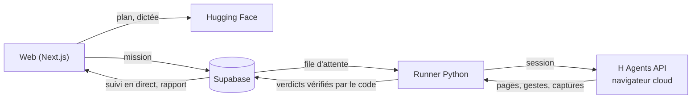

# HSentinel

Des agents IA de H Company testent un site web autorisé comme le ferait un humain : ils naviguent, cliquent et observent. Ensuite, le code vérifie chaque résultat sur des preuves, et l'avis de l'agent seul ne suffit pas.

- **Volet QA** : le site fait-il ce qu'on attend ?
- **Volet Pentest** : un accès qui devrait être refusé est-il possible ?

Les deux volets ont la même importance (décision D-26). Équipe 4 du hackathon « Build The Future » (H Company × Eugenia School, du 16 au 20 novembre 2026).

## État réel, le 18/11/2026 à 14 h 30

| Volet | Ce qui fonctionne, vérifié en réel | Ce qui manque |
|---|---|---|
| **QA** | On tape ou on dicte une consigne. Hugging Face en tire un plan, relu par l'utilisateur. L'agent H `sentinelqa-qa` le joue dans un navigateur cloud. Le code vérifie chaque critère, puis la web affiche le rapport, avec captures et coûts. **8 missions réelles** sur eugeniaschool.com, sur ordinateur et sur mobile : 0,036 $ et 81 s en moyenne. | La dictée n'a été testée qu'avec une voix de synthèse. Le temps humain gagné n'est pas mesuré. Il n'y a qu'une cible. Aucun défaut du site n'est prouvé à ce jour. |
| **Pentest : banc interne** | Paie Express, une application de test à failles injectées, lancée en local : **29 failles prouvées sur 30, 0 faux positif**, sur 5 audits (17/11). | — |
| **Pentest : Peer Review** | Le contrôle de la barrière anonyme de `/etudiant` (S-PEER-01) est raccordé au runner. Dans le module de Kimi (S-PEER-02), l'agent H `sentinelqa-pentest-acces` est créé et a joué une session réelle : la connexion du compte A. | **Aucun contrôle authentifié n'a été exécuté de bout en bout** : la connexion par HTTP n'est pas validée, et le compte B comme la ressource témoin manquent. Le module « HF → contrôles » ne tourne que sur un banc synthétique. Ces deux modules ne sont pas intégrés (`contributions/`). |

Tests, le 18/11 à 14 h 30 : runner 46/46, web 15/15, contrôle d'accès 18/18, « HF → contrôles » 42/47. Les 5 échecs viennent de la passe que Kimi n'a pas terminée (voir [`contributions/README.md`](contributions/README.md)).

La web n'est pas encore en ligne : elle tourne en local.

## Comment ça marche



La règle des verdicts :
- **conforme** ou **écart** : seulement avec une preuve relevée par le code, c'est-à-dire une page atteinte dans les événements H, un texte trouvé dans la page, une citation de l'agent retrouvée ou une erreur HTTP ;
- **non concluant** : tout le reste, même quand l'agent a un avis.

## Tester le volet QA

Ce qu'il faut :
- Python 3.12 et Node 20 ou plus ;
- un compte H, avec `holo login`, qui écrit `HAI_API_KEY` dans `~/.config/hai/.env` ;
- les clés Supabase et le `HF_TOKEN` dans `~/.config/sentinelqa/.env`. Le modèle est [`sentinelqa/.env.example`](sentinelqa/.env.example). Les clés restent toujours hors du dépôt.

```sh
python3 -m venv .venv && .venv/bin/pip install -r sentinelqa/requirements.txt
.venv/bin/python sentinelqa/runner/qa_worker.py --schema   # une seule fois : la file QA dans Supabase
.venv/bin/python sentinelqa/runner/qa_worker.py            # le worker qui prend les missions de la web
cd sentinelqa/web && npm install && npm run dev            # puis ouvrir http://localhost:3100
```

Dans la web : « Lancer un audit », onglet **QA**, puis « Dicter la consigne » ou une consigne tapée, puis « Préparer le plan » et « Lancer l'agent ». Ouvrez `localhost` et non `127.0.0.1`, sinon les envois sont refusés.

Sans la web : `.venv/bin/python sentinelqa/runner/qa_moteur.py --consigne "Ouvre Programmes puis le Bachelor et vérifie qu'il affiche « Bac+3 »"`.

Les tests : `.venv/bin/python -m unittest discover -s sentinelqa/runner/tests -p 'test_*.py'`, puis `cd sentinelqa/web && npm test`.

## Le dépôt

| Chemin | Contenu |
|---|---|
| [`sentinelqa/runner/`](sentinelqa/runner) | Le moteur Python : volet QA (`qa_*.py`), volet pentest (`missions.py`, `sentinelqa.py`) et agents H |
| [`sentinelqa/web/`](sentinelqa/web) | La web Next.js : lancement, suivi en direct, arrêt, rapports |
| [`sentinelqa/contrats/`](sentinelqa/contrats) | Les cibles autorisées et les règles partagées entre le runner et la web |
| [`sentinelqa/supabase/`](sentinelqa/supabase) | Les schémas : audits du pentest, file du QA |
| [`sentinelqa/cobaye/`](sentinelqa/cobaye) | Paie Express, l'application de test à failles injectées (comptes fictifs) |
| [`contributions/`](contributions) | Les modules pentest de Kimi, **en cours, non intégrés** |
| [`livrables/`](livrables) | L'architecture (06) et le registre des décisions (08), qui dit pourquoi chaque choix |
| [`notes/`](notes) | Nos retours sur l'API H (un livrable du hackathon) et la recherche sur le problème |
| [`contexte/`](contexte) | Le brief du hackathon, la référence de l'API H et l'analyse du showcase |
| [`CLAUDE.md`](CLAUDE.md) | Les consignes communes des assistants IA de l'équipe |

Le détail technique, les commandes et les pièges déjà rencontrés sont dans [`sentinelqa/README.md`](sentinelqa/README.md).

Ne sont pas publiés :
- les idées archivées et les versions dépassées des documents ;
- les passations entre agents ;
- les rapports bruts, qui contiennent des liens de session ;
- le PDF officiel du hackathon, qui contient des codes d'accès.

## Règles

- **Uniquement des sites contrôlés par l'équipe, ou autorisés par écrit** (article 323-1 du Code pénal). Aujourd'hui : eugeniaschool.com et peer-review-black.vercel.app, en consultation, sans aucune écriture (D-24).
- **Aucun secret dans le dépôt**, ni clé, ni mot de passe, ni code. Le `.gitignore` n'accepte que les chemins listés.
- Un chiffre cité est mesuré par nous ou sourcé ; sinon, on écrit « non mesuré ».

## Équipe

| Rôle | Qui |
|---|---|
| CEO | Alec Diamidia |
| CTO | Aurian Bingangoye |
| CAO (automatisation) | Aziz Tajini |
| CAIO (IA) | Mohamed El Hamss |
| CDO (données) | Jahdiel Kinvi |
| CPO (produit) | Tugdual Breuil |

Le suivi d'équipe est sur la [page Notion du projet](https://app.notion.com/p/Checkpoint-1-41a14c8bcf3080f881d1c85052ea48cf).
