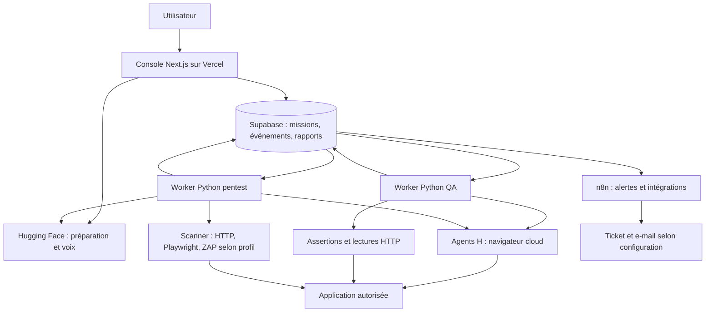

# HSentinel — Dossier de défense CTO

**Architecture, choix, preuves et questions du jury · Revue du 20 novembre 2026**

**Version examinée :** [`main`, commit `902b0c9`](https://github.com/jkinvi-byte/hsentinel-alertes/commit/902b0c915ca3e0ae943325c3367ec4cdce50549a). La comparaison GitHub confirme que le dépôt local correspond à cette version au moment de la revue.

**Mode d'emploi.** Commence par la fiche orale jointe, puis les sections 1, 5, 8 et 9. Le reste sert à répondre aux relances. Tu peux défendre un choix imparfait si tu sais expliquer son périmètre, son coût et son évolution.

**Niveau de preuve.** « Code relu » signifie une vérification dans cette version. « Mesure archivée » signifie un résultat consigné dans les rapports ou le journal, sans nouvelle exécution pendant cette revue. « Proposition » signifie une évolution à construire. La présence sur GitHub ne prouve ni le déploiement ni la disponibilité actuelle d'un service.

> **Point à régler avant de présenter la dernière version :** la dernière entrée D-54 indique que le scanner de Kimi et sa matrice sont publiés, mais que la console en ligne n'a pas encore été redéployée avec ce lot. Distingue le code publié, le moteur testé et l'interface réellement déployée. [C01]

## 1. Ta présentation technique en 90 secondes

> HSentinel aide une petite équipe SaaS à vérifier les parcours utilisateurs et les contrôles d'accès de son application. Nous avons deux volets de même importance : le QA fonctionnel et le pentest, avec un socle commun de missions, de preuves et de rapports.
>
> La console Next.js prépare une mission et la dépose dans Supabase. Deux workers Python prennent les missions : un pour le QA, un pour le pentest. Ils pilotent les agents H et les contrôles HTTP. Les traitements longs continuent indépendamment de la page web.
>
> H apporte la navigation visuelle : se connecter, trouver un menu, suivre un parcours sur ordinateur ou sur un écran mobile. Hugging Face transforme la consigne en plan, transcrit la voix et, dans le scanner, priorise des contrôles autorisés.
>
> La séparation essentielle est celle du raisonnement et de la vérification. Une affirmation libre du modèle ne suffit pas à déclarer une faille. Nos règles confrontent les observations, les réponses HTTP et les témoins attendus. Nous conservons quatre résultats : conforme, écart ou faille démontrée, non concluant, non exécuté.
>
> Nous avons exécuté des parcours sur des sites réels autorisés et calibré la détection sur un banc à vérité terrain connue. Les coûts et durées sont mesurés. Le prototype fonctionne avec un accès opérateur et des workers sur notre poste ; l'isolation entre clients et l'exploitation continue sont les prochaines étapes de production.

**La phrase à retenir :** « Nous automatisons l'exécution et rendons explicite ce qui a réellement été vérifié. »

## 2. L'architecture que tu dois savoir dessiner

| Brique | Responsabilité actuelle | Frontière importante |
|---|---|---|
| `web-console` | Interface de l'équipe, session opérateur, préparation, lancement, suivi, rapports | Ne calcule pas les verdicts ; les affiche |
| `web/lib` | Services partagés : HF, validation, accès Supabase, arrêt, captures | Réutilisés par la console ; il existe encore une ancienne interface `web` |
| Supabase / Postgres | Files persistantes et données structurées | Pas encore d'organisations clients ni de RLS par organisation |
| Worker QA | Réserve une mission, crée la session H, vérifie les critères, publie le rapport | Un traitement à la fois par processus |
| Worker pentest | Oriente vers le banc, le contrôle A/B ou le scanner générique | Ces trois chemins n'ont pas exactement les mêmes preuves ni les mêmes capacités |
| H Agents API | Agents enregistrés, navigateur cloud, sessions, coffres et trajectoires | Fournisseur de l'exécution visuelle ; ne décide pas seul du verdict produit |
| Hugging Face | Préparation du plan, transcription, conversation, synthèse vocale, priorisation | Aucun pouvoir d'élargir les autorisations du scanner |
| n8n | Déclenchements et transmission des constats | Le moteur de vérification continue sans lui ; l'envoi d'alertes peut échouer séparément |

**Déploiement réel :** console sur Vercel ; base Supabase distante ; navigateur H distant ; workers Python sur le Mac de l'équipe. Le banc Paie Express est sur Vercel ; le banc du scanner générique est un laboratoire distinct. Ce ne sont pas des microservices tous hébergés et supervisés. [C02][C03]

**Trois flux à distinguer :** les requêtes de l'utilisateur vers la console ; les appels du serveur et des workers aux fournisseurs ; les interactions du navigateur H et du scanner avec la cible.

## 3. Le trajet complet d'une mission

### 3.1 QA public : de la consigne à la preuve

1. L'utilisateur choisit une cible du catalogue, un appareil et un mode : guidé ou exploration bornée.
2. S'il dicte, Whisper produit un texte modifiable. Le texte rejoint le même parcours que la saisie clavier.
3. En mode guidé, Llama reçoit la consigne et les liens connus. Il propose au plus huit étapes et six critères : page, texte, constat. L'utilisateur relit le plan.
4. La route Next.js vérifie la session, l'origine de l'écriture et le contrat. Elle crée une ligne `qa_missions`.
5. Le worker prend la plus ancienne mission en attente. Un `PATCH` conditionné par `statut=en_attente` empêche deux workers de réserver simultanément la même ligne.
6. Le worker revalide la demande. Il confirme la définition de l'agent H puis démarre une session avec URL, écran, schéma de réponse et budgets.
7. Les événements H alimentent `qa_evenements`. L'interface les relit périodiquement.
8. Python confronte les observations aux critères et, lorsque pertinent, relit le site en HTTP.
9. Le rapport QA **v3** est conservé avec sessions, preuves, raisons, coûts disponibles et interruptions. Les écarts éligibles alimentent `constats`.

**Deux détails qui font CTO :** `termine` décrit la fin du traitement, pas un résultat « tout va bien » ; une mission terminée peut contenir des non-conclusions. Le suivi de la console utilise **SWR avec polling à 1,8 seconde pendant l'exécution**, pas un abonnement Supabase Realtime. [C04][C05][C06]

**Budgets concrets du catalogue QA.** Eugenia guidé : 25 steps / 300 s ; exploration : 40 steps / 420 s / 6 pages au plus. Peer Review guidé : 25 steps / 240 s. Ces plafonds encadrent la session H ; la préparation, les appels d'API et les vérifications finales ajoutent du temps. Le moteur accorde notamment un budget séparé de 60 s aux lectures finales : ne transforme pas le plafond de session en SLA de bout en bout.

**L'expert conversationnel est distinct de l'exécuteur.** Il conseille à partir du manuel et du contexte de mission. Il ne lance pas d'audit ; l'utilisateur doit reprendre la proposition puis passer par le parcours de validation. La voix simplifie l'entrée, sans modifier les permissions du moteur.

### 3.2 QA connecté : ce qui change

Le navigateur chiffre `JSON.stringify({ mot_de_passe: ... })` avec la clé publique RSA-OAEP du runner, SHA-256, clé de 3 072 bits. Le serveur reçoit le compte avec ce texte chiffré. Le worker retire le compte de la demande stockée avant de déchiffrer le mot de passe en mémoire ; il crée ensuite un coffre H propre à la mission.

L'agent utilise `fill_secret_at`. Le contrôle K1 vérifie la connexion et K2 cherche un marqueur d'identité attendu. Le coffre est supprimé en fin de traitement ; si la suppression échoue, le code le signale pour intervention. La demande peut porter jusqu'à trois marqueurs d'identité. [C07][C04]

**Précision :** le code du formulaire QA limite le message RSA à 300 octets, sous le maximum cryptographique de cette clé. Le chiffrement direct est adapté à ce petit secret ; de plus gros paquets demanderaient une enveloppe de chiffrement différente.

**Ne dis pas :** « Nous ne voyons jamais les mots de passe. » Le navigateur les saisit et le worker les déchiffre. La propriété défendable est : **ils ne transitent pas en clair dans la demande conservée par la base et ne sont pas insérés dans le prompt du modèle**. Les mécanismes de nettoyage ne prouvent pas l'effacement de toutes les sauvegardes et traces des fournisseurs.

### 3.3 Pentest : trois chemins à connaître

| Chemin | Usage | Ce qui fait preuve |
|---|---|---|
| `S-BANC-01`, Paie Express | Calibration lecture, écriture et administration sur données fictives | Rejeu HTTP et confirmation H ; comparaison à la vérité terrain du banc |
| `S-PEER-02`, Peer Review | Contrôle ciblé d'une ressource connue avec A, anonyme et B | Authentification et identité, témoin privé, assertions HTTP et observations H |
| `S-GEN-*`, scanner générique | Découverte et contrôles selon un profil : HTTP, navigateur, HF, ZAP | Assertions propres à chaque contrôle ; matrice d'accès ; distinction entre failles, configuration et candidats |

Le runner `missions.py` choisit le chemin. Le scanner générique sait utiliser des adaptateurs d'authentification formulaire ou Bearer et des sessions séparées. Son profil fixe les origines, chemins, opérations, comptes et budgets. L'adaptateur spécifique Peer Review reste utile pour son formulaire Next.js : **la livraison générique ne signifie pas que toutes les connexions arbitraires sont désormais prises en charge**. [C08][C09]

**Distinction essentielle :** la double confirmation HTTP + H est le fonctionnement du banc et du contrôle spécialisé. Ne la présente pas comme une exigence universelle de chaque contrôle du scanner générique. La campagne de laboratoire `daa3bb11` contient du HTTP et du Playwright ; son `cost_h` est `null`. Le scanner peut rendre une preuve déterministe sans session H pour ce contrôle.

## 4. Pourquoi ces choix plutôt que les alternatives ?

Quand le journal donne une raison historique, elle est indiquée. Les autres arguments sont une lecture technique du code actuel, pas une décision rétroactivement attribuée à l'équipe.

| Choix | Réponse défendable | Alternative et compromis |
|---|---|---|
| **Agent visuel H** | Explorer le parcours réellement utilisable, se connecter, trouver les éléments à l'écran ; le contrat décrit l'intention | Playwright excelle pour un parcours stable et des assertions précises. Nous l'utilisons aussi. Le gain de maintenance de H reste à mesurer |
| **Assertions en Python** | Les règles de résultat sont lisibles, testables, rejouables sur les mêmes observations | Un LLM juge serait souple, mais la gravité a réellement varié entre exécutions ; D-11 documente ce problème |
| **HTTP en complément du navigateur** | Relire efficacement une réponse, comparer les droits, confirmer un témoin | Le navigateur seul coûte plus et peut mal extraire le texte ; HTTP seul ne démontre pas le parcours utilisateur |
| **Deux workers et deux files** | QA et pentest ont des durées, des contrats et des besoins différents ; leur traitement est séparé | Unifier tout maintenant imposerait une migration. À terme, une enveloppe commune et des files spécialisées sont possibles |
| **Workers hors des routes Next.js** | Une campagne peut durer plusieurs minutes ; elle doit survivre à la fermeture de la page | Exécuter dans la requête web lie la mission au cycle HTTP. La route console déclare 90 s, alors que des audits mesurés durent près de 300 s |
| **Postgres comme file du MVP** | Persistance, réservation conditionnelle, historique et rapports dans un service déjà utilisé | Redis/Celery ou une file gérée ajouteraient un composant. Notre file n'a pas encore de bail, de heartbeat ni de reprise automatique après crash |
| **Supabase** | Choix D-09/D-38 : une base commune structurée, administration rapide et possibilité d'évoluer vers Auth/RLS | Les fichiers locaux gênent le partage. Auth, Storage et Realtime disponibles chez Supabase ne sont pas pour autant tous utilisés |
| **Next.js / Vercel** | Console serveur qui garde les clés hors du navigateur, pages produit et API dans un même projet | Une SPA avec un backend distinct est possible. Vercel héberge ici la console ; les jobs longs restent ailleurs |
| **Services partagés avec l'ancienne web** | Conserver les connexions et la logique déjà testées en changeant le design | Dupliquer aurait créé deux comportements. Dette actuelle : imports entre dossiers, deux interfaces et validations JS/Python à maintenir |
| **Agents H enregistrés sur mesure** | Consignes, réponses structurées, contrôle de la configuration, coffre injecté par session | L'agent H standard a servi à la v0. Les agents sur mesure rendent le comportement plus explicite ; ce ne sont pas des modèles entraînés par nous |
| **HF pour préparer et prioriser** | Langage naturel utile à l'entrée ; sélection encadrée de contrôles du scanner | Un moteur entièrement déterministe reste possible pour des profils connus. Le gain marginal de HF doit être comparé à budget égal |
| **Recherche lexicale pour l'expert** | D-51 : corpus de 25 fiches, alias et digest de mission ; solution simple à inspecter | Une base vectorielle n'est pas justifiée à ce volume. Ce choix se réévalue si le corpus et les recherches deviennent plus complexes |
| **n8n pour les intégrations** | D-15/D-47 : déclenchements et alertes séparés du verdict | Tout coder augmente la maintenance des connecteurs. n8n ajoute une dépendance d'exploitation, pas une dépendance de validité du test |
| **Banc à vérité terrain** | On connaît les défauts injectés et les contrôles sains ; on peut compter les erreurs | Un site réel inconnu ne permet pas de mesurer le rappel. Le banc risque toutefois d'être trop favorable à notre implémentation |
| **Observation des mises à jour** | D-43 : empreinte de compilation, assets et titres, sans intégration initiale chez le client | Un événement CI est plus précis. L'empreinte peut manquer une modification purement serveur ; W1 existe mais reste désactivé |
| **Contrats et schémas stricts** | Refuser les champs et opérations inattendus, revalider à l'exécution, conserver le périmètre du rapport | Un prompt libre seul serait plus flexible mais ne suffit pas à fixer les permissions ni à rendre les résultats comparables |

Sources : décisions D-05, D-06, D-09, D-11, D-15, D-37, D-38, D-43, D-51 et D-54 ; code des workers, routes, contrats et compilateur HF. [C01][C04][C05][C08][C10]

## 5. Ce que « prouvé » signifie exactement

### 5.1 Quatre résultats, deux niveaux de statut

| Résultat d'un contrôle | Interprétation |
|---|---|
| `passed` | Le critère particulier a satisfait sa règle de vérification |
| `failed` | Un écart a été établi ; en pentest, lire aussi la classification avant de dire « vulnérabilité » |
| `inconclusive` | Les observations ne permettent pas de trancher correctement |
| `skipped` | Le contrôle n'a pas été exécuté, par exemple faute de prérequis ou après arrêt |

Le statut de la **mission** (`en_attente`, `en_cours`, `termine`, `echec`) est distinct. La fin du processus n'est ni la réussite des critères ni la certification de la cible.

### 5.2 QA : trois forces de preuve différentes

- **Page :** retrouver la page dans la trajectoire ; distinguer un clic d'une adresse tapée. Une navigation directe ne prouve pas que le menu permet d'y accéder.
- **Texte :** rechercher la valeur attendue dans le contenu approprié. Pour conclure à une absence, le code exige une page servie suffisamment complète et cohérente avec l'écran. Une page privée relue anonymement ne suffit pas.
- **Constat :** retrouver une citation sur la page. Cela recoupe les propos de l'agent, mais **ne constitue pas une démonstration indépendante de toute la sémantique métier** de sa conclusion. Une citation retrouvée n'est pas une preuve universelle de conformité.

Le moteur conserve un désaccord agent/code comme non concluant dans certains cas. Les titres tronqués par H ont une raison explicite `h_text_partial`. [C06]

**Réponse précise à « votre système est déterministe ? » :** les règles d'évaluation le sont pour les mêmes entrées. La navigation du modèle, le contenu du site et les réponses des fournisseurs peuvent varier. L'ensemble d'une exécution n'est donc pas déterministe. Une température à zéro ne change pas cette réalité.

### 5.3 Contrôle d'accès : l'oracle vient de la règle métier

Avant de comparer A et B, il faut savoir que **A doit accéder à cette ressource et B ne doit pas y accéder**. Cette règle vient du propriétaire de l'application et du profil, pas d'une supposition du modèle.

| Observation | Conclusion admissible |
|---|---|
| A authentifié reçoit le témoin privé attendu | Contrôle positif établi ; les comparaisons deviennent interprétables |
| A ne reçoit pas la ressource attendue | Comparaison non concluante ; on ne peut pas prouver une isolation sur une ressource témoin défaillante |
| B reçoit le témoin privé de A | Violation démontrée dans ce scénario ; le scanner générique examine le contenu même sous HTTP 500 |
| B reçoit HTTP 200 sans témoin privé et sans refus explicite | Non concluant ; une coquille HTML n'est pas un refus prouvé |
| B reçoit un refus explicite, avec session correctement identifiée | Refus observé pour ce contrôle ; pas une certification générale |
| Un 404 est reçu par B | Le scanner peut l'accepter comme refus après contrôle positif de A ; un 404 sans ce contexte ne suffit pas |
| B est déconnecté ou sa session a expiré | On vérifie/renouvelle la session selon le chemin ; l'échec de connexion n'est pas une preuve d'autorisation correcte |

**Limites de l'oracle :** un marqueur trop générique, public ou mal choisi affaiblit la preuve. Un identifiant d'URL n'est pas un témoin privé. Les profils et règles métier doivent donc être relus. L'adaptation au site est une vraie partie du produit. [C09]

### 5.4 Scanner : ne mélange jamais les compteurs

`demonstrated_vulnerability`, `configuration_weakness`, `observation` et `tool_candidate` sont des catégories distinctes. Un candidat ZAP n'est pas une faille confirmée. Le scanner ne publie dans les constats que les résultats `failed + demonstrated_vulnerability`.

La campagne de laboratoire a **10 assertions `failed`, mais 6 vulnérabilités uniques**, plus 3 assertions de faiblesse de configuration. Les doublons et les types de résultat expliquent pourquoi ces nombres ne sont pas interchangeables. [R02]

## 6. Données, accès et frontières de confiance

### 6.1 L'accès à HSentinel lui-même

La console utilise un **accès opérateur commun**. Le code émet un cookie signé par HMAC-SHA256, durée de huit heures, `HttpOnly`, `SameSite=Lax`, `Secure` en production. Les routes vérifient la session ; les écritures vérifient aussi l'origine. L'ancienne web utilise une garde opérateur distincte fondée sur le même secret et HTTP Basic. [C11]

**Ce n'est pas encore une authentification client multi-tenant.** Les tables métier ont la RLS activée sans politiques d'accès public ; le serveur et les workers utilisent une clé secrète qui passe outre cette RLS. Cela ferme l'accès direct public. Cela ne crée pas une isolation entre plusieurs clients servis par le backend.

La prochaine étape est Supabase Auth + organisations + appartenances + politiques RLS par organisation, y compris sur missions, événements, constats et preuves. Il faut ensuite tester les accès inter-organisations depuis les vrais points d'entrée. Les cookies de choix d'offre ne sont pas une autorisation commerciale. [C12]

**Exception volontaire du laboratoire :** `cobaye_ecritures` est accessible avec la clé publishable du banc, dans une politique limitée à ses données fictives. Cette exception ne concerne pas les tables de missions. Elle ne doit pas devenir le modèle d'accès de l'application commerciale.

### 6.2 Où vont les données ?

| Destination | Données nécessaires | Limite à expliquer |
|---|---|---|
| Supabase | Demande, statut, événements, preuves sélectionnées et rapport ; secret chiffré transitoire pour le QA connecté | Le rapport peut contenir des observations sensibles ; « pas de mot de passe » ne veut pas dire « aucune donnée personnelle » |
| H | Instructions, application visitée, captures/texte, secrets déposés au coffre | Le coffre évite le secret dans le prompt ; le navigateur et le fournisseur participent bien au traitement |
| Hugging Face / fournisseur d'inférence | Consigne, liens connus, audio, conversation ; inventaire encadré du scanner | Le fournisseur effectif et la conservation doivent être qualifiés avant engagement contractuel ; ne pas promettre une résidence des données non vérifiée |
| n8n / GitHub / e-mail | Constats filtrés, états d'alerte, références | Les sites tiers gardent leurs constats réservés ; les tickets publics sont limités aux applications déclarées éligibles |

Le scanner générique minimise ses preuves : références, empreintes et métadonnées plutôt que corps bruts, cookies et charges utiles. Cette politique n'est pas identique à celle de tous les rapports QA et captures H. Les URL de capture passent par le serveur avec une validation du chemin de ressource H. [C13][C05]

**À ne pas confondre :** un hash de preuve aide à l'identifier ; il ne rend pas à lui seul le journal infalsifiable. Nous n'avons pas démontré une chaîne d'audit signée et immuable.

**Reproductible ne signifie pas figé dans le temps.** Le rapport conserve le scénario et son périmètre ; une reproduction dépend encore de la version du site, des données, des comptes et de l'état initial. La veille ne donne pas systématiquement un commit Git fiable de l'application testée. Versionner l'oracle, les règles et la cible améliore cette propriété.

### 6.3 Périmètre et actions

Les sites réels du projet sont testés en consultation, avec connexion autorisée. Les écritures métier du banc sont un autre profil, explicitement activé sur données fictives.

Le client HTTP du scanner vérifie origine, chemins, méthode, redirections, adresses réseau et budgets. Sa connexion utilise l'IP validée. **Cette protection ne décrit pas automatiquement tous les outils du projet.** La garde du navigateur H observe les événements après leur émission : elle peut arrêter la suite, mais n'intercepte pas chaque clic avant son exécution. L'incident documenté du 18 novembre a ouvert une page d'évaluation sans enregistrer de note. C'est un apprentissage de conception, pas une garantie à cacher. [C14][C06]

Dans le laboratoire, une campagne ZAP a envoyé des POST malgré `postData: false`. L'équipe a donc maintenu le mode large au laboratoire. « Aucun formulaire métier soumis par notre code » et « aucune mutation réelle du site » sont deux mesures différentes ; un GET peut aussi avoir un effet sur une application mal conçue. Le zéro mutation du banc est attribuable à son observateur, pas à une propriété universelle du protocole. [C01][R02]

## 7. Robustesse : ce qui tient et ce qui manque

| Incident / question | Comportement actuel | Amélioration de production |
|---|---|---|
| L'utilisateur ferme l'onglet | La demande persiste et le worker poursuit | Notification et reprise de consultation |
| Deux workers voient la même demande | Réservation conditionnelle ; un seul obtient la ligne | Tests sous charge et contrôle global de concurrence |
| Le worker meurt après réservation | Une mission peut rester `en_cours` ; pas de reprise automatique générale repérée | Bail, heartbeat, réconciliation avec la session H, politique de reprise |
| L'utilisateur relance après une réponse réseau perdue | Une nouvelle mission peut être créée ; pas de clé d'idempotence globale à la création | Clé d'idempotence par lancement |
| Supabase répond mal | Boucles de lecture avec temporisation croissante, jusqu'à 30 s ; le journal tolère certains échecs | Outbox locale/durable et réconciliation des rapports non publiés |
| H tarde ou se bloque | Budgets steps/temps ; interruption sur certains états ; annulation tentée | Supervision et vérification de l'annulation ; budget partagé entre workers |
| H passe à `idle` avant de fournir la réponse | Relecture jusqu'à dix secondes dans le moteur QA | Surveiller cette métrique et les régressions du SDK |
| HF renvoie 429/5xx au plan ou à l'expert | Nouvelle tentative vers le même modèle sans fournisseur imposé | Circuit breaker, métriques et budgets de dépendances |
| HF échoue dans le scanner | Plan déterministe de secours pour les contrôles autorisés | Comparer la couverture et le coût avec/sans HF |
| Le coffre ne se supprime pas | Erreur journalisée pour intervention | Nettoyeur périodique des coffres orphelins |
| n8n échoue | Le rapport reste disponible ; alertes séparées et rattrapage | Mesurer le délai de livraison et reprendre les erreurs |
| Le Mac dort | Les missions ne sont plus consommées | Workers hébergés et supervisés avant une offre continue |

Sources : workers et services relus. Les évolutions de la dernière colonne sont des **propositions**, pas des fonctions livrées. [C04][C05][C08][C10]

**Trois réponses à maîtriser :**

- **Pas d'« exactly once » promis.** La réservation atomique protège une prise de travail. Elle ne rend pas atomiques les appels H, les écritures du rapport et la création d'un ticket externe.
- **La clé publique du runner n'est pas un heartbeat.** `cleRunner()` relit la dernière clé enregistrée ; elle peut exister alors que le processus est arrêté. `null` signifie absence de clé enregistrée, pas un diagnostic complet de disponibilité.
- **Le bouton Arrêter n'est pas instantané.** L'arrêt passe par la base, les cycles de lecture et l'appel H. La vérification finale conserve encore ses propres lectures ; le banc peut attendre une étape et une remise en état.

**Montée en charge.** On peut ajouter des workers grâce à la réservation conditionnelle, mais il faut d'abord une concurrence globale bornée, un routage des secrets vers la bonne clé, une gestion des missions abandonnées et des quotas par client. L'espace H a été documenté avec trois sessions simultanées ; ce quota doit être revérifié avant de dimensionner un service. Aucun test de charge client n'est revendiqué.

## 8. Les chiffres que tu peux défendre

**Sépare toujours** temps d'exécution, temps humain actif, coût fournisseur connu et coût complet du service. Les moyennes ci-dessous portent sur des scénarios différents.

| Expérience | Résultat archivé | Durée / coût | Ce que cela ne prouve pas |
|---|---|---|---|
| QA guidé Eugenia « Bac+3 », 10 répétitions | 10/10 sur ce scénario | Moyenne 29 s ; 0,007 $ H | Le taux de réussite universel du QA ou un gain humain de 29 s |
| QA exploration, 10 répétitions | 10/10 selon le protocole « au moins 3 pages, sans arrêt » | Moyenne 103 s ; 0,051 $ H | Aucun défaut dans les pages ; un signal mobile reste non concluant |
| QA connecté Peer Review, 10 répétitions | Connexion/identité 10/10 ; « Mon parcours » 10/10 | Moyenne 40 s ; 0,015 $ H | Tous les critères conformes : titres/états ont aussi produit des non-conclusions |
| Paie Express, 10 audits | 59 détections sur 60 occasions de détecter les 6 défauts injectés ; aucun faux positif observé sur les contrôles sains | 170–349 s ; 0,13–0,21 $ H par audit | 59 failles différentes ; 98 % de couverture du marché ; zéro faux positif garanti |
| Paie Express depuis la console | 6/6 défauts injectés retrouvés | 298 s ; 0,203 $ H | Le coût total de tous les fournisseurs et de l'exploitation |
| S-PEER-02 réel | 2 conformes, 0 faille, 1 non concluant | 106,27 s ; 0,0346595 $ H | Une faille trouvée sur l'école ou l'isolation générale de son site |
| Scanner générique, laboratoire `daa3bb11` | 6 vulnérabilités fictives uniques ; 7 ressources dans la matrice | 215,51 s ; 1 028 requêtes actives ZAP ; 1 116 requêtes comptées au total | Un taux de réussite commercial ou une campagne H intégrale |
| HF dans cette campagne | Priorités valides, dont une ressource IDOR observée ; 2 419 tokens | 42,842 s ; 0,00049728 $ HF rapporté | Un gain de détection attribuable causalement à HF : comparaison activé/désactivé manquante |
| Scanner passif Peer Review `16c90a28` | 0 faille démontrée ; 7 candidats non confirmés | 82,9 s ; 0,00645764 $ H | Une absence de vulnérabilité |

Les trois premières séries et les dix audits du banc sont consignés dans l'architecture/journal. Les rapports S-PEER-02 et des deux campagnes génériques ont été ouverts pendant cette revue ; leurs résumés ont été recoupés. [C02][C03][R01][R02][R03]

**Tests avant publication de `902b0c9`, d'après D-54 :** runner : 123 tests exécutés dont 1 sauté ; contribution Kimi : 25 ; web : 47 ; console : 43 ; navigateur : 21 ; builds web et console. Ces suites n'ont pas été relancées pour produire ce dossier. Le nombre de tests ne mesure ni la couverture de toutes les applications ni la disponibilité en production. [C01]

**Retour concret sur notre produit :** quatre essais H sur notre console ont relevé des indicateurs rognés et un montant cassé sur mobile ; des corrections ont été revérifiées. La barre d'icônes repliée reste imparfaite. Ce cas illustre la valeur d'une observation visuelle ; il ne prouve pas que Playwright serait incapable de détecter ces défauts avec les bonnes assertions. [C01, D-53]

### Le ROI à présenter honnêtement

Le suivi indique encore « temps humain gagné : à mesurer ». Un coût H faible ne suffit pas à établir la rentabilité client.

**Temps humain économisé par campagne = temps manuel actif − préparation HSentinel − relecture des résultats − interventions et reprises.**

**Valeur mensuelle du temps = minutes économisées / 60 × fréquence mensuelle × coût horaire chargé.** À comparer au prix facturé. Pour notre marge : retirer du revenu les appels H/HF, l'infrastructure, le support et l'exploitation. Ne pas déduire deux fois le coût fournisseur dans le ROI du client si ce coût est déjà inclus dans son abonnement.

À mesurer avant le pitch si possible : trois parcours identiques, exécutés manuellement puis avec HSentinel, en séparant chronomètre total et minutes d'attention humaine. Conserver aussi les cas non concluants. Ne pas inventer un coût de fuite évitée ni transformer une petite série en statistique de marché.

## 9. Questions difficiles — réponses prêtes à dire

### 1. « Pourquoi le computer use est-il nécessaire ? »

« Nous vérifions aussi qu'un utilisateur peut trouver et accomplir le parcours dans l'interface. Une réponse API correcte ne le démontre pas. H apporte l'exécution visuelle ; le code contrôle les résultats. Pour les vérifications purement HTTP, nous utilisons directement HTTP. »

### 2. « Pourquoi pas Playwright seulement ? »

« Playwright est excellent pour les parcours connus. H permet une navigation guidée par l'intention et l'exploration visuelle. Notre hypothèse est de réduire la préparation et l'entretien de certains parcours ; nous devons encore la mesurer contre une suite Playwright équivalente. Nous utilisons déjà Playwright pour notre console et certains contrôles. »

### 3. « Vous êtes une surcouche de H ? »

« H fournit la capacité d'action. Nous apportons les contrats métier, les règles de preuve, les contrôles entre comptes, les profils, les rapports et les intégrations. Notre valeur se juge sur la fiabilité et le temps gagné dans ce travail précis. »

### 4. « H fait déjà du QA. Qu'ajoutez-vous ? »

« Oui : le QA par agent existe, y compris chez H. Notre différenciation à démontrer est l'association des parcours fonctionnels et des règles d'accès, avec preuves attribuées, non-conclusions explicites et suivi opérationnel pour une petite équipe SaaS. » Ne prétends pas que H ne possède aucun de ces mécanismes sans comparaison détaillée. [E01]

### 5. « Votre agent s'adapte à tous les sites ? »

« Nous adaptons le moteur par profils. Les cibles de démo sont connues ; les connexions, règles métier et témoins doivent être renseignés. Nous ne revendiquons pas un onboarding universel à partir d'une URL. »

### 6. « Pourquoi Holo 35B et pas un autre modèle ? »

« C'est le modèle sur lequel nos scénarios ont été mesurés. Le QA permet aussi Holo 27B par session. Nous n'avons pas établi qu'un modèle est optimal sur tous les critères ; le prochain choix se fera par comparaison réussite, non-conclusions, latence et coût. »

### 7. « Où sont vos agents, et combien ? »

« Ce sont des configurations persistantes enregistrées chez H, puis instanciées en sessions. Le QA a un agent public et un connecté ; le banc a un explorateur et un vérificateur ; les contrôles réels ont leurs agents dédiés. L'appareil et le coffre sont des paramètres de session. » Les anciens `hsentinel-*` de la branche Mohamed ne sont pas les agents intégrés de `main`. [C02]

### 8. « Vos agents apprennent-ils à chaque passage ? »

« Nous n'avons pas de mécanisme démontré d'apprentissage en ligne. Nous conservons les observations et améliorons les profils, les consignes et les règles. Nos agents ne réentraînent pas le modèle H. »

### 9. « HF change vraiment le résultat ? »

« Pour le QA, il produit le plan relu par l'utilisateur. Dans le scanner, ses priorités compilées déclenchent des contrôles autorisés. Cela établit une intégration fonctionnelle ; le gain supplémentaire de détection reste à mesurer avec un groupe de comparaison. »

### 10. « Pourquoi plusieurs modèles HF ? »

« Les tâches diffèrent : Whisper transcrit ; Llama prépare et converse ; Kokoro synthétise la voix ; Qwen priorise dans le scanner. Nous réutilisons les modèles déjà intégrés, sans prétendre avoir fait un benchmark exhaustif. » L'ancien banc utilise Qwen2.5-72B ; le scanner générique Qwen3-32B par défaut.

### 11. « Pourquoi pas un agent qui décide de tout ? »

« Le modèle est utile pour interpréter et explorer. Les permissions, les budgets et les verdicts demandent des règles inspectables. Un schéma de réponse propre ne garantit pas à lui seul un résultat vrai. »

### 12. « Et si le site injecte des instructions dans le contenu ? »

« Le contenu du site est une donnée non fiable. Le scanner compile les propositions HF contre les identifiants et permissions du profil. La navigation H reste un autre périmètre : consignes et arrêt après observation réduisent le risque, sans prouver une immunité générale aux injections de prompt. »

### 13. « Deux textes identiques prouvent une fuite ? »

« Pas en général : deux pages de connexion ou deux erreurs peuvent être identiques. Le banc a une règle de similarité contextualisée ; le scanner générique exige un contrôle positif et un témoin privé attribuable. La similarité seule n'est pas un oracle universel. »

### 14. « Pourquoi un résultat non concluant ? »

« Parce qu'une panne d'outil ou un contenu incomplet ne doit pas devenir un faux succès. Le rapport indique la raison et ce qui manque pour conclure. Nous devons ensuite réduire ce taux sans dégrader la validité des verdicts. »

### 15. « Comment prouvez-vous une absence ? »

« Seulement pour une attente et une source suffisamment définies. En QA, le moteur évite de conclure à l'absence d'un texte si la page est incomplète. En pentest, nous prouvons un refus observé sur un scénario, pas l'absence de toutes les failles. »

### 16. « Vos scores de gravité sont-ils CVSS ? »

« Non. Ce sont des règles internes explicites, adaptées au contrôle et aux données observées. Elles sont stables pour les mêmes entrées. Nous ne les présentons ni comme un score CVSS ni comme une certification. »

### 17. « Le classement OWASP rend votre pentest le plus avancé ? »

« Non. Broken Access Control est A01 du Top 10 OWASP 2025 : cela justifie l'importance de cette famille. La profondeur réelle de notre test dépend des scénarios, comptes, ressources et preuves couverts. » [E02]

### 18. « Avez-vous trouvé une faille sur le site de l'école ? »

« Les rapports examinés ne démontrent aucune fuite. S-PEER-02 a deux contrôles conformes et un non concluant. La détection positive est calibrée sur nos bancs fictifs. »

### 19. « Les tests ne sont-ils pas faits pour réussir sur votre banc ? »

« Le banc apporte une vérité terrain et des contrôles sains ; il reste favorable à notre domaine. Pour démontrer la généralisation, il faut des applications indépendantes, des défauts inconnus à l'avance et des variantes de présentation. Nous ne convertissons pas les résultats du banc en taux de marché. »

### 20. « ZAP fait le vrai travail, alors ? »

« ZAP est un moteur complémentaire. Ses alertes restent candidates. Notre scanner apporte les profils, sessions, contrôles d'accès et assertions ; H apporte la navigation quand elle est nécessaire. La valeur se mesure au résultat vérifié, pas au nombre d'outils assemblés. »

### 21. « Pourquoi Python et TypeScript ? »

« TypeScript sert l'interface Next.js ; Python rassemble le SDK H, HTTP, les validations et le scanner. Cela suit les briques existantes et permet des jobs séparés. Le coût est la duplication de certains contrats, à réduire par des schémas partagés et des tests de compatibilité. »

### 22. « Pourquoi deux versions de rapport ? »

« Le QA a évolué vers un contrat v3 ; les missions pentest utilisent une enveloppe v2. La console les normalise. Une évolution durable doit versionner les schémas et maintenir les lecteurs des rapports historiques. »

### 23. « Le worker garantit-il une seule exécution ? »

« Il garantit une réservation conditionnelle de la ligne en attente. Il manque encore une garantie globale face aux crashs et répétitions réseau. Nous ajouterons idempotence, baux et réconciliation avant de revendiquer une exécution fiable à grande échelle. »

### 24. « Le worker tombe au milieu : que faites-vous ? »

« Nous avons des événements et l'identifiant de session pour diagnostiquer, mais pas de reprise automatique générale. Le service actuel est opéré. La prochaine étape est un superviseur qui distingue session encore active, mission abandonnée et rapport à republier. »

### 25. « Si je ferme mon ordinateur, vos tests s'arrêtent ? »

« Fermer la page du client n'arrête pas une mission. En revanche, les workers du prototype tournent sur notre Mac : s'il s'arrête, le service est affecté. L'hébergement supervisé des workers est nécessaire avant une offre disponible en continu. »

### 26. « Vous êtes prêts pour cent clients ? »

« Non, pas dans cette exploitation. Le découpage permet l'évolution, mais il manque l'isolation client, la supervision, les quotas et la validation de charge. La priorité est un pilote opéré et mesuré. »

### 27. « La RLS protège déjà vos clients ? »

« Elle ferme actuellement les tables à l'accès public. Notre serveur utilise une clé privilégiée et nous avons un accès d'équipe. L'isolation entre clients doit être construite et testée explicitement. »

### 28. « Comment protégez-vous les secrets ? »

« Chiffrement navigateur vers runner pour le secret de QA connecté, retrait de la base avant déchiffrement, coffre H par mission, nettoyage et clés de service côté serveur. Cela réduit les expositions ; cela n'élimine pas les obligations d'exploitation ni la confiance dans les fournisseurs. »

### 29. « Pourquoi RSA si HTTPS existe ? »

« HTTPS protège le transport. Le chiffrement applicatif protège aussi le mot de passe conservé temporairement dans la file : le runner possède la clé privée. La livraison de cette clé publique et du code web reste une frontière de confiance. »

### 30. « L'arrêt empêche toutes les écritures ? »

« Non. C'est une annulation coopérative, avec un délai d'observation. Les profils et consignes limitent les actions ; la garde H ne se substitue pas à un filtrage réseau avant action. »

### 31. « Peut-on ouvrir n'importe quelle URL dans votre app ? »

« La console actuelle utilise un catalogue. Le scanner générique exige un profil relu et contrôle les requêtes qu'il émet. Un produit ouvert à des URL arbitraires demanderait un onboarding et des protections supplémentaires ; ce n'est pas la capacité actuelle. »

### 32. « Tout est temps réel ? »

« Les événements sont persistés et la console les relit environ toutes les 1,8 seconde pendant la mission. Nous affichons un suivi fréquent ; nous ne prétendons pas utiliser un canal WebSocket Supabase. »

### 33. « Le test part exactement à chaque déploiement ? »

« La veille actuelle observe périodiquement une empreinte de la page d'entrée. W1 pour les événements GitHub est importé mais désactivé. Un changement purement serveur peut échapper à l'empreinte. »

### 34. « Que se passe-t-il si n8n est indisponible ? »

« La mission et son rapport restent traités par nos workers. L'alerte a son propre état et un mécanisme de rattrapage. Une panne de notification ne devient pas une réussite ou un échec fictif du contrôle. »

### 35. « Votre preuve est-elle opposable ou infalsifiable ? »

« Nous fournissons des observations attribuées, des règles et des références permettant une revue. Nous ne revendiquons pas un journal immuable signé ni une qualification réglementaire. »

### 36. « Votre coût de run est-il le coût complet ? »

« Nous savons mesurer des coûts H et certains coûts HF. Les valeurs inconnues restent nulles. Le coût complet doit inclure hébergement, stockage, alertes, support et reprises ; nous ne vendons pas une marge calculée sur H seul. »

### 37. « Combien de temps gagne le client ? »

« Les durées machine sont mesurées ; le temps humain économisé n'a pas encore été validé dans le suivi. Notre protocole compare préparation, exécution manuelle, relecture et reprises sur les mêmes parcours. »

### 38. « Le client peut déjà acheter et s'inscrire ? »

« Il peut demander un accès et cette demande est enregistrée. Les organisations clients, quotas et paiement ne sont pas encore une chaîne commerciale complète. Les pages de prix ne prouvent pas un paywall opérationnel. »

### 39. « Qu'avez-vous appris de l'API H ? »

« Trois exemples concrets : `idle` peut précéder la réponse finale ; certains titres à styles mixtes sont tronqués dans le texte extrait ; une garde qui lit les événements ne bloque pas nécessairement le geste précédent. Nous avons adapté la lecture finale, les verdicts et notre description des limites. »

### 40. « Quelle est votre prochaine décision technique ? »

« Avant d'ajouter des fonctions : aligner la version déployée, mesurer le temps humain, fiabiliser l'exploitation des workers. Ensuite seulement, ouvrir les comptes clients avec une isolation complète et des quotas. »

## 10. Comment défendre HSentinel face au projet d'automatisation répétitive

Leur idée, telle que décrite par l'équipe, est de repérer les tâches répétées sur le poste et d'automatiser les plus fréquentes. C'est une proposition facile à comprendre et naturellement liée au computer use. Leur implémentation n'a pas été examinée ; la rumeur de rachat n'est pas vérifiée.

Le mécanisme de repérage existe dans le **task mining**, notamment documenté par Microsoft. Le relevé local du showcase mentionne aussi ImproveMe, Show Me Once et d'autres cousins. Le QA par agent existe également, dont Tester H. La seule catégorie d'idée ne départage donc pas les projets. [E03][E01][C15]

| Axe de défense | Ce que HSentinel doit montrer | Preuve encore nécessaire |
|---|---|---|
| **Un problème et un acheteur précis** | CTO de petite équipe SaaS ; répétition de la vérification à chaque évolution | Entretien et intention de pilote, pas seulement un persona écrit |
| **Un résultat interprétable** | Attendu, observé, preuve, verdict et raison d'une non-conclusion | Un exemple simple compréhensible en quelques secondes |
| **Deux dimensions d'une même fonctionnalité** | Le bon utilisateur réussit son parcours ; les accès interdits sont vérifiés séparément | Démo avec données fictives et règle de droit claire ; ne pas prétendre un scénario unifié déjà livré partout |
| **Un computer use justifié** | Menu et navigation sur un vrai site ; défaut mobile réellement vu | Ne pas réduire la démo à une liste de réponses HTTP |
| **Une économie démontrable** | Minutes humaines économisées et coût connu par campagne | Comparaison manuelle/assistée ; faible coût technique seul insuffisant |
| **Une réponse honnête à l'incertitude** | Un cas conforme, un écart connu, un cas non concluant | Montrer que le produit n'invente pas une réussite pour finir la démonstration |

**Angle recommandé :** « À chaque évolution d'un SaaS, vérifiez les parcours et les accès, avec des résultats que votre équipe peut examiner et reproduire. »

**Pour H, hypothèse stratégique à défendre :** une verticale répétable peut produire des usages récurrents et des retours précis sur la fiabilité de son API. Ce n'est pas une preuve qu'H préférera votre projet ni qu'il souhaite l'acquérir.

**Grille locale du jury :** technique/API 30 %, impact 25 %, faisabilité/adoption/apprentissages 25 %, UX/démo/pitch 20 %. Votre prochain avantage peut donc venir d'une preuve de temps gagné et d'une démo cohérente, sans nouvelle fonctionnalité. [C16]

## 11. Ce qui doit être prêt pour la démo

### Priorité immédiate

1. **Choisir et identifier la version montrée.** Confirmer si D-54 a été déployée ; sinon, annoncer précisément ce qui sera montré dans le moteur et ce qui l'est dans la console.
2. **Démarrer et vérifier les deux workers.** Vérifier une mission réelle de bout en bout ; une page web accessible ou une clé RSA enregistrée ne suffit pas.
3. **Répéter le parcours retenu.** Même écran, même compte de test, même scénario. Tester aussi le micro et les haut-parleurs réels ; garder la saisie disponible.
4. **Préparer trois résultats lisibles.** Un contrôle conforme, un défaut injecté démontré, une non-conclusion expliquée. Identifier clairement les résultats archivés et les passages live.
5. **Mesurer l'effort humain.** Même un petit protocole explicite est plus défendable qu'un pourcentage inventé.
6. **Vérifier l'alerte si elle fait partie du pitch.** Un webhook authentifié qui répond 200 n'établit pas, seul, un nouveau ticket et un e-mail livrés.

### Après le hackathon : ordre de production proposé

| Étape | Travail concret | Critère de sortie |
|---|---|---|
| Pilote opéré | Workers supervisés, heartbeat, reprise contrôlée, surveillance des budgets et coffres | Pannes injectées et missions réconciliées sans résultat perdu ni action dupliquée non maîtrisée |
| Comptes clients | Auth, organisations, RLS, autorisations serveur et séparation des preuves | Un client ne peut ni lire ni déclencher les missions d'un autre, tests de bout en bout à l'appui |
| Qualité mesurée | Corpus indépendant, contrôles sains, perturbations UI, mesures de non-conclusions | Résultats ventilés par scénario et comparaison avec une référence scriptée |
| Économie mesurée | Temps humain, coût complet, fréquence réelle, support | Pilotes qui confirment l'usage et une disposition à payer |
| Offre autonome | Quotas, facturation, limites, rétention et parcours d'autorisation | Droits et compteurs cohérents avec les événements de facturation |
| Croissance | Ordonnanceur, isolation d'exécution, pools de workers et budgets globaux | Test de charge avec objectifs de délai et taux de réussite explicites |

## 12. Les formulations qui peuvent te piéger

| À éviter | À dire à la place |
|---|---|
| « Tout est déployé » | « Voici le commit et le déploiement que nous démontrons ; D-54 doit être confirmé côté console » |
| « Supabase isole déjà nos clients » | « Les tables sont fermées au public ; l'isolation par organisation reste à construire » |
| « Le suivi utilise Supabase Realtime » | « La console relit les événements par polling » |
| « Le QA connecté passe entièrement 10/10 » | « Connexion et identité 10/10 ; certains autres critères restent non concluants » |
| « On a trouvé 59 failles » | « 59 détections sur 60 occasions, avec six failles injectées rejouées dix fois » |
| « Zéro faux positif » | « Aucun observé sur ces contrôles sains dans ce protocole » |
| « Tout est confirmé visuellement et en HTTP » | « La stratégie de preuve dépend du moteur et du contrôle » |
| « Le scanner a trouvé dix vulnérabilités » | « Dix assertions échouées ; six vulnérabilités uniques sur cette campagne » |
| « HF augmente forcément notre détection » | « HF est raccordé ; son apport marginal demande une comparaison » |
| « L'agent voit l'écran donc il a forcément raison » | « Nous recoupons les observations ; certaines preuves restent dépendantes de l'extraction H » |
| « Tout le traitement est déterministe » | « Les règles le sont pour les mêmes entrées » |
| « L'arrêt bloque immédiatement toute action » | « L'annulation est coopérative et son délai dépend des échanges » |
| « Une clé runner disponible prouve qu'il tourne » | « Il manque un signal de santé récent » |
| « Chaque déploiement déclenche exactement un audit » | « Une veille observe les changements ; le webhook CI n'est pas actif » |
| « Un run coûte 0,007 $ au total » | « Ce scénario a coûté en moyenne 0,007 $ H ; le coût complet est distinct » |
| « Le mobile a été testé sur un vrai téléphone » | « Le navigateur H utilise un viewport mobile de 390 × 844 » |
| « Le replay est une vidéo » | « H rejoue les observations et actions de la session » |
| « Le N°1 OWASP prouve que notre pentest est le plus profond » | « Il justifie l'importance de la famille ; notre couverture se mesure par scénarios » |

### Écarts documentaires relevés

Ne mémorise pas les résumés anciens sans leur date. Le README dit encore que le compte B manque ; D-54 et le rapport S-PEER-02 prouvent l'exécution. Plusieurs sections d'architecture gardent l'ancien problème de secret n8n ; D-47 et le suivi décrivent la bascule faite à 10 h 57. La table historique dit encore « web pas déployée » ; la console l'est depuis le 19, mais sans garantie que le dernier lot y soit présent. L'ancien D-09 parle d'Auth/Realtime/Storage comme choix de plateforme : le code relu n'en fait pas trois fonctionnalités livrées.

Le dossier ci-présent corrige ces formulations pour la préparation orale. Il ne modifie pas les documents canoniques ni les décisions de l'équipe.

## 13. Dernier entraînement : 12 questions sans tes notes

1. Dessine où tourne chaque brique, et où passe une mission.
2. Explique pourquoi H et HTTP sont tous les deux utiles.
3. Donne un exemple où `inconclusive` est la bonne réponse.
4. Dis pourquoi un `200` et un `500` ne suffisent pas à trancher un accès.
5. Distingue le banc, S-PEER-02 et le scanner générique.
6. Explique pourquoi ta file n'est pas une garantie « exactement une fois ».
7. Retrace le mot de passe du navigateur jusqu'au coffre et au nettoyage.
8. Explique ce que RLS protège aujourd'hui et ce qu'il reste à construire.
9. Donne un résultat chiffré avec son protocole et sa limite.
10. Justifie HF sans prétendre un gain non mesuré.
11. Explique comment tu passes du Mac à un service exploitable.
12. Réponds à « pourquoi vous plutôt que Tester H ou une suite Playwright ? ».

**Méthode de réponse :** décision → raison → preuve → limite → prochaine étape. Si tu ne sais pas, précise ce que tu peux vérifier au lieu d'improviser une garantie.

## 14. Le vocabulaire à maîtriser

| Terme | Sens dans ce projet |
|---|---|
| Agent / session | Configuration persistante / exécution particulière de cette configuration |
| Oracle | Règle qui permet de dire quel résultat est correct ; elle dépend de l'attente métier |
| Assertion | Contrôle exécutable d'une propriété précise |
| Contrôle positif | Vérifier que le cas autorisé fonctionne avant d'interpréter les cas interdits |
| Faux positif / faux négatif | Signaler à tort un défaut / manquer un défaut existant |
| Rappel / précision | Part des défauts connus détectés / part des défauts signalés réellement vrais, avec protocole et dénominateurs explicites |
| Couverture | Ressources ou scénarios effectivement vérifiés par rapport à un ensemble défini ; pas le pourcentage de sécurité totale d'un site |
| IDOR / contrôle d'accès | Accès à un objet sans autorisation suffisante ; la vérification doit connaître propriétaire, rôle et règle |
| RLS | Politiques d'accès aux lignes imposées par Postgres ; une clé privilégiée peut les contourner |
| Idempotence | Répéter une demande sans répéter involontairement son effet |
| Réservation atomique | Une prise de travail conditionnelle indivisible ; distincte de l'atomicité de toute la mission |
| Bail / heartbeat | Réservation à durée limitée / signe périodique de vie du worker ; à ajouter à notre exploitation |
| Polling / webhook | Relire périodiquement / être appelé lorsqu'un événement est produit |
| Backoff | Espacer progressivement les tentatives après une erreur |
| Outbox | Enregistrer durablement une action à transmettre puis la livrer avec suivi et reprise |
| SLO / SLA | Objectif opérationnel mesuré / engagement de service contractuel ; aucun n'est établi par dix essais |
| Rejeu H | Consultation des actions et observations de la session ; distincte d'une nouvelle exécution du test |

**Attention aux échantillons :** dix réussites sur dix ne prouvent pas une fiabilité de 100 %. Les mêmes six failles répétées ne forment pas soixante cas métier indépendants.

## Sources et points d'entrée

Les liens de code sont figés au commit examiné. Les rapports locaux peuvent être exclus du dépôt public ; ils sont cités pour l'équipe sans reproduire de données de comptes.

- **[C01]** [Journal des décisions](https://github.com/jkinvi-byte/hsentinel-alertes/blob/902b0c915ca3e0ae943325c3367ec4cdce50549a/livrables/08-justification-des-choix.md) — notamment D-05 à D-15, D-43, D-47, D-50 à D-54 ; deux entrées portent D-54.
- **[C02]** [Architecture publiée](https://github.com/jkinvi-byte/hsentinel-alertes/blob/902b0c915ca3e0ae943325c3367ec4cdce50549a/ARCHITECTURE.md) — à lire avec les écarts de la section 12.
- **[C03]** [Suivi](https://github.com/jkinvi-byte/hsentinel-alertes/blob/902b0c915ca3e0ae943325c3367ec4cdce50549a/SUIVI.md) — mesures, état des tâches et temps humain à mesurer.
- **[C04]** [Worker QA](https://github.com/jkinvi-byte/hsentinel-alertes/blob/902b0c915ca3e0ae943325c3367ec4cdce50549a/sentinelqa/runner/qa_worker.py#L66) — secret, prise de mission, publication, arrêt et nettoyage.
- **[C05]** [API console](https://github.com/jkinvi-byte/hsentinel-alertes/blob/902b0c915ca3e0ae943325c3367ec4cdce50549a/sentinelqa/web-console/app/api/console/%5B...path%5D/route.ts), [service QA](https://github.com/jkinvi-byte/hsentinel-alertes/blob/902b0c915ca3e0ae943325c3367ec4cdce50549a/sentinelqa/web/lib/qa.js), [suivi de mission](https://github.com/jkinvi-byte/hsentinel-alertes/blob/902b0c915ca3e0ae943325c3367ec4cdce50549a/sentinelqa/web-console/components/console/mission-detail.tsx#L23).
- **[C06]** [Moteur QA](https://github.com/jkinvi-byte/hsentinel-alertes/blob/902b0c915ca3e0ae943325c3367ec4cdce50549a/sentinelqa/runner/qa_moteur.py#L586) — règles de résultat ; `lire_fin` à la ligne 918 ; session à la ligne 929.
- **[C07]** [Chiffrement navigateur](https://github.com/jkinvi-byte/hsentinel-alertes/blob/902b0c915ca3e0ae943325c3367ec4cdce50549a/sentinelqa/web-console/lib/qa-account.mjs), [clé du runner](https://github.com/jkinvi-byte/hsentinel-alertes/blob/902b0c915ca3e0ae943325c3367ec4cdce50549a/sentinelqa/runner/cle_runner.py).
- **[C08]** [Routage des missions](https://github.com/jkinvi-byte/hsentinel-alertes/blob/902b0c915ca3e0ae943325c3367ec4cdce50549a/sentinelqa/runner/missions.py), [runner pentest](https://github.com/jkinvi-byte/hsentinel-alertes/blob/902b0c915ca3e0ae943325c3367ec4cdce50549a/sentinelqa/runner/sentinelqa.py#L738), [scanner](https://github.com/jkinvi-byte/hsentinel-alertes/blob/902b0c915ca3e0ae943325c3367ec4cdce50549a/sentinelqa/runner/pentest/execution.py).
- **[C09]** [Matrice d'accès](https://github.com/jkinvi-byte/hsentinel-alertes/blob/902b0c915ca3e0ae943325c3367ec4cdce50549a/sentinelqa/runner/pentest/acces.py), [authentification](https://github.com/jkinvi-byte/hsentinel-alertes/blob/902b0c915ca3e0ae943325c3367ec4cdce50549a/sentinelqa/runner/pentest/authentification.py).
- **[C10]** [Compilation des propositions HF](https://github.com/jkinvi-byte/hsentinel-alertes/blob/902b0c915ca3e0ae943325c3367ec4cdce50549a/sentinelqa/runner/pentest/hf.py).
- **[C11]** [Session opérateur](https://github.com/jkinvi-byte/hsentinel-alertes/blob/902b0c915ca3e0ae943325c3367ec4cdce50549a/sentinelqa/web-console/lib/operator-session.mjs), [cookie](https://github.com/jkinvi-byte/hsentinel-alertes/blob/902b0c915ca3e0ae943325c3367ec4cdce50549a/sentinelqa/web-console/app/actions.ts), [garde historique](https://github.com/jkinvi-byte/hsentinel-alertes/blob/902b0c915ca3e0ae943325c3367ec4cdce50549a/sentinelqa/web/lib/acces-operateur.js).
- **[C12]** [Schéma QA](https://github.com/jkinvi-byte/hsentinel-alertes/blob/902b0c915ca3e0ae943325c3367ec4cdce50549a/sentinelqa/supabase/qa.sql), [accès privilégié du worker](https://github.com/jkinvi-byte/hsentinel-alertes/blob/902b0c915ca3e0ae943325c3367ec4cdce50549a/sentinelqa/runner/base.py#L47), D-50 dans C01.
- **[C13]** [Minimisation des preuves](https://github.com/jkinvi-byte/hsentinel-alertes/blob/902b0c915ca3e0ae943325c3367ec4cdce50549a/sentinelqa/runner/pentest/preuves.py), [alertes SQL](https://github.com/jkinvi-byte/hsentinel-alertes/blob/902b0c915ca3e0ae943325c3367ec4cdce50549a/sentinelqa/supabase/alertes.sql#L153).
- **[C14]** [Politique réseau du scanner](https://github.com/jkinvi-byte/hsentinel-alertes/blob/902b0c915ca3e0ae943325c3367ec4cdce50549a/sentinelqa/runner/pentest/politique.py).
- **[C15]** [Relevé local du showcase, 16 novembre](../../contexte/02-showcase-h.md) — la page publique n'a pas pu être rouverte lors de cette revue ; comparaison historique, pas audit des concurrents.
- **[C16]** [Règles et grille du jury](../../CLAUDE.md#3-comment-on-est-noté).
- **[R01]** [Rapport S-PEER-02](../../sentinelqa/rapports/rapport-20261119-114623-971079.json).
- **[R02]** [Rapport du laboratoire générique](../../sentinelqa/rapports/rapport-20261119-163636-562026.json).
- **[R03]** [Rapport passif Peer Review](../../sentinelqa/rapports/rapport-20261119-163834-769931.json).
- **[E01]** [Description officielle de Tester H](https://tester.hcompany.ai/terms-of-service) — page ouverte pendant la revue ; confirme le positionnement d'automatisation des tests web en langage naturel, sans comparaison exhaustive de fonctions.
- **[E02]** [OWASP Top 10:2025 — A01 Broken Access Control](https://top10.owasp.org/2025/A01_2025-Broken_Access_Control/) — classement de la famille, pas mesure de notre profondeur.
- **[E03]** [Microsoft — Overview of task mining](https://learn.microsoft.com/en-us/power-automate/task-mining-overview) — page ouverte ; capture des actions et identification des tâches automatisables.
- **[E04]** [H Agents API — Agents](https://hub.hcompany.ai/agents-api/agents/overview) — configuration enregistrée, environnement, modèle et instructions ; documentation ouverte pendant la revue.
