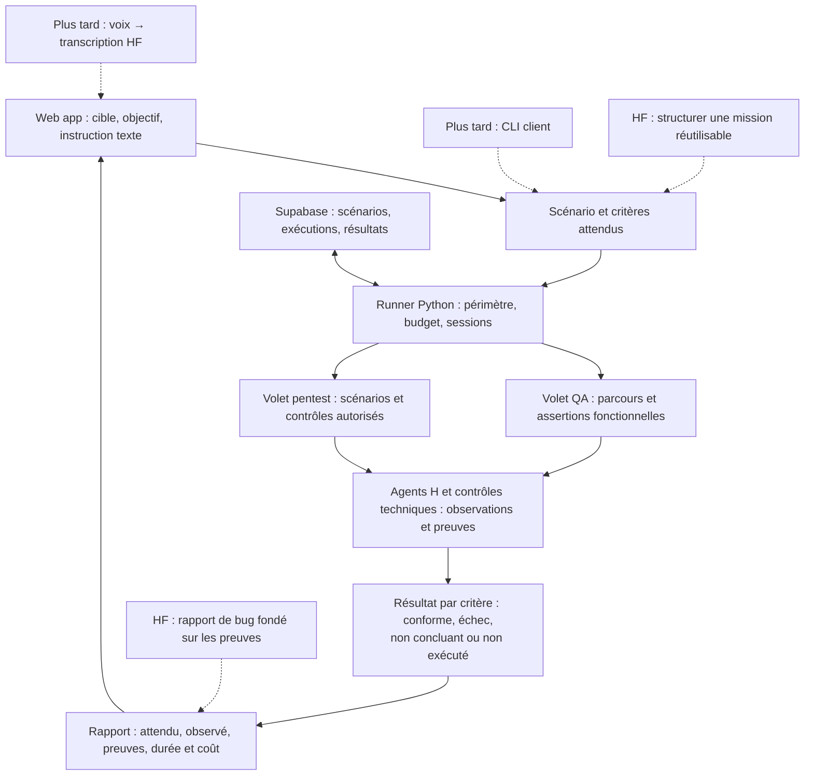

# HSentinel : l'architecture, vue d'ensemble

> **L'état réel du projet est tenu à jour dans le [README](../README.md) à la racine (18/11, 14 h 30 : volet QA exécuté en réel, pentest en cours).** Ce document décrit l'architecture visée.

> 17/11/2026. **Cadrage confirmé par Aurian (D-26), implémentation proposée.** QA fonctionnel et pentest sont deux volets de même importance, à développer sur sites réels. Notion sera mis à jour par le chef de projet.
> Les écarts du code et le plan technique : [guidelines 09](09-guidelines-demo-sites-reels.md). Les décisions : [registre 08](08-justification-des-choix.md). Le corps historique du document 07 et son PDF illustré décrivent l'ancienne architecture.

> **État au 18/11, D-27 :** premier lot codé : catalogue, lancement QA/pentest, scénarios anonymes Q-PUB-01 et barrière d'entrée S-PEER-01, preuves, rapports et arrêt. 30 tests locaux et build réussis ; validation avec H non obtenue (`ConnectError`), smoke navigateur bloqué par l'ouverture du port local (`EPERM`). Le socle réel complet reste en cours. [Lancement et limites](../sentinelqa/README.md).

> **D-28 :** le runner référence maintenant deux agents persistants, `sentinelqa-qa` et `sentinelqa-pentest`, définis et enregistrables via `--preparer-agents`. Les 25 tests Python passent ; l'enregistrement distant échoue avant toute réponse H (résolution de l'hôte). Aucun nouvel agent n'est déclaré créé. Les agents historiques du cobaye et ses intégrations Supabase/HF existaient déjà.

## Le problème

Les équipes de startups consacrent du temps à vérifier le fonctionnement et la sécurité de leurs applications, puis à documenter les anomalies. HSentinel vise à exécuter les parcours QA et les scénarios de pentest à partir d'une consigne, et à rendre des résultats vérifiables. Le temps réellement gagné et la qualité des résultats restent à mesurer pour chaque volet.

Le QA vérifie le comportement attendu. Le pentest cherche à démontrer un comportement interdit ou une faiblesse exploitable dans le périmètre défini. Les contrôles d'accès constituent un premier scénario concret du volet pentest.

## Ce qu'on livre d'abord

**Deux parcours de même priorité : une mission QA et une mission pentest sur sites réels, chacune avec exécution, résultat et preuves.** La web app partage le lancement, le suivi et les rapports ; les scénarios et critères de preuve restent propres à chaque volet.

| Volet | Premier périmètre proposé | Préconditions |
|---|---|---|
| QA fonctionnel | Consulter les pages, utiliser les menus et vérifier l'arrivée sur l'écran attendu | URL, mission et critères de réussite ; aucun compte pour un parcours public |
| Pentest | Chercher un contournement en lecture d'une règle d'accès connue | Autorisation existante, comptes utiles, ressource connue et visibilité attendue |

Les deux cibles retenues sont le site public Eugenia et Peer Review. D-24 conserve la limite : **aucune écriture métier ni changement de droits**. Les deux chantiers avancent sans dépendance artificielle entre eux, chacun avec ses préconditions, son budget et son critère de fin. Le socle de démo n'est complet que lorsque les deux parcours fonctionnent. Un contrôle d'accès ciblé ne constitue pas un pentest exhaustif.

Sans instruction, une exploration QA peut chercher des anomalies de navigation et d'affichage dans un périmètre et un budget définis. Elle doit dire ce qu'elle a visité et ce qu'elle n'a pas pu vérifier. Elle n'invente pas les règles métier attendues et ne lance pas automatiquement un pentest.

## Le schéma proposé

Un seul contrat de lancement sert les canaux texte, voix et terminal. Le choix QA/sécurité est distinct du choix guidé/exploratoire et du canal de saisie.

## Rôle des briques et état réel

| Brique | À conserver | À adapter ou construire |
|---|---|---|
| Web app | Lancement et suivi des audits | Consigne QA, comptes facultatifs, rapports par critère ; authentification opérateur avant exposition |
| Runner Python | Orchestration, événements, entrée terminal interne | Parcours QA indépendant des trois comptes et de la connexion du cobaye ; profils de cibles et résultats explicites |
| Agents H | Navigation visuelle et traces | Missions QA avec limites, attendus et observations structurées |
| Supabase | Stockage des audits et événements | Scénarios réutilisables et résultats QA selon les besoins du premier parcours |
| Hugging Face | Intégration de modèles déjà présente | Une contribution effective : scénario structuré ou rapport fondé sur les faits ; transcription ensuite |
| n8n | Idée de déclenchements et notifications | À différer après l'exécution de bout en bout |

Le flux historique reste spécialisé dans Paie Express ; D-27 ajoute une branche dédiée aux missions réelles. Les hypothèses HF du flux historique sont calculées puis comparées aux constats, sans piloter les tests. Les scénarios authentifiés, l'exploration large et HF dans le nouveau flux restent à construire. Le tableau ci-dessus décrit la cible complète, partiellement implémentée par ce premier lot.

## Pourquoi du computer use

La cible du QA est ce que l'utilisateur peut effectivement faire et voir : menu accessible, bonne page atteinte, état compréhensible. Un appel API seul ne valide pas ce parcours. L'agent H vise à exécuter une intention dans cette interface sans écrire un script spécifique pour chaque parcours.

Un navigateur scripté reste une alternative valable. L'avantage de H doit se mesurer dans le temps de création et de maintenance du scénario, sa réussite et la facilité de vérification ; l'agent n'est pas supposé être toujours plus rapide ou plus fiable. Les accès à notre base et les assertions déterministes restent du code ordinaire.

## Deux chantiers de démo au même niveau

| Priorité | Chantier | Critère de fin |
|---|---|---|
| P0 | Socle commun : cible, objectif QA/pentest, instruction, sessions, périmètre, preuves et rapport | Les deux volets peuvent être lancés et suivis indépendamment |
| P0 | QA réel guidé : depuis l'accueil Eugenia, trouver le programme Bachelor et vérifier la page atteinte | Étapes, attendu/observé, preuve et temps mesurés |
| P0 | Pentest réel ciblé : sur Peer Review, tenter en lecture un accès que la règle connue doit refuser | Identités et ressource connues, contrôle exécuté, refus attendu ou violation documentée ; erreur d'exécution distincte |
| P1 | Réutilisation, exploration bornée et HF | Scénarios relançables et contribution HF démontrée : structuration QA, priorisation de contrôles autorisés ou rapport fondé sur les preuves |
| P2 | Voix et CLI client | Deux entrées supplémentaires vers les deux volets du même moteur |

La préparation des comptes et de la règle attendue du pentest est un travail P0. Aucune faille réelle n'est présumée ; l'absence de faille sur le contrôle exécuté reste un résultat recevable. L'entrée terminal existante sert aux essais internes ; aucune application de bureau distincte n'est justifiée à ce stade.

Le site montré vendredi dépendra des résultats et de la fiabilité. Paie Express reste le banc interne pour les défauts connus et leurs contrôles sains ; ses mesures ne prouvent pas la performance sur les sites réels.

## Mesurer le gain

Comparer, pour chaque volet, le même scénario et les mêmes critères avec la méthode actuelle de l'équipe, puis avec HSentinel. Compter le temps humain de préparation, supervision, relecture, correction des faux constats et maintenance. Afficher séparément la durée machine et le coût du run. Pour le pentest, documenter aussi les contrôles exécutés, la reproductibilité des constats et les résultats non concluants ; aucune sécurité globale n'est déduite d'un contrôle réussi.

**Gain net estimé = valeur du temps humain économisé − coûts d'exécution et de maintenance supplémentaires.** Le temps d'attente et le délai de retour restent visibles. Un rapport long à relire peut annuler le gain d'une exécution automatique.

La voix se mesure sur le temps de dictée et de correction comparé à la saisie. Le terminal se justifie ensuite par les automatisations des utilisateurs techniques, sans moteur distinct de celui de la web app.
