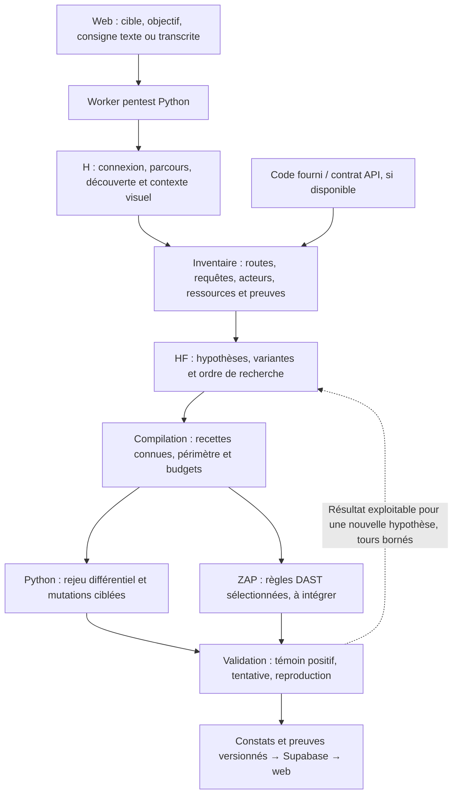

# Brief pour Kimi Code — moteur de pentest guidé par Hugging Face

Aurian demande maintenant un moteur capable de chercher et de démontrer davantage de failles sur les sites réels autorisés, avec une intégration claire dans l'architecture. Commence par rendre un parcours authentifié fiable, puis élargis les familles de tests. Livre du code exécuté, des preuves et les limites de couverture.

Ce brief accompagne une contribution codée : `contributions/hf-pentest/`. Lis son README et ses tests avant de la reprendre. Ne la considère pas comme validée sur le site réel.

## 1. Le cadre et l'état réel à reprendre

- Lire `CLAUDE.md`, les décisions D-23 à D-31 dans `livrables/08-justification-des-choix.md`, les architectures 06/07, les guidelines 09 et `contributions/kimi-pentest/NOTE-INTEGRATION.md`.
- QA et pentest ont la même importance. Claude travaille sur le QA, `/qa`, la voix et `qa_*`. Ce lot concerne le pentest.
- Deux cibles déjà autorisées : `https://www.eugeniaschool.com/` et `https://peer-review-black.vercel.app/etudiant`. D-24 fixe l'absence d'écriture métier et de changement de droits. La connexion technique est distincte. L'autorisation n'est pas à redemander.
- Le README Kimi rapporte un parcours H réel du compte A, session `b40ccc6f-22c1-4131-bb32-3e5873dd3158`. Sa note indique encore que le POST HTTP `/connexion` ne produit pas de cookie et que la vérification d'identité échoue. Vérifier si cela a été corrigé depuis ; ne pas prendre ce diagnostic pour un S-PEER-02 réussi.
- Les quatre défauts signalés dans `revues/kimi-pentest/REVUE.md` ont des correctifs visibles dans le code relu. Rejouer les régressions concernées après modification.
- La bonne instance Supabase doit être identifiée à partir de la configuration effective web/runner. Ne pas prendre la base historique pour la cible par défaut et ne pas lancer un worker qui consomme toutes ses missions.
- Le contenu Notion n'a pas pu être relu par Codex pendant ce lot. Les instructions récentes d'Aurian et les fichiers locaux font foi dans cette passation.

## 2. Où le moteur s'insère



H reste utile pour atteindre les fonctionnalités, comprendre les parcours, vérifier les comptes et obtenir une preuve visuelle. Le moteur technique teste les requêtes et leurs variantes. Une réponse JSON ou une page 403 peut être une preuve HTTP pertinente sans contenir l'identité à l'écran.

Modifications à effectuer :

| Composant actuel | Évolution nécessaire |
|---|---|
| `runner/hf.py` historique | Remplacer son rôle de propositions recoupées après coup par des hypothèses qui pilotent réellement les exécuteurs du nouveau flux. Ne pas casser le cobaye. |
| `contributions/hf-pentest/hf_pentest/planification.py` | Base du planificateur HF strict. Étendre ses contrats quand les nouvelles recettes sont prêtes. |
| `contributions/kimi-pentest/` | Adaptateur d'authentification, sessions et premier exécuteur d'accès. Résoudre la connexion HTTP puis découpler preuve HTTP et observation H. |
| Nouveau module d'inventaire de requêtes | Relier une action H à une requête réelle, sa méthode, ses paramètres autorisés et son acteur. Les observations d'URL H seules ne fournissent pas ce contrat. |
| `contributions/hf-pentest/hf_pentest/execution.py` | Point de départ du répartiteur de tests et du contrôle des requêtes Python ; ajouter des adaptateurs d'outils. |
| Worker pentest | Piloter découverte → plan → tests → validation → rapport, avec arrêt global et conservation des résultats partiels. |
| Rapport et web | Afficher les hypothèses séparément des contrôles et des failles prouvées ; montrer la couverture et les tests non exécutés. |
| Stockage | Versionner l'enveloppe et les références de preuves. Le rapport de campagne livré est un format interne v1, **pas** directement le rapport mission v2 attendu par la web. Prévoir une conversion explicite. |

Ne pas substituer un rapport de campagne v1 à une mission v2. Choisir un discriminant explicite pour la campagne dans le worker et l'API, ajouter son normaliseur, puis seulement la brancher à la file vérifiée. Réutiliser le JSON de rapport existant si cela suffit ; aucune migration distante n'est présumée nécessaire ou exécutée par Codex.

## 3. Quel moteur pour chercher plus profondément ?

**Recommandation d'implémentation : H + HF + rejeu Python, complétés par ZAP sélectionné.** C'est une proposition technique, pas un benchmark démontrant que cette combinaison trouve plus de failles.

| Solution | Apport pour HSentinel | Décision proposée |
|---|---|---|
| Python différentiel | Tester les règles métier avec les comptes, objets et requêtes du parcours réel ; contrôler précisément la preuve. | Premier moteur, déjà raccordé au lot HF. |
| OWASP ZAP | Automatisation YAML, authentification et sessions, scans passifs/actifs, import d'API et rapports. | Premier complément à prototyper pour les défauts techniques. Choisir explicitement les règles et requêtes compatibles avec D-24. |
| Nuclei | Tests reproductibles par modèles YAML ; mécanismes d'authentification et de fuzzing HTTP. | Complément ciblé ensuite, si un modèle pertinent correspond à une surface observée. |
| Shannon | Le projet combine analyse de source et tentatives d'exploitation avec preuves. Son édition ouverte attend le code de l'application. | Référence de conception et candidat à comparer sur un environnement adapté avec code disponible ; pas un remplacement immédiat du flux de démo. |

Les capacités de ZAP ci-dessus sont décrites dans son [Automation Framework](https://www.zaproxy.org/docs/automate/automation-framework/) et son [job de scan actif](https://www.zaproxy.org/docs/desktop/addons/automation-framework/job-ascan/). Un plan ZAP devra être testé sur un banc contrôlé pour vérifier ses requêtes effectives et son arrêt ; une configuration déclarative ne prouve pas ces propriétés.

Nuclei fournit une [architecture par modèles](https://docs.projectdiscovery.io/opensource/nuclei/overview) et du [fuzzing HTTP](https://docs.projectdiscovery.io/templates/protocols/http/fuzzing-overview). Fixer la version du binaire, les modèles exacts et leurs empreintes ; ne pas lancer toute la collection comme étape implicite du produit.

Le [README de Shannon](https://github.com/KeygraphHQ/shannon) décrit aussi des actions susceptibles de modifier l'application et recommande des environnements de test. Ces effets ne correspondent pas au périmètre sans écriture de D-24. Sa compatibilité avec notre modèle HF précis et notre cas réel n'est pas testée. Ne pas recopier ses promesses commerciales dans notre démo.

## 4. Priorités de construction et critères de sortie

### P0 — Des sessions et des requêtes fiables

1. Réparer l'authentification HTTP en observant la vraie soumission Next.js : encodage, champs de Server Action, redirections et cookies. Vérifier A puis B sur un marqueur d'identité distinct. L'échec doit arrêter les tests dépendants, sans verdict vert.
2. Définir l'inventaire des requêtes réelles et les ressources témoins. Ne pas supposer qu'une évaluation entre étudiants est privée : enregistrer la règle attendue et son origine.
3. Traiter le cas API : actuellement `agent_acces.py` exige le marqueur d'identité dans le texte de la page finale. Une réponse JSON, une page 403 ou une page de refus peut ne pas le contenir. Vérifier l'identité sur une page dédiée dans la même session, puis attribuer la requête et sa réponse à cette session.
4. Calculer et conserver le verdict HTTP avant de traiter une défaillance d'observation H. Aujourd'hui `_observer_ou_fixer` peut empêcher l'assertion alors qu'une réponse HTTP exploitable existe. Une preuve HTTP valide de fuite doit rester visible ; l'absence de preuve visuelle reçoit son propre état.
5. Raccorder la brique HF existante à une ressource réelle, puis à une deuxième. Produire la trace hypothèse → recette → requêtes → résultat.

Critère : A authentifié et autorisé reçoit le témoin, B authentifié et l'anonyme sont réellement testés, les preuves sont attribuées, les sessions H sont identifiables. Une absence de faille est recevable ; aucune faille n'est garantie.

### P1 — Davantage de surface et de variantes

Implémenter chaque famille comme une recette versionnée avec ses prérequis et son oracle de preuve :

| Famille | Tentative concrète | Preuve exigée |
|---|---|---|
| Accès horizontal | Rejouer avec B une lecture d'objet connu de A ; couvrir détail, liste, téléchargement/export lorsque ces routes sont observées. | Témoin de A reçu par B avec identité valide et contrôle positif. |
| Accès vertical | Rejouer une lecture réservée à un rôle avec le compte de rôle inférieur, si ces rôles existent réellement. | Règle de rôle explicite et contenu réservé effectivement reçu. |
| Routes présentes seulement dans le code | Identifier une route et son point de contrôle dans un extrait fourni ; l'ajouter au périmètre exécutable avec sa ressource témoin. | Provenance fichier/lignes + requête réelle + contrôle positif ; le code suspect seul reste une hypothèse. |
| Paramètres de lecture | Substituer les références d'objets ou de comptes de test dans les paramètres réellement observés ; dédupliquer les variantes. | Même oracle de contenu protégé, pas seulement une différence de longueur ou de statut. |
| Session et cache | Vérifier qu'une lecture isolée ne reçoit pas une réponse privée attribuable à une autre session ; confirmer l'identité avant/après. | Contenu témoin et attribution de session reproductibles. |
| Entrées réfléchies / contrôles DAST ciblés | Identifier les points d'entrée et brancher des règles pertinentes de ZAP sur les requêtes compatibles avec le périmètre. | Résultat technique reproduit ; une réflexion de texte ou un en-tête absent ne suffit pas à déclarer une exploitation. |

La version livrée refuse les query strings et ne fait que trois lectures par ressource. Pour les paramètres, créer un `RequestSpec` : `request_id`, origine fixée, méthode, chemin, clés de paramètres autorisées, valeurs liées aux objets de test, références d'acteur et de preuve. Étendre le validateur et ses tests avant l'exécuteur. Ne pas remplacer cette étape par l'acceptation d'URL libres du modèle.

La capture de trafic est un chantier explicite. `contexte/03-agents-api.md` et `notes/retours-agents-api.md` mentionnent les profils, `user_device` et un paramètre de proxy cloud ; cela ne prouve ni export HAR cloud ni interception HTTPS déjà fonctionnels. Faire un petit essai de capacité. Si nécessaire, utiliser un navigateur de test piloté par H sur la machine et un collecteur réseau local distinct. Les cookies restent dans l'adaptateur en mémoire, jamais dans le contexte HF ou les rapports publics.

### P2 — Boucle HF adaptative et comparaison mesurée

- Après une tentative, renvoyer à HF un résultat minimal : identifiants de tests, statut, catégorie de réponse et références de preuves. Aucun cookie ni contenu étudiant.
- Autoriser au plus deux tours de planification au départ, avec budget commun et déduplication entre tours. Une panne ne doit pas déclencher davantage de tentatives.
- Mesurer avec et sans HF sur le même banc connu et au même budget : cas couverts, failles confirmées, faux positifs, non-conclusions, durée et coûts. Sur le site réel, rapporter les constats obtenus sans prétendre connaître toutes les failles présentes.
- Si du code est généré par modèle, il constitue un nouvel exécuteur à tester dans un environnement isolé avant admission au registre. La démonstration actuelle n'exécute pas de Python ou de shell produit par le modèle.

## 5. Robustesse à conserver

- Valider les sorties HF localement même avec `json_schema` : champs inconnus, références inventées, doublons, sorties tronquées et incohérences doivent être rejetés.
- Garder les budgets distincts : appels/tokens HF, requêtes HTTP, ressources, sessions/steps H, durée globale. Le plafond HTTP Python ne mesure pas le trafic du navigateur H ou de ZAP.
- Faire passer chaque outil technique par son propre contrôle effectif du périmètre et son arrêt. Un conteneur ou un prompt seul ne filtre pas les destinations réseau.
- Refuser les redirections hors cible ; séparer les sessions ; ne pas hériter de proxy ou de profil implicite.
- Garder les résultats partiels à l'arrêt et signaler toute annulation H non confirmée.
- Ne jamais traiter 200, 403 ou un texte LLM comme une preuve suffisante isolée. Une fuite reste une fuite si le contenu privé arrive avec un statut 500.
- Préserver les quatre états : `passed`, `failed`, `inconclusive`, `skipped`. Aucun test exécuté donne un rapport non concluant, pas un bilan vert.
- Les valeurs sensibles connues et le texte brut des pages ne doivent pas être exportés. Le détecteur de secrets des extraits n'est pas une garantie d'anonymisation de tout contenu : sélectionner des extraits nettoyés.
- Le marqueur doit correspondre à la ressource privée, être distinct des identités et ne pas apparaître sur une page publique/générique. Sa longueur minimale ne démontre pas cette propriété.

## 6. Ce que Codex livre et ce qui reste ouvert

Livré dans `contributions/hf-pentest/` : contrat d'inventaire UI/code, client HF structuré, compilation, contrôle HTTP avant envoi, budgets de campagne, appel réel à `executer_controle_acces`, CLI, rapports et banc de tests.

Validation : **38 tests locaux passent**. Le banc synthétique exécute 18 requêtes interceptées par les transports de test : une route connue respecte la règle, une route présente seulement dans le code fictif révèle le témoin à B avec HTTP 500. Les verdicts proviennent du runner Kimi et de ses assertions, pas d'un résultat de sécurité simulé dans le planificateur.

**HF, H et le réseau du site sont remplacés par des doubles dans ce banc. Aucun appel HF réel, nouvelle session H ou test authentifié du site de l'école n'a été effectué par ce lot.** Le code et les paramètres d'inférence restent à valider avec le fournisseur réel. Le modèle proposé est configurable ; sa disponibilité n'a pas été mesurée ici.

Limites actuelles : cible Peer Review uniquement dans ce raccordement, chemins simples sans paramètres, une seule famille de contrôle d'accès, pas de collecte automatique du trafic, pas de découverte autonome de tout le dépôt, pas de ZAP/Nuclei intégré, pas de migration ni de branchement web/worker. Les ressources doivent déjà être référencées dans l'inventaire ; HF peut sélectionner une route absente de l'UI mais ne crée pas encore de nouvelle entrée d'inventaire à partir du code.

## 7. Livraison attendue de Kimi

1. Corriger les points P0 et livrer un premier rapport réel attribuable ; documenter précisément tout prérequis encore manquant.
2. Donner le schéma d'architecture modifié et les fichiers touchés, avec un chemin d'intégration qui préserve le QA de Claude.
3. Livrer ensuite une famille supplémentaire exécutée, son cas vulnérable et son contrôle sain. Ajouter ZAP seulement si son contrat d'exécution est éprouvé.
4. Fournir les commandes exactes, tests, sessions réelles, mesures et observations en distinguant fixture, fournisseur réel et cible réelle.
5. Rapporter une faille uniquement après preuve reproductible. Si le site n'en présente aucune sur les contrôles exécutés, présenter ce résultat et la couverture obtenue.

Pour démarrer :

```sh
.venv-holo/bin/python -m unittest discover -s contributions/hf-pentest/tests -v
.venv-holo/bin/python contributions/hf-pentest/banc.py
.venv-holo/bin/python contributions/hf-pentest/main.py valider --inventaire contributions/hf-pentest/exemples/inventaire-synthetique.json --plan contributions/hf-pentest/exemples/plan-synthetique.json
```
