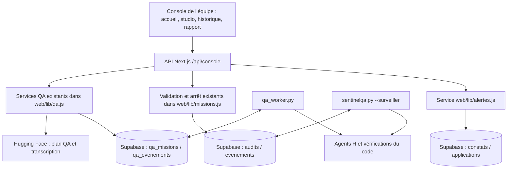

# Raccordement et suite du chantier

Ce lot suit la demande d’Aurian du 18 novembre : intégrer les fonctionnalités dans l’interface de son camarade pendant que les moteurs continuent d’évoluer. Les changements fonctionnels restent dans `web-console` ; les moteurs et la base existants sont réutilisés.

## Où cela s’insère

Les services sont importés directement, pas appelés par un second serveur HTTP. On ne démarre donc pas l’ancienne web pour faire fonctionner la nouvelle. `next.config.mjs` inclut le dossier parent dans le traçage des dépendances pour emporter les modules partagés lors d’une compilation de déploiement.

## Les contrats à garder stables

| Frontière | Entrée / sortie | Point d’extension |
|---|---|---|
| Préparation QA | cible et consigne → plan validé | `web/lib/qa.js`, `web/lib/qa-contrat.mjs` |
| Dictée | audio limité à 8 Mo → texte modifiable | même service de transcription, contrôleur média partagé |
| Lancement QA | demande v3 → identifiant de `qa_missions` | `lib/console-contract.mjs` délègue au validateur existant |
| Compte QA connecté | clé publique → mot de passe chiffré → `compte` v3 | `cleRunner`, `lib/qa-account.mjs`, `validerCompte`, puis worker existant |
| Alertes | filtre application → constats, bilan, tickets | `web/lib/alertes.js`, nouvelle page `/app/alertes` |
| Lancement pentest | demande v2 → enveloppe dans `audits` | catalogue, `ligneMission`, puis runner existant |
| Rapport | données v2/v3 → vue `Mission` | `lib/mission-view.mjs`, puis `MissionDetail` |
| Arrêt | identifiant → demande d’arrêt | services existants et worker de chaque volet |

La nouvelle UI ne calcule pas les verdicts métier. Elle traduit les statuts du rapport. Les références de preuves absentes sont signalées comme indisponibles ; les captures disponibles restent relayées par le serveur authentifié.

## Ordre conseillé, pendant la finalisation des fonctionnalités

1. **P0 — Recette de la console sur le poste de démo.** Exécuter les tests navigateur, examiner les captures desktop/mobile, puis faire un QA public réel depuis cette interface. Vérifier la demande dans `qa_missions`, son traitement par le worker, le rapport et l’arrêt. Critère de fin : un parcours complet rejouable depuis `/app/nouveau`.
2. **P0 — Finir le raccordement pentest avec Kimi.** Exécuter S-PEER-01 ; pour S-PEER-02, intégrer son exécuteur au runner et vérifier les préconditions des acteurs. Garder la sortie v2, ou ajouter un adaptateur documenté avec une fixture. Activer le scénario dans le catalogue seulement quand le worker sait le traiter. Critère de fin : demande web → exécution → preuves attribuées → rapport, y compris un cas non concluant.
3. **P0 — Recetter le QA connecté désormais raccordé.** Le formulaire, le chiffrement, la clé publique et les résultats K1/K2 sont intégrés. Tester un compte de démonstration depuis la console, puis un arrêt. Critère de fin : connexion, identité, consultation et arrêt vérifiés, identifiants absents de la vue du rapport. Vérifier aussi les libellés `h_text_partial`, `write_risk` et `forbidden_page`.
4. **P1 — Rendre la disponibilité des workers visible.** Aujourd’hui, la console sait qu’une demande est enregistrée, pas si un worker est vivant. Ajouter un signal daté par worker et distinguer « service indisponible » de « mission en attente ». Prévoir aussi une clé d’idempotence persistée pour les relances après coupure réseau ; le verrou actuel empêche les doubles clics, pas les doublons après une réponse perdue.
5. **P1 — Mesurer le ROI sur le parcours de démo.** Mesurer le passage manuel, la préparation, la supervision et la relecture de l’agent sur la même tâche. Afficher ensuite la comparaison avec les coûts mesurés. La durée totale de l’agent n’est pas du temps humain économisé.
6. **P1 — Publier une version de répétition.** Après la recette, configurer les variables serveur et l’accès d’équipe, vérifier que les modules du dossier parent sont inclus, puis contrôler une mission réelle et le microphone en HTTPS. Ce lot ne déploie rien.

**En parallèle avec Jahdiel : recetter l’envoi des alertes.** Le service de consultation est raccordé à `/app/alertes` avec filtre, gravité, état d’envoi et ticket. L’architecture indique que les tables et le branchement du runner sont prêts dans la base de l’équipe ; la bascule des workflows n8n et la recette d’un ticket restent à terminer. L’interface reflète les états enregistrés et ne déclenche aucun envoi.

Les abonnements et l’onboarding généraliste viennent après ces parcours démontrés. Les déclencheurs CI de Jahdiel peuvent être branchés une fois leur frontière avec le runner vérifiée.

## Recette réelle minimale

| Passage | Vérification attendue |
|---|---|
| QA texte sur Eugenia | Plan relu, navigation, critères et preuves cohérents |
| QA voix | Micro réellement fermé après arrêt/annulation ; texte modifiable avant lancement |
| QA mobile | Formulaire, plan et rapport sans débordement à 390 px |
| QA connecté | Clé disponible, compte chiffré, K1/K2 et motifs d’arrêt lisibles ; changer de cible efface le compte |
| Alertes | Filtre, échec d’envoi, ticket associé et absence de ticket correspondent aux données du service |
| Arrêt d’une mission | Demande visible, arrêt côté worker, résultats restants non exécutés |
| Pentest disponible | Rapport fondé sur les contrôles exécutés, aucun succès déduit d’une absence de données |
| Panne de service | Message d’erreur explicite, aucune donnée simulée de remplacement |

## Limites du premier lot

- Historique limité aux 30 derniers enregistrements par volet ; pas encore de pagination.
- Journal limité aux 500 premiers événements renvoyés par les services partagés. Pour les parcours plus longs, utiliser le curseur `apres` et fusionner les événements par identifiant.
- Authentification d’équipe provisoire. Une offre multi-client demandera des utilisateurs, organisations et droits par mission.
- Les formats et les données traversent l’API testée par contrats ; l’exécution de bout en bout de cette nouvelle web reste à valider.
- La disponibilité déclarée d’un scénario ne prouve pas la disponibilité instantanée de H ou du worker. Une clé publique présente ne constitue pas un signal d’activité du worker.

## Mise à jour des documents partagés

Le contrat serveur de référence est décrit dans `ARCHITECTURE.md` §11. Le lot console réutilise ce contrat sans modifier les services, les workers ou la base. État de vérification : 28 tests locaux et compilation réussis ; recette navigateur tentée mais bloquée au démarrage de Chrome, avant l’ouverture des pages. La validation réelle de la nouvelle interface reste à faire.
